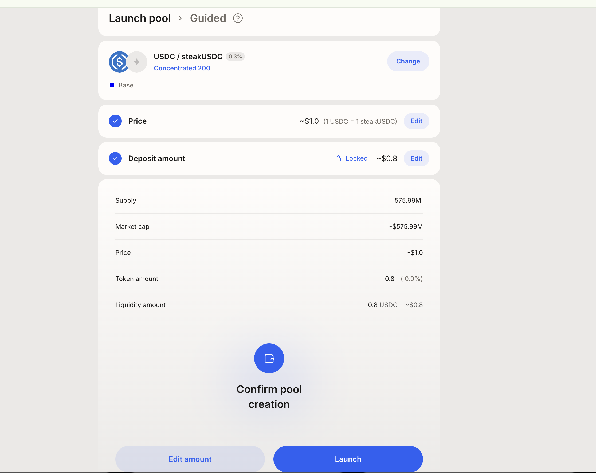
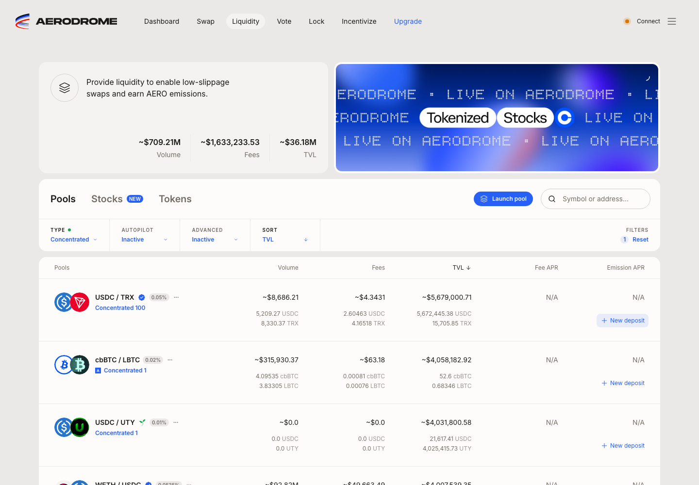
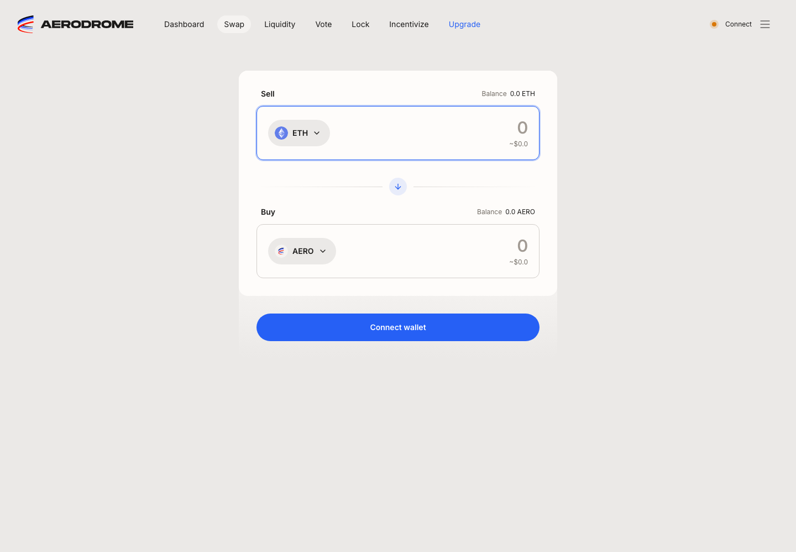
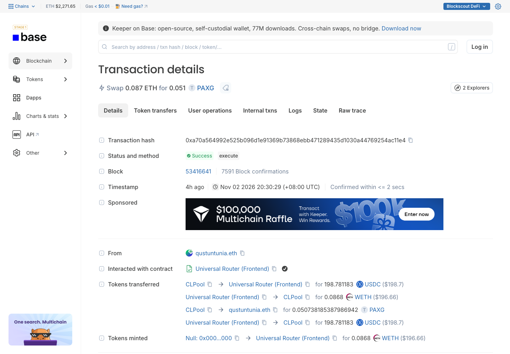
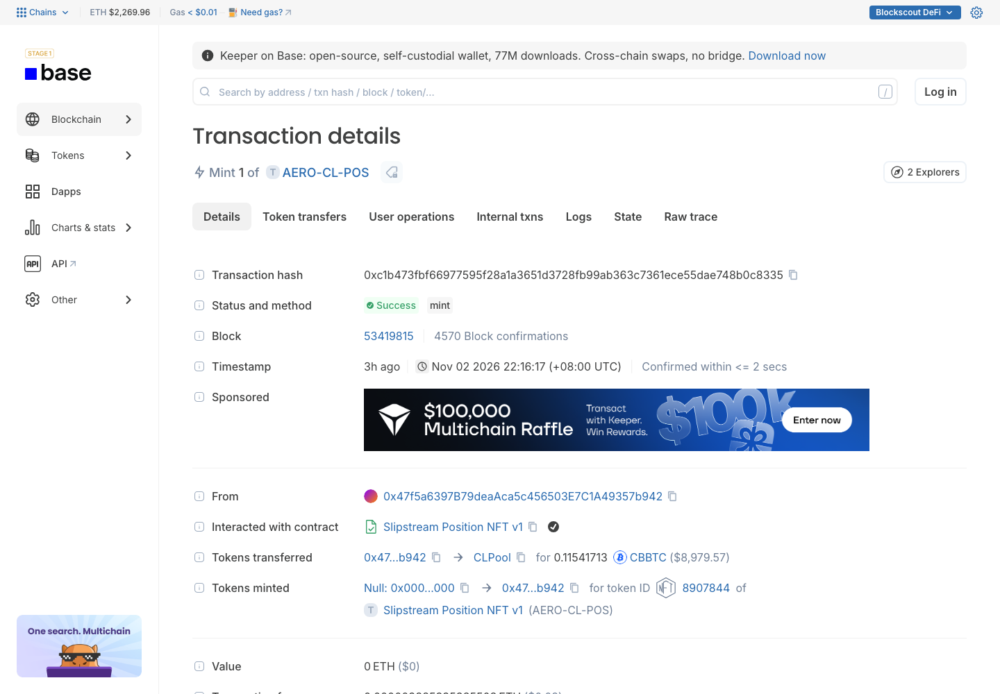
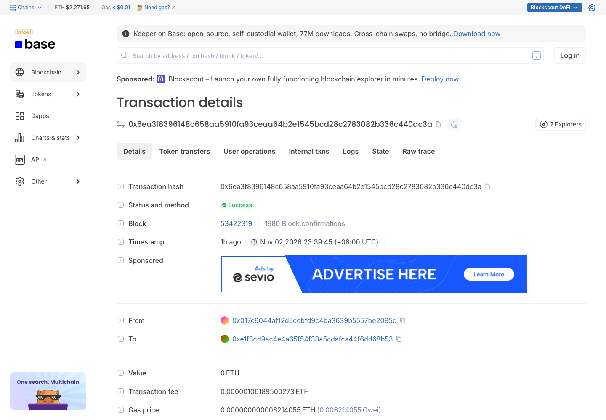
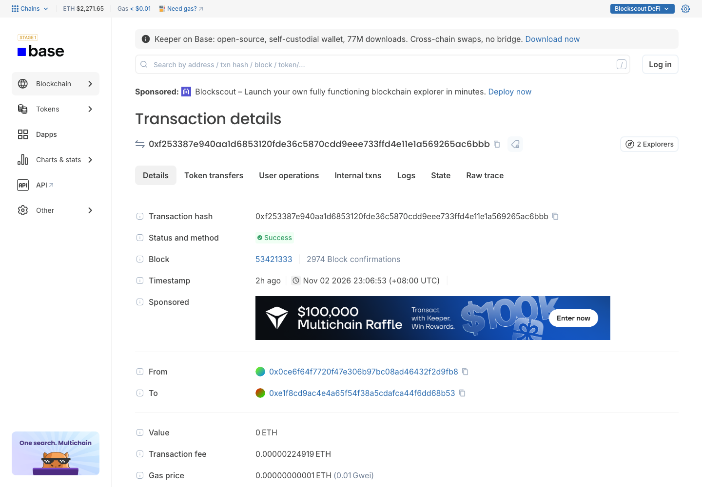
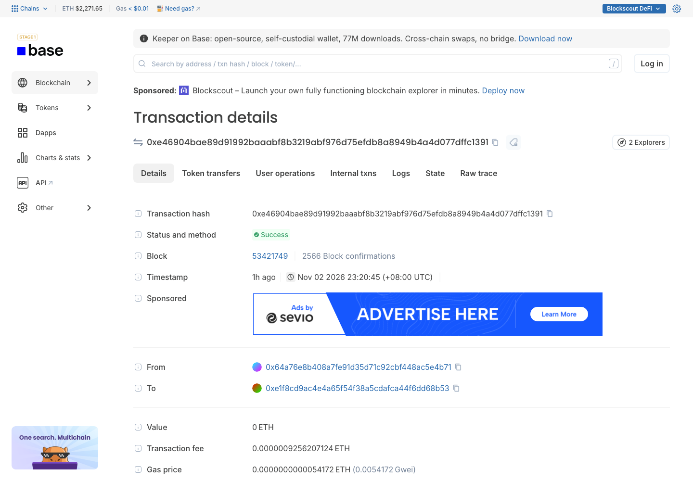
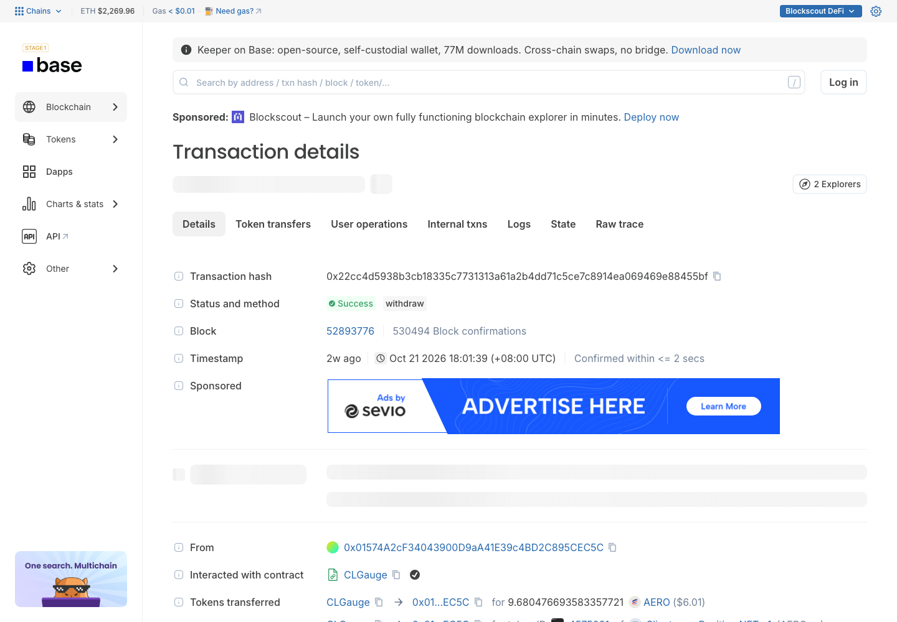
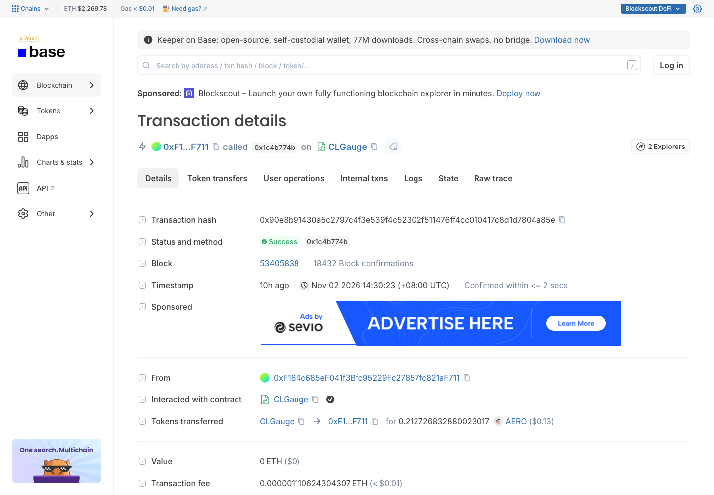

# Aerodrome V3（Slipstream 集中流动性）— Base

> **链**：Base ｜ chainId **8453** ｜ 浏览器 https://basescan.org（交易截图取自 https://base.blockscout.com）
> **调研日期**：2026-08-14，2026-11-03 补全交易类型
> 本人实测 1 笔（建池 + 铸首个仓位，2026-08-14）；其余为链上公开样本，非本人钱包，已逐条用 Base RPC 确认 status=0x1 并核对 selector
> 与 V2 共用前端 aerodrome.finance，前端里以池类型「Concentrated」区分；V2 见 [Aerodrome.md](Aerodrome.md)

## 合约

| 项 | 值 |
|---|---|
| 前端 | Swap https://aerodrome.finance/swap ｜ 流动性 https://aerodrome.finance/liquidity（Type 筛选选 **Concentrated** → https://aerodrome.finance/liquidity?filters=concentrated%2Cdefault；池名下标签「Concentrated &lt;tickSpacing&gt;」即 CL 池）｜ 建池 https://aerodrome.finance/launch（流动性页 Launch pool 按钮）｜ 新建仓位：池列表 New deposit → `https://aerodrome.finance/deposit?token0=…&token1=…&type=<tickSpacing>&factory=<CLFactory>` ｜ 仓位管理 https://aerodrome.finance/dash ｜ 升级 https://aerodrome.finance/upgrade（launch / deposit / dash / upgrade 均需连钱包） |
| CLFactory（三套并存，同一 Voter） | 当前前端主用 `0xf8f2eB4940CFE7d13603DDDD87f123820Fc061Ef`（5300 池）；第二套 `0xade65c38cd4849adba595a4323a8c7ddfe89716a`（2300 池，本人实测池所在）；老版 `0x5e7BB104d84c7CB9B682AaC2F3d509f5F406809A`（3673 池） |
| NonfungiblePositionManager | 对应三套：`0xe1f8cd9AC4e4A65F54f38a5CdAfCA44f6dD68b53` ｜ `0xa990c6a764b73bf43cee5bb40339c3322fb9d55f` ｜ `0x827922686190790b37229fd06084350E74485b72` |
| Swap 路由 | 前端 Universal Router `0xcAF22ce31298CF2BF1D152862F80216478ad7c67`；官方合约表另列老 UniversalRouter `0x6Cb442acF35158D5eDa88fe602221b67B400Be3E`、SwapRouter `0xBE6D8f0d05cC4be24d5167a3eF062215bE6D18a5` |
| CLGauge | CLGaugeFactory `0xD30677bd8dd15132F251Cb54CbDA552d2A05Fb08` ｜ Voter `0x16613524e02ad97eDfeF371bC883F2F5d6C480A5`（`gauges(pool)` 查池对应 gauge）｜ 示例 CLGauge `0xa0b61fdb9f1fb9b917fe38b49427fd4d87472d28`（WETH/USDC CL50）｜ 奖励币 AERO `0x940181a94A35A4569E4529A3CDfB74e38FD98631` |
| Pool Launcher / Locker | Launcher：本人实测 `0xb9a1094d614c70b94c2cd7b4efc3a6adc6e6f4d3`，当前前端配置 `0x3C890c7454C17410E49E035F6C4755c4E2012b4b` ｜ Locker `0x8bf02b8da7a6091ac1326d6db2ed25214d812219` |
| Upgrade 迁移 | LP Migrator `0x293Ba185d875B5c562B552082cfef630dab57baD` → 新仓位铸在 Aero 的 NFT `0x4857DB576eE0e45F10525eC59527BfD10beeC60b`（`Slipstream V3 Deposit`） |
| 示例池 | WETH/USDC CL50 `0x3fe04a59ebd38cf06080a6f60a98d124eb59392a`（当前 Factory）；本人实测池 USDC/steakUSDC CL200 `0xa11ebf7059a0a03226bf66f1cf2e07f45855b62c`（第二套 Factory） |
| LP 凭证 | ERC-721 `AERO-CL-POS`（Slipstream Position NFT v1，三个 NPM 同名同 symbol） |

## 交易类型覆盖

12 类：11 类有样本（本人实测 1 类，公开样本 10 类），1 类 ⬜。

| # | 交易类型 | 前端入口 | 合约 · 方法 | tx hash | 来源 |
|---|---|---|---|---|---|
| 1 | Swap（经 CL 池） | Swap 页 | Universal Router · `execute(bytes,bytes[],uint256)` `0x3593564c`；本例 ETH→USDC→PAXG 依次经 CL50、CL10 两个 Slipstream 池 | [0xa70a564992e525b096d1e91369b73868ebb471289435d1030a44769254ac11e4](https://basescan.org/tx/0xa70a564992e525b096d1e91369b73868ebb471289435d1030a44769254ac11e4) | 公开样本 |
| 2 | 建池 + 铸首个仓位（锁仓） | 流动性页 → Launch pool → Guided | Launcher · `launch(...)` `0x499a98fd`（内部 PoolCreated → Initialize → NPM mint → NFT 转入 Locker 克隆的 lock 合约） | [0x042810a8cb89ae113c9a56dfcebbf90591e2addfc7fc42efe72268e04242abf8](https://basescan.org/tx/0x042810a8cb89ae113c9a56dfcebbf90591e2addfc7fc42efe72268e04242abf8) | 本人实测 |
| 3 | Mint 新仓位（已有池） | 流动性页 → Concentrated 池 → New deposit | NPM · `mint((address,address,int24,int24,int24,uint256,uint256,uint256,uint256,address,uint256,uint160))` `0xb5007d1f` | [0xc1b473fbf66977595f28a1a3651d3728fb99ab363c7361ece55dae748b0c8335](https://basescan.org/tx/0xc1b473fbf66977595f28a1a3651d3728fb99ab363c7361ece55dae748b0c8335) | 公开样本 |
| 4 | Increase liquidity 加仓 | Dashboard → CL 仓位 → 追加存入 | NPM · `increaseLiquidity(...)` `0x219f5d17` | [0x6ea3f8396148c658aa5910fa93ceaa64b2e1545bcd28c2783082b336c440dc3a](https://basescan.org/tx/0x6ea3f8396148c658aa5910fa93ceaa64b2e1545bcd28c2783082b336c440dc3a) | 公开样本 |
| 5 | Decrease liquidity 部分撤出 | Dashboard → CL 仓位 → Withdraw（部分） | NPM · `multicall(bytes[])` `0xac9650d8` = `decreaseLiquidity` `0x0c49ccbe` + `collect` `0xfc6f7865` | [0xf253387e940aa1d6853120fde36c5870cdd9eee733ffd4e11e1a569265ac6bbb](https://basescan.org/tx/0xf253387e940aa1d6853120fde36c5870cdd9eee733ffd4e11e1a569265ac6bbb) | 公开样本 |
| 6 | Collect fees 领手续费 | Dashboard → 未质押 CL 仓位 → Claim | NPM · `collect((uint256,address,uint128,uint128))` `0xfc6f7865` | [0xe46904bae89d91992baaabf8b3219abf976d75efdb8a8949b4a4d077dffc1391](https://basescan.org/tx/0xe46904bae89d91992baaabf8b3219abf976d75efdb8a8949b4a4d077dffc1391) | 公开样本 |
| 7 | 全部撤出 + Burn NFT | Dashboard → CL 仓位 → Withdraw 100% | NPM · `multicall` `0xac9650d8` = `decreaseLiquidity` `0x0c49ccbe` + `collect` `0xfc6f7865` + `burn(uint256)` `0x42966c68` | [0x40150da38d55f01ab4790507117b76eb90820c3a207ac5392d61299820e1c963](https://basescan.org/tx/0x40150da38d55f01ab4790507117b76eb90820c3a207ac5392d61299820e1c963) | 公开样本 |
| 8 | Stake NFT 到 CLGauge | Dashboard → CL 仓位 → Stake | CLGauge · `deposit(uint256 tokenId)` `0xb6b55f25`（NFT 转入 gauge） | [0x245f4fbf721e7dfad728efd3b42e00f5aff5d536ec75bb819a507736c69d8631](https://basescan.org/tx/0x245f4fbf721e7dfad728efd3b42e00f5aff5d536ec75bb819a507736c69d8631) | 公开样本（2026-10-21，gauge 被 kill 前） |
| 9 | Unstake | Dashboard → 已质押仓位 → Unstake | CLGauge · `withdraw(uint256 tokenId)` `0x2e1a7d4d`（同笔自动领 AERO，抛 ClaimRewards） | [0x22cc4d5938b3cb18335c7731313a61a2b4dd71c5ce7c8914ea069469e88455bf](https://basescan.org/tx/0x22cc4d5938b3cb18335c7731313a61a2b4dd71c5ce7c8914ea069469e88455bf) | 公开样本 |
| 10 | Claim AERO 奖励 | Dashboard → 已质押仓位 → Claim | CLGauge · `getReward(uint256 tokenId)` `0x1c4b774b` | [0x90e8b91430a5c2797c4f3e539f4c52302f511476ff4cc010417c8d1d7804a85e](https://basescan.org/tx/0x90e8b91430a5c2797c4f3e539f4c52302f511476ff4cc010417c8d1d7804a85e) | 公开样本 |
| 11 | Upgrade 仓位迁移到 Aero | Upgrade 页 → Deposits → Upgrade | LP Migrator · `0x0553db0c`（合约未开源）：老 NPM decrease + collect + burn → Aero NFT `0x4857DB57…` mint | [0x9e8625ca37353d9adcb91c4680f41419fd67efeaf88681be92344f83c796d6d7](https://basescan.org/tx/0x9e8625ca37353d9adcb91c4680f41419fd67efeaf88681be92344f83c796d6d7) | 公开样本 |
| 12 | Launch 锁仓仓位到期取回 | Dashboard → Locked 仓位 | lock 克隆合约（Locker 下发），接口未确认 | ⬜ 无样本 | 本人锁仓至 2027-02-06 未到期；Locker 近 10 万块无事件，未找到公开样本 |

页面有入口但**不属于 CL 池交易**：Vote / Lock / Incentivize（ve 体系）、Stocks 标签页、Upgrade 页的 Locks / AERO tokens 部分。

## 截图

**前端页面**

| Launch pool 确认页（本人实测） | 流动性页 · Type = Concentrated |
|:-:|:-:|
|  |  |
| **Swap 页** |  |
|  |  |

**交易详情（公开样本，均为 blockscout）**

| 1 Swap（`0xa70a56…`） | 3 Mint 新仓位（`0xc1b473…`） |
|:-:|:-:|
|  |  |
| **4 Increase liquidity（`0x6ea3f8…`）** | **5 部分撤出（`0xf25338…`）** |
|  |  |
| **6 Collect fees（`0xe46904…`）** | **7 全部撤出 + Burn（`0x40150d…`）** |
|  |  |
| **8 Stake（`0x245f4f…`）** | **9 Unstake（`0x22cc4d…`）** |
|  |  |
| **10 Claim AERO（`0x90e8b9…`）** | **11 Upgrade 迁移到 Aero（`0x9e8625…`）** |
|  |  |

## 开发注意

- **按 tickSpacing 而非 fee 索引池**：池唯一键是 `(token0, token1, tickSpacing)`，`PoolCreated` 第三个 indexed 字段和 `positions(tokenId)` 第 5 个返回值都是 `tickSpacing`，套 Uniswap V3 ABI 会解错；费率另读 `pool.fee()`（是动态值，如老版 WETH/USDC CL100 `fee()`=624）。**三套 CLFactory / NPM 都要订阅**，只接官方合约表里的老地址会漏掉当前前端建的池。
- **LP 是 NFT，按 tokenId 追踪归属**：Stake 后 NFT 转入 CLGauge（`ownerOf` = gauge，归属看 gauge `Deposit(user, tokenId, liquidity)`）；Launch pool 建的仓位 NFT 在 Locker 克隆出的 lock 合约里（`ownerOf` = lock，归属读 `lock.owner()` 或 Locker 的 `LockCreated`）；Upgrade 会 burn 本协议 NFT、在 Aero 的 NFT 合约重新 mint。
- **前端多数操作走 NPM `multicall`，要按内层 selector 判类型**：部分撤出 = decrease + collect，全部撤出 = decrease + collect + burn；单独 `collect` 才是领手续费。CLGauge 的 `withdraw` 会同时领 AERO。

## 待确认

- 三套 CLFactory / NPM 的关系：前端配置里当前主用 `0xf8f2eB49…`、老版 `0x5e7BB104…` 标为 OLD，第二套 `0xade65c38…` 不在配置里，但列表和 deposit 链接仍会带出它的池
- Aero（2026-10-22 上线）之后 Aerodrome 的 CL gauge 已被 kill（抽查均 `isAlive`=0，示例 gauge 于 2026-10-21 23:39 UTC kill），Stake（#8）是否还能点、是否还要纳入解析；Upgrade（#11）的 Migrator 未开源，`0x0553db0c` 的函数名待确认
- Launch 锁仓仓位的到期取回接口，以及锁仓期间能否领手续费（#12）
