# Aave V4 — Arc 调研

> **链**：Arc（Circle 推出的 L1，**主网**，原生 Gas 币是 USDC） ｜ chainId **5042**（测试网是 5042002，本文不涉及） ｜ 浏览器 https://explorer.arc.io （Blockscout） ｜ RPC `https://rpc.mainnet.arc.io`
> **调研日期**：2026-10-13 ｜ hash 均为链上公开交易（非本人钱包），已逐条确认成功

**部署现状**：Aave V4 **已在 Arc 主网上线**，DefiLlama 从 2026-09-17 开始统计。Core Hub 存款约 $2.95 亿、借款约 $1.08 亿，链上 2026-09-02 完成部署。V4 前端是 **pro.aave.com**；app.aave.com 是 V3，那里的「Aave V4」菜单会跳到 pro.aave.com。

## 合约

| 项 | 值 |
|---|---|
| 前端 | 总览 https://pro.aave.com/explore/deposit ｜ Arc Core Hub https://pro.aave.com/explore/hub/NTA0Mjo6MHgxNzI4OGRmYzg2MjA1MzAxMDY0NTc3Yjk4QjAyYjgxMDE3ZTZGNzlD ｜ 储备页示例 https://pro.aave.com/explore/reserve/arc/core/main/USDC （路径格式 `/explore/reserve/arc/core/<market>/<symbol>`） |
| Core Hub（流动性中心） | `0x17288dfc86205301064577b98B02b81017e6F79C`（用户不直接调用，只发 `Add` / `Remove` / `Draw` / `Restore` 记账事件） |
| Main Spoke（市场 Main：USDC / EURC / cirBTC / WETH） | `0xB843bdC3a87A05E77E07Df9FE48928b3A34b134d` |
| Forex Spoke（市场 Forex：USDC / EURC） | `0x4164EBCAF74670aa74C8D4F59de6157c0780F1bB` |
| USDC Maple eSpoke（市场 maple-syrupusdc：syrupUSDC / USDC） | `0x18Dde098d25722C14e09842a6Fa7db6aAFC395a2` |
| Tokenization Spoke（ERC4626 存款凭证） | USDC `0x42EAB64310E1D1c66b4d8aF7C9C4ce253885eB83` ｜ EURC `0x5A10b1533C0f1f181DC8a428BF5Eb58B08fc8d2c` ｜ cirBTC `0x83D364DbAf4e7018E0b87dB3FaB3d1d8535a6F13` ｜ WETH `0xe8B890fea6e1E3915A337eD3136487F2f4f7e59D` |
| Position Manager | Taker `0xe9fae1C386c6f45B1fb3C3Ef01aDE424DAd4bCcF` ｜ Giver `0x01Da80Eef3004ebbF90b7637B1De7fF30fBc7cf1` ｜ Config `0xa5Aa65Ae1c830d2ae10853CeEa42AE653adB3312` ｜ SignatureGateway `0x0d36A4a21119BBBDe559d59002254171D976289f` |
| Treasury Spoke | `0xcbd466CB8709D9f6dd8312668B4dbef394cE0e15` |
| 资产 | USDC `0x3600000000000000000000000000000000000000`（6 位） ｜ EURC `0xbEf5f6d51CB62b58e6A8f77868681825C6fe21c1` ｜ cirBTC `0x171A4217b86A807A64eB94757Db6849fb4bDbAA0` ｜ WETH `0x128cC466B61f542da60c70e3aA11c10e19B84EDB` ｜ syrupUSDC `0x0dC6b79F3c3854E4d74514fD4d29BE6c96Beee39` |

地址来源：bgd-labs/aave-address-book `src/AaveV4Arc.sol`，并和前端市场 ID 做了交叉核对（市场 ID 是 base64 编码的 `5042::<spoke 地址>`）。Arc 上**没有** NativeTokenGateway，因为原生币本身就是 USDC。

### 交易类型覆盖

统计口径：Blockscout 上 3 个 Spoke 的全部入站交易，Main 5,330 笔、Forex 1,198 笔、Maple 132 笔，按方法名归类，`multicall` 再拆成内部调用。

| # | 交易类型 | 前端入口 | 合约 · 方法 | tx hash |
|---|---|---|---|---|
| 1 | 存入并开启抵押（前端主路径，占 Spoke 交易的大头） | 储备页 → Deposit | Spoke · `multicall` = `permitReserve` + `supply` + `setUsingAsCollateral`（事件 `Supply` + `SetUsingAsCollateral`） | [0x3d73e558cfd963147bf1e2151d27dd83cdf5692416f6a30a14834655d411ca44](https://explorer.arc.io/tx/0x3d73e558cfd963147bf1e2151d27dd83cdf5692416f6a30a14834655d411ca44) |
| | 存入（直接调用） | 储备页 → Deposit | Spoke · `supply(uint256 reserveId,uint256,address)` | [0x8621aa27ae310b481628d969c786b01f0aa4ce1d6a1f3ef329dc614e3caf5391](https://explorer.arc.io/tx/0x8621aa27ae310b481628d969c786b01f0aa4ce1d6a1f3ef329dc614e3caf5391) |
| 2 | 取出 | Dashboard → Withdraw（需连钱包） | Spoke · `withdraw(uint256,uint256,address)`（事件 `Withdraw`） | [0x1f50e14a8832451661e0f902bafea1265d85a26dfa3ff716321a70c0fc08c5b9](https://explorer.arc.io/tx/0x1f50e14a8832451661e0f902bafea1265d85a26dfa3ff716321a70c0fc08c5b9) |
| 3 | 借款 | 储备页 → Borrow | Spoke · `borrow(uint256,uint256,address)`（事件 `Borrow`，Hub 发 `Draw`） | [0x5194c688871e39988dca8521aa27217dd4886a6bc852120c8f05fd99293b06a9](https://explorer.arc.io/tx/0x5194c688871e39988dca8521aa27217dd4886a6bc852120c8f05fd99293b06a9) |
| 4 | 存入并借款（一笔完成） | 未见独立入口（疑为前端或聚合器组合调用） | Forex Spoke · `multicall` = `supply` + `setUsingAsCollateral` + `borrow` + `getUserAccountData` | [0x71c28ab11fea9749b294078b30a47f7bd8beb6dc23f730193c0747972420797a](https://explorer.arc.io/tx/0x71c28ab11fea9749b294078b30a47f7bd8beb6dc23f730193c0747972420797a) |
| 5 | 还款 | Dashboard → Repay（需连钱包） | Spoke · `repay(uint256,uint256,address)`（事件 `Repay`，Hub 发 `Restore`） | [0x36698f886a4debca70ac45dcfe208aef7090269c6e69cc87f6400d9edd4d9d1e](https://explorer.arc.io/tx/0x36698f886a4debca70ac45dcfe208aef7090269c6e69cc87f6400d9edd4d9d1e) |
| | 还款（permit 免 approve） | 同上 | Spoke · `multicall` = `permitReserve` + `repay` | [0x331c846dd83c99dda2aa7d410cd0df570dc1647ba8ebd61ab85dde8c42fd20b4](https://explorer.arc.io/tx/0x331c846dd83c99dda2aa7d410cd0df570dc1647ba8ebd61ab85dde8c42fd20b4) |
| 6 | 开关抵押 | Dashboard → Collateral 开关（需连钱包） | Spoke · `setUsingAsCollateral(uint256,bool,address)`（事件 `SetUsingAsCollateral`） | [0x2acc9df7f162245242fd8eb1687d46599c7b306c5cca07824802c515fe221cc5](https://explorer.arc.io/tx/0x2acc9df7f162245242fd8eb1687d46599c7b306c5cca07824802c515fe221cc5) |
| 7 | 清算 | 无前端（清算机器人） | 清算合约 `0x82f49f6b…7Da9` 先用 Morpho 闪电贷，再调 Main Spoke `liquidationCall`（Spoke 发 `LiquidationCall`） | [0xd11da097c99f82c788099dcddfe4b12ca40b0027131db901fecd4630a00b9500](https://explorer.arc.io/tx/0xd11da097c99f82c788099dcddfe4b12ca40b0027131db901fecd4630a00b9500) |
| 8 | 授权仓位管理器 | 未见前端入口 | Spoke · `setUserPositionManager(address,bool)`（事件 `SetUserPositionManager`） | [0x926cf5ab7b09f94093ecc084873f9cf15b5836f82c10489063fcb6ff21aed8f4](https://explorer.arc.io/tx/0x926cf5ab7b09f94093ecc084873f9cf15b5836f82c10489063fcb6ff21aed8f4) |
| 9 | 委托借款 / 取款额度 | 未见前端入口 | TakerPositionManager · `approveBorrow`（事件 `BorrowApproval`） / `approveWithdraw`（事件 `WithdrawalApproval`） | [0x17d21ee70650ee6758ad71b05920cfb09c696627d603f979805446f2347e3bf1](https://explorer.arc.io/tx/0x17d21ee70650ee6758ad71b05920cfb09c696627d603f979805446f2347e3bf1) ｜ [0x2f01a906778bfed737115df2080b0b55c3f4df3d13973437794999414a3b48d4](https://explorer.arc.io/tx/0x2f01a906778bfed737115df2080b0b55c3f4df3d13973437794999414a3b48d4) |
| 10 | Tokenization Spoke 存入（ERC4626） | 未见前端入口 | USDC Tokenization Spoke · `deposit(uint256,address)`（事件 `Deposit`，Hub 发 `Add`） | [0xc98ca5f8774e1510f162d5863861fcddb47da69c3e423f07975a639886fc9889](https://explorer.arc.io/tx/0xc98ca5f8774e1510f162d5863861fcddb47da69c3e423f07975a639886fc9889) |
| 11 | Tokenization Spoke 赎回 | 未见前端入口 | USDC Tokenization Spoke · `redeem(uint256,address,address)`（事件 `Withdraw`） | [0x246a9deb3f6c860b8fef6c7005102d19781107999801548a23df0457e0932372](https://explorer.arc.io/tx/0x246a9deb3f6c860b8fef6c7005102d19781107999801548a23df0457e0932372) |
| 12 | 领奖励 | ⬜ | — | ⬜ Arc 地址簿里没有 V4 奖励 / Incentives 合约，前端储备页也没有 Claim 入口 |
| 13 | E-Mode | ⬜ | — | ⬜ V4 没有 E-Mode，按资产相关性隔离风险是靠不同 Spoke（Main / Forex / Maple）做的；Spoke 发的 `RefreshUserDynamicConfig` 事件是被动刷新，不是用户操作 |

页面有入口但**不上链**：Insights（数据页）、储备页「…」菜单（See All Markets / Copy Reserve Contract Address）。Dashboard / Activity 未连钱包时直接跳回 Deposit 页；Deposit / Borrow 按钮会弹出连钱包窗口（本次未连钱包）。

### 截图

**前端页面**

| Core Hub on Arc | Main 市场（Deposit / Borrow Markets） |
|:-:|:-:|
| 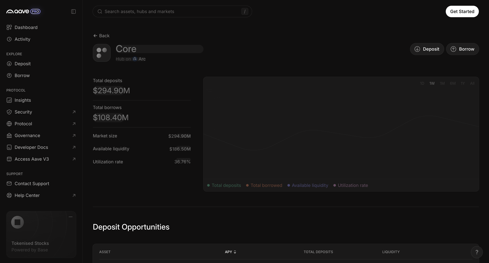 | 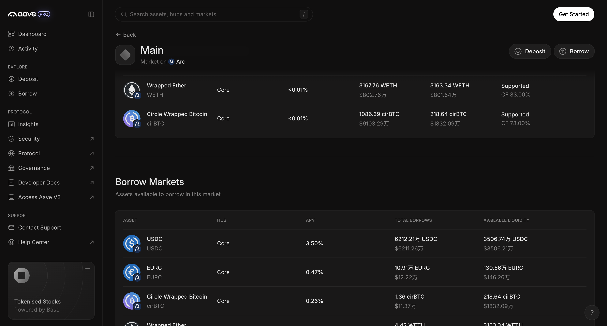 |
| **Forex 市场** | **Maple syrupUSDC 市场** |
| 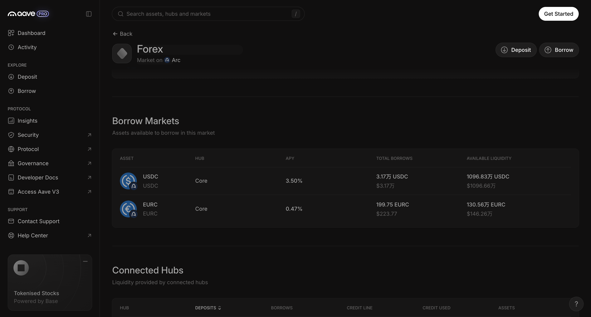 | 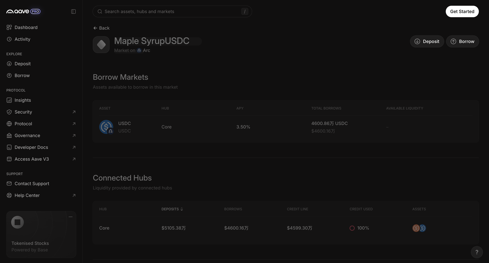 |
| **USDC 储备页（Deposit / Borrow 按钮）** | **点 Deposit → 连钱包弹窗** |
| 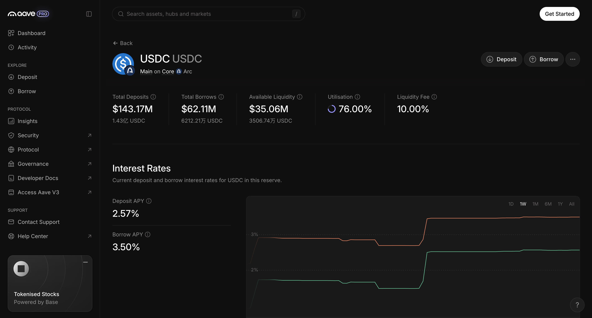 | 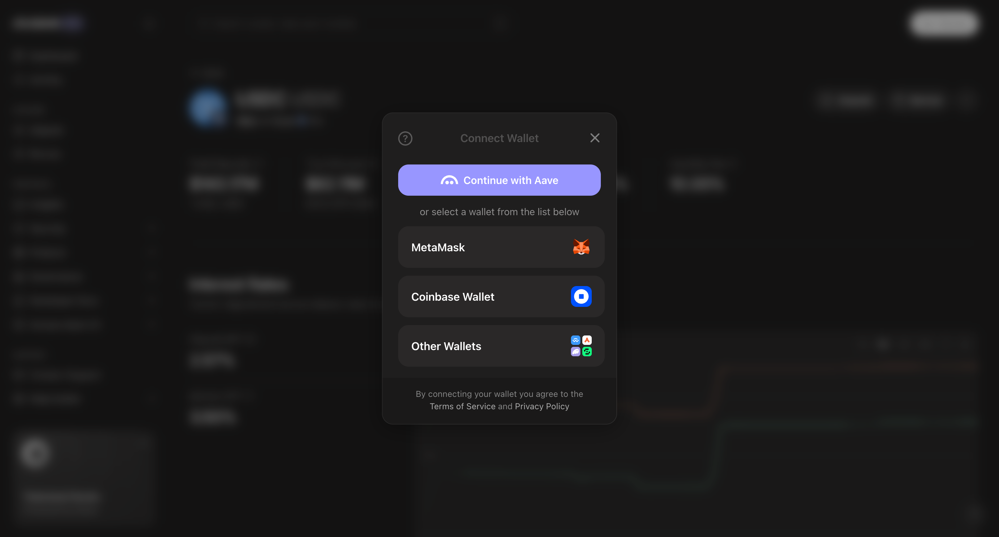 |

**交易详情（均为 explorer.arc.io）**

| 1 存入并开抵押（`0x3d73e5…`） | 1 存入（`0x8621aa…`） |
|:-:|:-:|
| 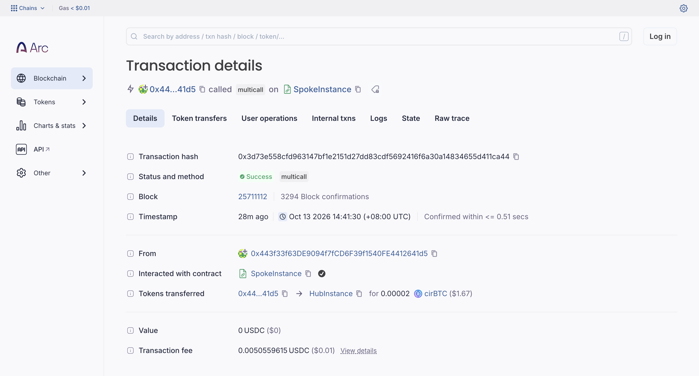 | 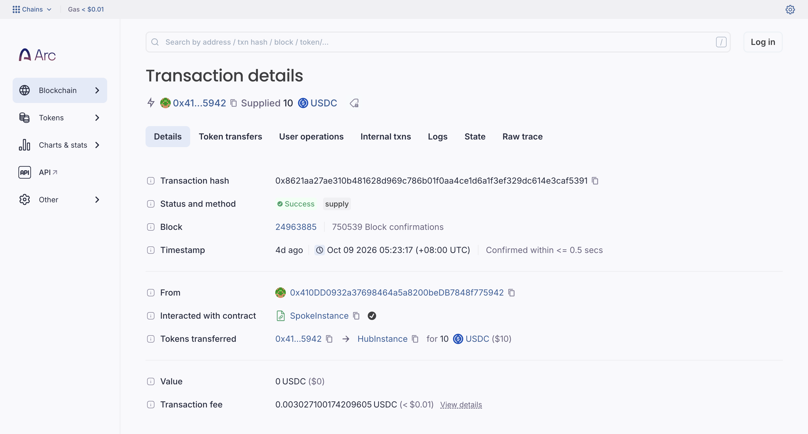 |
| **2 取出（`0x1f50e1…`）** | **3 借款（`0x5194c6…`）** |
| 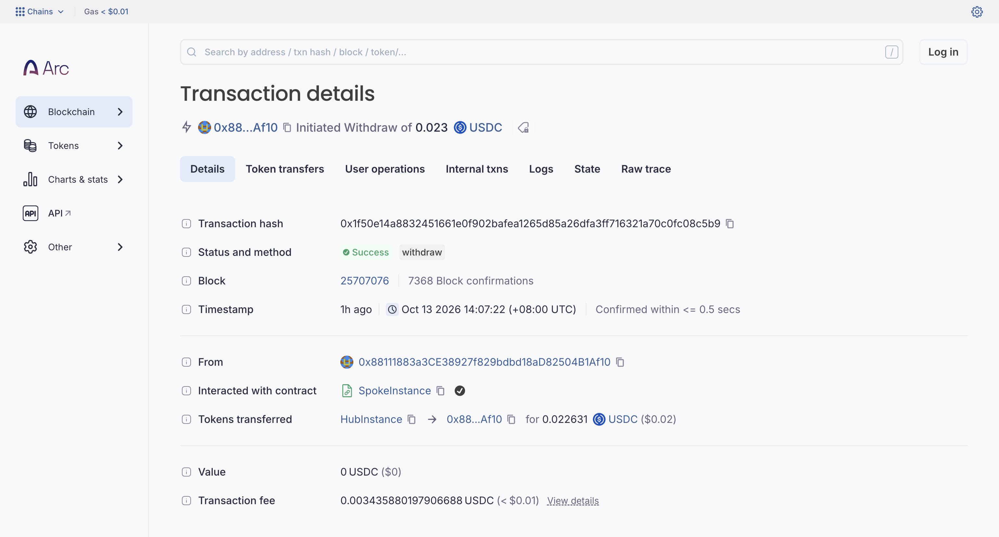 | 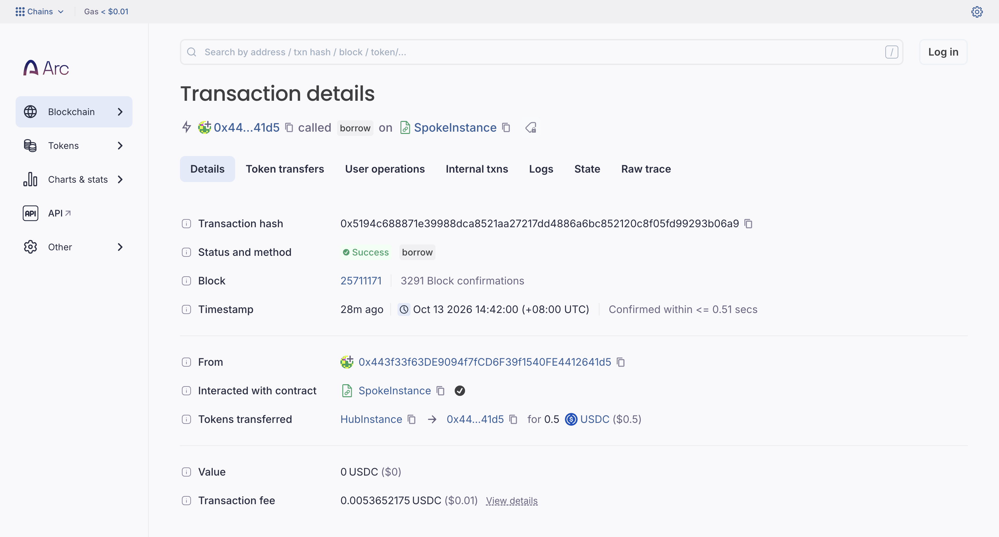 |
| **4 存入并借款（`0x71c28a…`）** | **5 还款（`0x36698f…`）** |
| 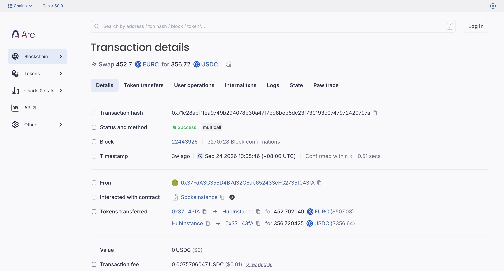 | 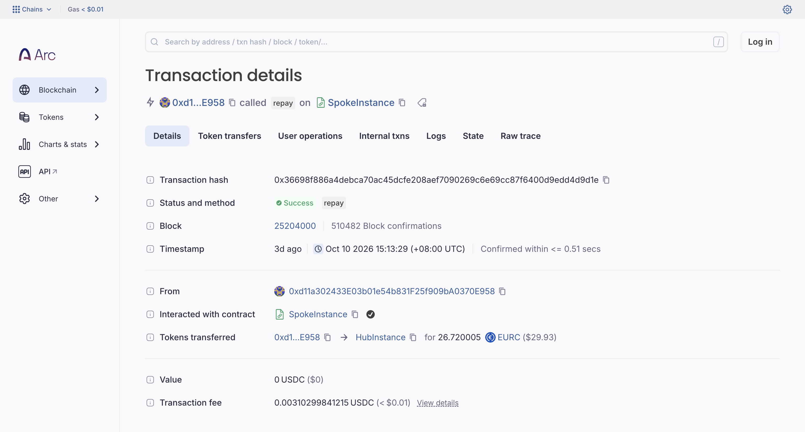 |
| **5 permit 还款（`0x331c84…`）** | **6 开关抵押（`0x2acc9d…`）** |
| 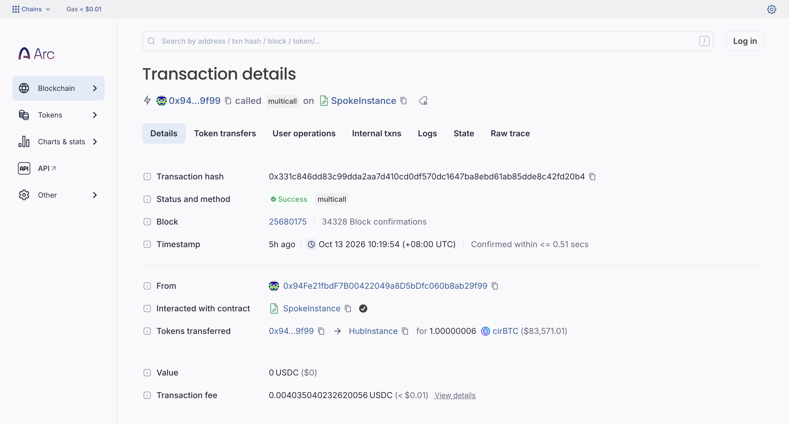 | 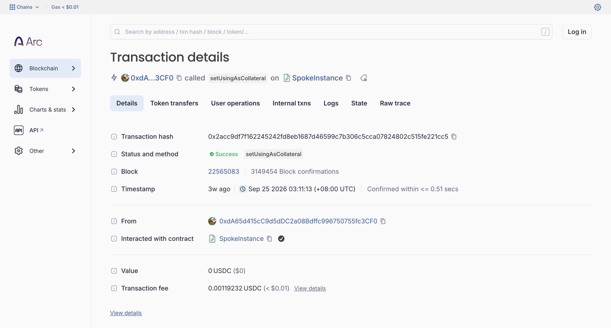 |
| **7 清算（`0xd11da0…`）** | **8 授权仓位管理器（`0x926cf5…`）** |
| 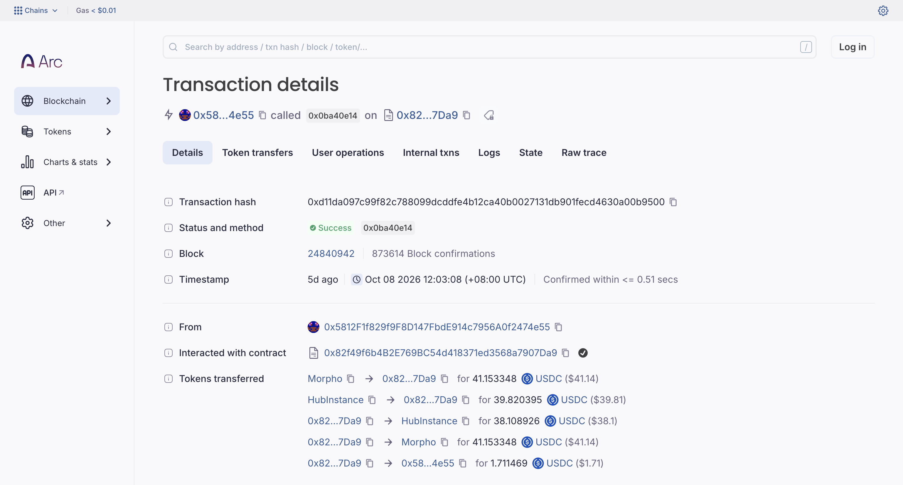 | 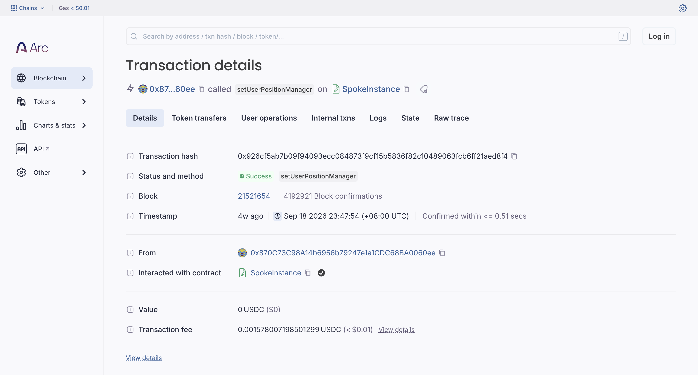 |
| **9 委托借款授权（`0x17d21e…`）** | **10 Tokenization 存入（`0xc98ca5…`）** |
| 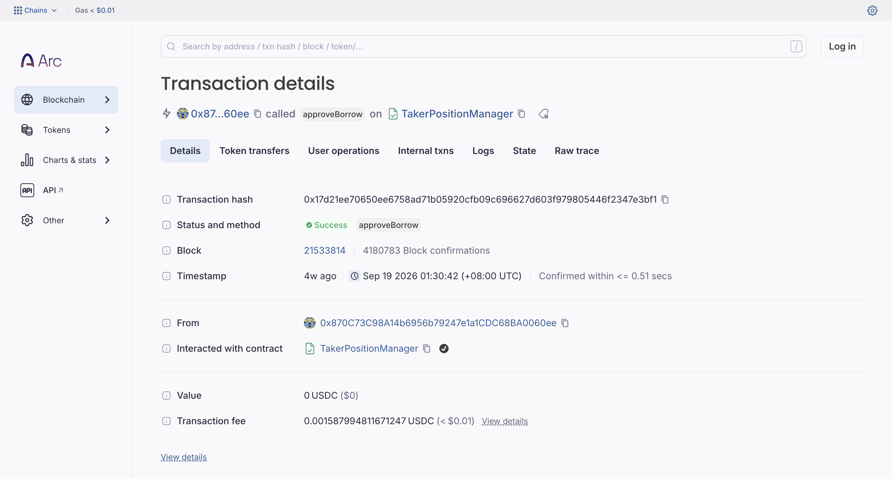 | 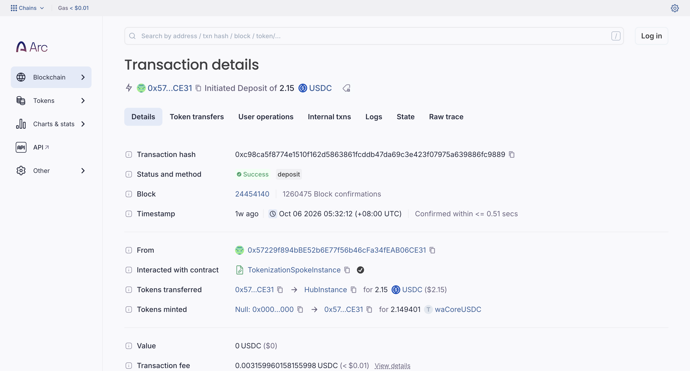 |
| **11 Tokenization 赎回（`0x246a9d…`）** | |
| 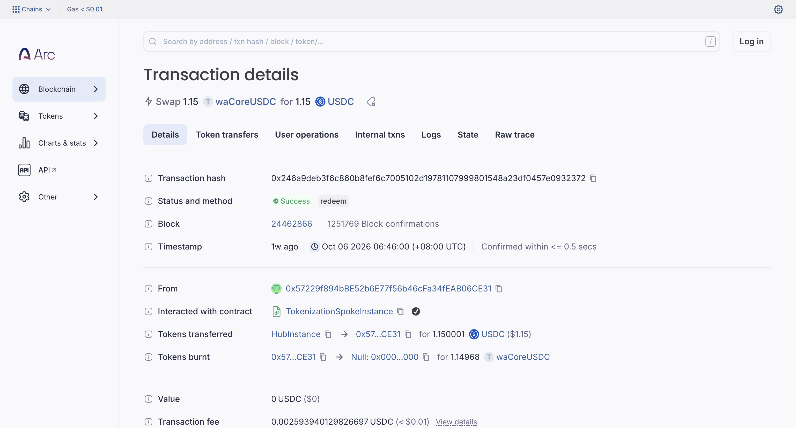 | |

### 开发注意

1. **大部分交易是 `multicall`，必须按内部调用和事件解析**：Main Spoke 5,330 笔里有 3,580 笔是 `multicall`。只看 tx 方法名会把存入、还款、借款都归成 `multicall`，要以 Spoke 发的 `Supply` / `Withdraw` / `Borrow` / `Repay` / `SetUsingAsCollateral` / `LiquidationCall` 事件为准。另外 Spoke 用 `reserveId`（uint256）而不是资产地址来定位储备，要配合 Spoke 的储备配置把 id 映射成资产。Repay 事件数（2,295）远多于直接 repay 交易，说明很多还款是其他合约代调的。
2. **Arc 上的 USDC 每次转账会出两条 Transfer**：一条来自 `0xffff…fffe`（原生币系统日志，18 位精度），一条来自 ERC20 接口 `0x3600…0000`（6 位精度），金额相同。按 ERC20 Transfer 统计时只取 `0x3600…`，否则会重复计数，精度也会弄错。

### 待确认

1. #4 存入并借款、#8～#11（仓位管理器、Tokenization Spoke）在 pro.aave.com 未连钱包时看不到入口，需要连钱包后确认 Dashboard 有没有对应按钮，再决定是否纳入接入范围。
2. Dashboard 上的 Withdraw / Repay / 抵押开关入口，是按 V4 合约方法和 V3 前端习惯推定的，需要连钱包验证按钮的名字和位置。
3. 清算样本是在扫完 Main Spoke 约 1.2 万条事件里找到的 2 笔（事件扫描未跑完全量），Forex / Maple Spoke 暂时没找到清算样本。
