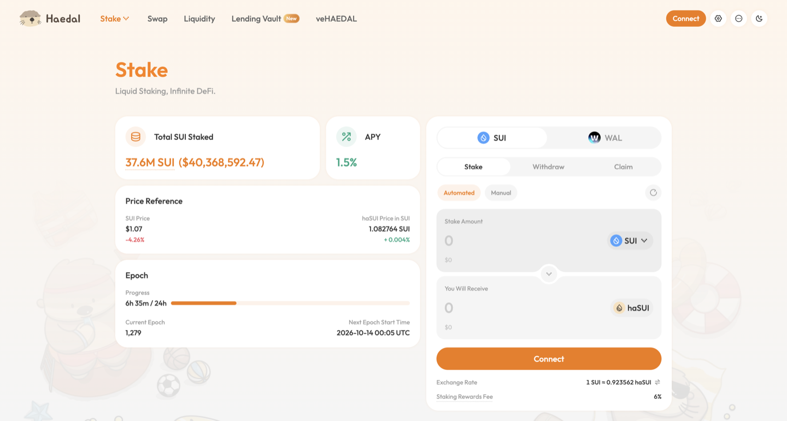
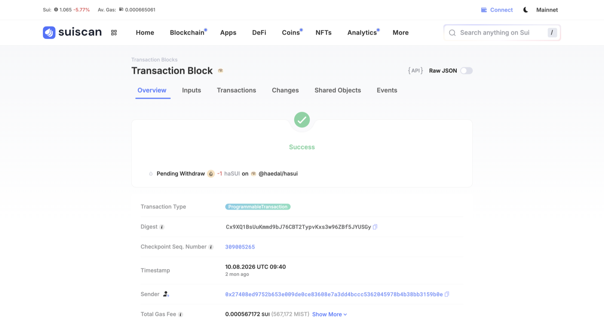
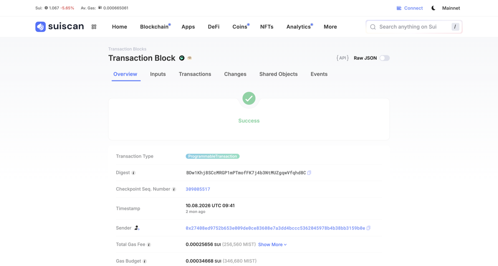

# Haedal —— haSUI（SUI 流动质押）

> ⚠️ **范围声明**：本协议**不属于**本仓库原本的 RWA 7 协议范围，来自 **DeX 行情接链项目**（协议表条目 `SUIHaedal`）。
> **状态**：✅ 前端可点击交易类型 21/21 均有 digest + 交易截图（2026-10-13，haSUI / haWAL / Swap / Liquidity Vault / Lending Vault / veHAEDAL）；其中 stake + 两条赎回路径为 2026-08-10 本人实测，其余为公开样本
> **实测时间**：2026-08-10 ｜ **测试钱包**：SUI `0x27408ed9752b653e009de0ce83608e7a3dd4bccc5362045978b4b38bb3159b0e`
> **链上验证方式**：SUI **GraphQL**（`graphql.mainnet.sui.io`）—— ⚠️ JSON-RPC 公共节点已下线，见 §6.5
> **解析类型**：A（NAV 累积，1 haSUI = 1.08016 SUI）

## 交易类型覆盖（2026-10-13）

前端：Stake https://www.haedal.xyz/stake ｜ Swap https://www.haedal.xyz/swap ｜ Liquidity https://www.haedal.xyz/vault ｜ Lending Vault https://www.haedal.xyz/lending ｜ veHAEDAL https://www.haedal.xyz/veHAEDAL

| 包 | 地址 |
|---|---|
| haSUI 质押（前端当前调用版本） | `0x19e6ea7f5ced4f090e20da794cc80349a03e638940ddb95155a4e301f5f4967c`（original `0xbde4ba4c2e274a60ce15c1cfff9e5c42e41654ac8b6d906a57efa4bd3c29f47d`） |
| haWAL 质押 | `0xec3d810a492541d4013c551b7b34d8e9d74a81ebd3642bad78611209b86c214d`（original `0x8b4d553839b219c3fd47608a0cc3d5fcc572cb25d41b7df3833208586a8d2470`） |
| 聚合 router（Swap Out / Swap 页） | `0xffd4058af7d6f6d66c335930cced8c91e38ec943e2392232aee27e8127e684e9`；haSUI / haWAL 适配器 `0xb717f942133a66d390f5114c42b79736e83decdc69d6ba6c8db106fcc1fbe6ef` |
| Liquidity Vault | `0xbf180d2cd8a9126a8b363fcd6bd8b1d57d7ac3fc6c6c11557713f0f27dc21ea7` |
| Lending Vault | `0x3777fbddf314316bb4b3618538255b09eff5460de094f5084f21edbeacbec9a8` |
| veHAEDAL | `0x2520e3de754d9785d29b34e8f15a92556fee5492d54ea7f548c44ab10a87bc4e`；奖励 `0x451682db8053eced4e8cd1aa3deb9c52f61c9b34650f536ed9c4c1a58327e329` |

| # | 交易类型 | 前端入口 | 模块 · 函数 | digest |
|---|---|---|---|---|
| 1 | haSUI 质押（Automated） | Stake → SUI → Stake | 质押包 · `interface::request_stake` | [8wToiZwttDRZnAXc5X5xf9boD9Njee77qumFokExup18](https://suiscan.xyz/mainnet/tx/8wToiZwttDRZnAXc5X5xf9boD9Njee77qumFokExup18)（本人实测） |
| 2 | haSUI 质押（Manual 自选节点） | Stake → Manual → Choose a Validator | 质押包 · `interface::request_stake`（validator 参数非 `0x0`） | [GGA2CSZq1ZrvKPpwbCCtskjAMCb1WXreYtKpN8TiZ34U](https://suiscan.xyz/mainnet/tx/GGA2CSZq1ZrvKPpwbCCtskjAMCb1WXreYtKpN8TiZ34U)（公开样本） |
| 3 | haSUI 普通解押（等 epoch） | Withdraw → Unstake | 质押包 · `interface::request_unstake_delay` | [Cx9XQ1BsUuKmmd9bJ76CBT2TypvKxs3w96ZBf5JYUSGy](https://suiscan.xyz/mainnet/tx/Cx9XQ1BsUuKmmd9bJ76CBT2TypvKxs3w96ZBf5JYUSGy)（本人实测） |
| 4 | haSUI 即时解押（费 0.02%） | Withdraw → Instant Unstake | 质押包 · `interface::request_unstake_instant_v2` | [AvKhsPnSWSJXjgWzTJ2aBJSj4wh3L9yuttnYknonhzin](https://suiscan.xyz/mainnet/tx/AvKhsPnSWSJXjgWzTJ2aBJSj4wh3L9yuttnYknonhzin)（公开样本） |
| 5 | haSUI Swap Out | Withdraw → Swap Out | 聚合 router · `new_swap_context` → 适配器 `hasui::swap` → router `confirm_swap` | [BDw1Khj8SCcMRGP1mPTmofFK7j4b3NtMUZgqwVfqhd8C](https://suiscan.xyz/mainnet/tx/BDw1Khj8SCcMRGP1mPTmofFK7j4b3NtMUZgqwVfqhd8C)（本人实测） |
| 6 | haSUI 领取（Unstake 到期后） | Claim | 质押包 · `interface::claim_v2` | [HCmjgVXVMDx4n5ADEx7dv4fVW5ah758KACCdorrSEKH1](https://suiscan.xyz/mainnet/tx/HCmjgVXVMDx4n5ADEx7dv4fVW5ah758KACCdorrSEKH1)（公开样本） |
| 7 | haWAL 质押 | Stake → WAL → Stake | haWAL 包 · `interface::request_stake` | [Gt1uj66EkdsfRrYSzA9TzZdcUnUdbpqoRf7uPjdUeBnn](https://suiscan.xyz/mainnet/tx/Gt1uj66EkdsfRrYSzA9TzZdcUnUdbpqoRf7uPjdUeBnn)（公开样本） |
| 8 | haWAL 普通解押（等 epoch，约 14 天） | WAL → Withdraw → Unstake | haWAL 包 · `interface::request_unstake_delay` | [6q4dyBwbfUWoHZMGKikN9ZG4vtpsnW9Z3hb24UUKY3QQ](https://suiscan.xyz/mainnet/tx/6q4dyBwbfUWoHZMGKikN9ZG4vtpsnW9Z3hb24UUKY3QQ)（公开样本） |
| 9 | haWAL 即时解押 | WAL → Withdraw → Instant Unstake | haWAL 包 · `interface::request_unstake_instant` | [6a9YEysXBkcfQQG9FTcueMBnaTsSw1dZ6Ac2tczDoeu1](https://suiscan.xyz/mainnet/tx/6a9YEysXBkcfQQG9FTcueMBnaTsSw1dZ6Ac2tczDoeu1)（公开样本） |
| 10 | haWAL Swap Out | WAL → Withdraw → Swap Out | 聚合 router（旧版 `0xde5d696a…`）· `new_swap_context` → 适配器 `hawal::swap` → `confirm_swap` | [7FeUu6mMxy7C9aWFRSBuLMGUbHb8c9WrVNrzVLnnvKT7](https://suiscan.xyz/mainnet/tx/7FeUu6mMxy7C9aWFRSBuLMGUbHb8c9WrVNrzVLnnvKT7)（公开样本，2026-03） |
| 11 | haWAL 领取 | WAL → Claim | haWAL 包 · `interface::claim` | [2ULiJP28WcrfXrh39p5jUfjk2zzxGs52EYmtrYhcJfdw](https://suiscan.xyz/mainnet/tx/2ULiJP28WcrfXrh39p5jUfjk2zzxGs52EYmtrYhcJfdw)（公开样本） |
| 12 | Swap（任意币对） | Swap 页（Powered by Cetus） | 聚合 router · `new_swap_context_v3` → `<DEX>::swap` → `confirm_swap_v3` | [EKidm4d4yR28Eq7Mo7Kf9hptrRQRoVq48Z4jNEFWW116](https://suiscan.xyz/mainnet/tx/EKidm4d4yR28Eq7Mo7Kf9hptrRQRoVq48Z4jNEFWW116)（公开样本；聚合器通用交易，链上无法区分是否经 Haedal 前端发起） |
| 13 | Liquidity Vault 存入 | Liquidity → Deposit（可开 Zap） | Liquidity Vault 包 · `vault::deposit` | [J2LwFFV7a7WoV413gPRV84pVVu7wirvTZeWSd5JbaY6Q](https://suiscan.xyz/mainnet/tx/J2LwFFV7a7WoV413gPRV84pVVu7wirvTZeWSd5JbaY6Q)（公开样本） |
| 14 | Liquidity Vault 取出 | Liquidity → 详情 → Withdraw | Liquidity Vault 包 · `vault::new_withdraw_cert` → `withdraw_clmm` → `withdraw_asset` → `destroy_withdraw_cert` | [G2e1een6cpfdLA58daHShRXehR6msDfn2hRXhd2CQ7SY](https://suiscan.xyz/mainnet/tx/G2e1een6cpfdLA58daHShRXehR6msDfn2hRXhd2CQ7SY)（公开样本） |
| 15 | Lending Vault 存入 | Lending Vault → Deposit | Lending Vault 包 · `vault_entry::begin_deposit` + `complete_deposit_return` | [HRwHcdybLtgKTRGVoVSx26hxqAiRuw4nSqUT6cdafXod](https://suiscan.xyz/mainnet/tx/HRwHcdybLtgKTRGVoVSx26hxqAiRuw4nSqUT6cdafXod)（公开样本） |
| 16 | Lending Vault 取出 | Lending Vault → 详情 → Withdraw | Lending Vault 包 · `vault_entry::begin_withdraw_idle_only` + `complete_withdraw`（开 Auto Swap 时为 `complete_withdraw_return` + 聚合器 swap） | [D1NTw3nuBZTpVNc6yxBzA6vPGdhAt8HQ6SYrzstxEzcL](https://suiscan.xyz/mainnet/tx/D1NTw3nuBZTpVNc6yxBzA6vPGdhAt8HQ6SYrzstxEzcL)（公开样本） |
| 17 | veHAEDAL 锁仓 | veHAEDAL → Lock HAEDAL | veHAEDAL 包 · `staking::add_stake` | [7gAAmZarkP5h4mwuxciHZe4Hg2uZ1meCuzvLuo71fXSQ](https://suiscan.xyz/mainnet/tx/7gAAmZarkP5h4mwuxciHZe4Hg2uZ1meCuzvLuo71fXSQ)（公开样本） |
| 18 | veHAEDAL 追加锁仓数量 | veHAEDAL（已有锁仓，需连钱包） | veHAEDAL 包 · `staking::add_to_existing_stake` | [3juBPvWS3pTBP6rZqMiUob4K7rtQAkKPbjZSmCA9Ht46](https://suiscan.xyz/mainnet/tx/3juBPvWS3pTBP6rZqMiUob4K7rtQAkKPbjZSmCA9Ht46)（公开样本） |
| 19 | veHAEDAL 延长锁期 | veHAEDAL（已有锁仓，需连钱包） | veHAEDAL 包 · `staking::extend_existing_lock` | [EF7PPDyuETXMSe75NmRgVqyR7v4N8CTnDZbYqsWq4n4S](https://suiscan.xyz/mainnet/tx/EF7PPDyuETXMSe75NmRgVqyR7v4N8CTnDZbYqsWq4n4S)（公开样本） |
| 20 | veHAEDAL 到期解锁 | veHAEDAL（到期后，需连钱包） | veHAEDAL 包 · `staking::unstake_and_claim` | [7NpfeheAB11vy27wWtEkp5T6aXA8QzvX5euUPTiP98ij](https://suiscan.xyz/mainnet/tx/7NpfeheAB11vy27wWtEkp5T6aXA8QzvX5euUPTiP98ij)（公开样本） |
| 21 | veHAEDAL 领奖励 | veHAEDAL → Your Rewards → Claim | veHAEDAL 奖励包 · `reward_distribution::claim_rewards_v2` | [BZw7NGiD95aydMbkBW5gpJGCBHG4Fpcyb8jdARhHNvPv](https://suiscan.xyz/mainnet/tx/BZw7NGiD95aydMbkBW5gpJGCBHG4Fpcyb8jdARhHNvPv)（公开样本） |

页面有入口但**不产生 Haedal 交易**：Stake 菜单下的 DeFi（第三方协议策略列表，点击跳外链）、Stats（数据页）、Nodes（菜单项，`/nodes` 直达为 404）；Lending Vault 的 Risk Disclosure 勾选（仅本地确认）。

⚠️ 开发注意：
- **按 original package 识别，不要写死版本地址**：haSUI 包共 8 个版本，前端当前调用 v7 `0x19e6ea7f…`，但 v8 `0x126e4cfb…` 也有用户调用；haWAL 同理（5 个版本）。按 MoveCall 过滤需覆盖全部版本。
- **两个 Vault 的存取交易里混有大量 keeper 调用**（Pyth 喂价、`calculate_aum`、聚合器 swap 等，一笔 15~20 个 MoveCall），用户动作只认 `vault::deposit` / `vault::new_withdraw_cert`（Liquidity）和 `vault_entry::begin_deposit` / `begin_withdraw_*`（Lending）。

### 截图

**前端页面**

| Stake（SUI / Automated） | Stake（Manual 自选节点） |
|:-:|:-:|
|  |  |
| **Withdraw → Unstake** | **Withdraw → Instant Unstake** |
|  |  |
| **Withdraw → Swap Out（2026-08-10 实测时截图）** | **Claim** |
|  |  |
| **Stake（WAL）** | **Withdraw（WAL）** |
|  |  |
| **Swap** | **Liquidity Vault 列表** |
|  |  |
| **Liquidity Vault 详情（Deposit / Withdraw / Zap）** | **Lending Vault 列表** |
|  |  |
| **Lending Vault 详情（Deposit / Withdraw / Auto Swap）** | **veHAEDAL** |
|  |  |
| **DeFi（第三方策略列表，无链上交易）** | **Stats（无链上交易）** |
|  |  |

**交易详情（每类一张，均为 suiscan）**

| 1 haSUI 质押交易（`8wToiZ…`） | 2 haSUI 手动选节点质押（`GGA2CS…`） |
|:-:|:-:|
|  |  |
| **3 haSUI 普通解押（`Cx9XQ1…`）** | **4 haSUI 即时解押（`AvKhsP…`）** |
|  |  |
| **5 haSUI Swap Out（`BDw1Kh…`）** | **6 haSUI 领取（`HCmjgV…`）** |
|  |  |
| **7 haWAL 质押（`Gt1uj6…`）** | **8 haWAL 普通解押（`6q4dyB…`）** |
|  |  |
| **9 haWAL 即时解押（`6a9YEy…`）** | **10 haWAL Swap Out（`7FeUu6…`）** |
|  |  |
| **11 haWAL 领取（`2ULiJP…`）** | **12 Swap（`EKidm4…`）** |
|  |  |
| **13 Liquidity Vault 存入（`J2LwFF…`）** | **14 Liquidity Vault 取出（`G2e1ee…`）** |
|  |  |
| **15 Lending Vault 存入（`HRwHcd…`）** | **16 Lending Vault 取出（`D1NTw3…`）** |
|  |  |
| **17 veHAEDAL 锁仓（`7gAAmZ…`）** | **18 veHAEDAL 追加锁仓（`3juBPv…`）** |
|  |  |
| **19 veHAEDAL 延长锁期（`EF7PPD…`）** | **20 veHAEDAL 到期解锁（`7Npfeh…`）** |
|  |  |
| **21 veHAEDAL 领奖励（`BZw7NG…`）** |  |
|  |  |

---

## 0. 一句话结论

haSUI 是 SUI 的流动质押凭证（NAV 累积，1 haSUI ≈ 1.080 SUI）。**本协议最重要的实测发现是：UI 上的「赎回」有三个 tab，其中两条路径的链上事件完全不同 —— 普通 Unstake 抛 `UserNormalUnstaked` 且当笔不到账（等 epoch），Swap Out 抛 `UserInstantUnstaked` + DEX router 的 `SwapEvent` 且当笔即时到账。把两者当成同一种「赎回」处理，PNL 和状态机都会错。**

## 1. 基础信息（实测口径）

| 字段 | 值 |
|------|-----|
| 协议 | Haedal（haedal.xyz） |
| 链 | **SUI** |
| 本次实测产品 | **haSUI**（另有 WAL 产品线未测） |
| Supply Coins | SUI（原生币） |
| Coins Integrated | **haSUI** |
| Total Staked | **35,630,291.45 SUI ≈ $24,635,507.52**（2026-08-10 UI 快照） |
| 收益率 | **APY 1.48%**（2026-08-10 UI 快照） |
| **Staking rewards fee** | **6%**（UI 明示，协议抽成） |
| haSUI / SUI 汇率 | **1.08016 SUI**（UI 快照，标注 +0.004% ↗） |
| SUI 价格 | **$0.69**（UI 快照） |
| 池子类别 | **混合**：普通 Unstake ≈ 1 天（等 epoch）／ Instant Unstake ／ Swap Out 即时 |
| 产品网页 | https://haedal.xyz |
| 接入情况 | 待定（DeX 项目侧口径） |

## 2. 协议背景

⬜ **未做**。UI 观察到的产品结构：顶部导航 **Stake / Defi / Liquidity / veHAEDAL / Stats / Other**，资产可切 **SUI / WAL**（Walrus）。
有 **veHAEDAL** 治理代币锁仓机制。

## 3. 底层资产

⬜ **未做**。底层为 SUI 原生质押（委托给验证人），验证人清单未取。UI 的 Stake 面板有 **Automated / Manual** 两个模式 —— **Manual 疑为手动选验证人**，未测。

## 4. 收益来源

| 收益腿 | 来源 |
|--------|------|
| SUI 原生质押收益 | 扣 **6% staking rewards fee** 后归 haSUI 持有人（体现为 haSUI/SUI 汇率上升） |

⚠️ 单腿，相对简单。**注意 6% 抽成已反映在汇率里**，不要重复扣减。

## 5. 链上机制与凭证代币（✅ 实测）

### 5.1 地址 / 包清单

| 项 | 值 |
|----|-----|
| **Haedal package** | `0xbde4ba4c2e274a60ce15c1cfff9e5c42e41654ac8b6d906a57efa4bd3c29f47d` |
| **haSUI coinType** | `0xbde4ba4c2e274a60ce15c1cfff9e5c42e41654ac8b6d906a57efa4bd3c29f47d::hasui::HASUI` |
| SUI coinType | `0x0000000000000000000000000000000000000000000000000000000000000002::sui::SUI` |
| 🔴 **Swap Out 用到的 DEX router package** | `0x33ec64e9bb369bf045ddc198c81adbf2acab424da37465d95296ee02045d2b17` |
| 事件模块 | `…::staking::UserStaked` / `UserNormalUnstaked` / `UserInstantUnstaked` |

### 5.2 🔴🔴 三条赎回路径，链上完全不是一回事

UI 的 **Withdraw** 下有三个 tab：**Unstake ／ Instant Unstake ／ Swap Out**。实测两条：

| 路径 | 链上事件 | 当笔 SUI 到账？ | 汇率 | 样本 |
|------|---------|:---:|------|------|
| **Unstake**（默认） | `staking::UserNormalUnstaked` | 🔴 **否**（只扣 gas 0.000567 SUI） | 1 haSUI = 1.08016 SUI（UI）| ✅ 已实测 |
| **Instant Unstake** | ⬜ 未测 | 推测是 | 推测有折价 | ⬜ **无样本** |
| **Swap Out** | `staking::UserInstantUnstaked` **+ `0x33ec64e9…::router::SwapEvent`** **+ `router::ConfirmSwapEvent`** | ✅ **是**（净 +1.079686948 SUI） | 换出毛额 **≈1.079943**（净额 1.079687 + gas 0.000257） UI 报价 1.079791，滑点容忍 0.5% | ✅ 已实测 |

**→ 这是本页最重要的结论。三条路径必须当成三种交易类型：**

1. **Unstake** = 「赎回-提交」，用户 haSUI 已扣但 SUI 未到 → **必须有「赎回中」状态**（UI 明示 *Wait time ≈ 1 days*，Next Epoch 2026-08-11 00:05 UTC，Epoch 1215）
2. **Swap Out** = 🔴 **走外部 DEX router 的二级市场兑换**，虽然协议自己也抛了 `UserInstantUnstaked`，但**实际对价来自 DEX 池子而非协议赎回** → **是否计为「赎回」需要产品定义**（与 8/3 记录的 Re 走 ParaSwap、Fragmetric 买 wFRAG 是同一类问题，但 Haedal 更微妙 —— **协议事件和 DEX 事件同时出现**）
3. **Instant Unstake** 仍是空白

### 5.3 汇率交叉验证（三方吻合）

| 来源 | 数值 |
|------|------|
| UI Stake 面板 | 1 SUI ≈ **0.925789** haSUI |
| 链上实测反推 | 1 SUI → **0.925789166** haSUI |
| UI「haSUI Price in SUI」（反向） | **1.08016**（1 / 0.925789 = 1.080159 ✅） |

**→ 完全吻合，NAV 反推口径可靠。**

## 6. 数据接入要点

### 6.1 ✅ 实测交易全集（2026-08-10，UTC）

| # | 时间 | 操作 | 交易类型 | digest | 链上结果 |
|:---:|------|------|---------|--------|---------|
| 1 | 09:37:25.910 | Stake 1 SUI | **质押（即时 mint）** | `8wToiZwttDRZnAXc5X5xf9boD9Njee77qumFokExup18` | checkpoint 309004341 SUI **−1.001580784**（含 gas 0.001580784） haSUI **+0.925789166** event `staking::UserStaked` |
| 2 | 09:40:49.369 | Unstake 1 haSUI | 🔴 **赎回-提交（等 epoch）** | `Cx9XQ1BsUuKmmd9bJ76CBT2TypvKxs3w96ZBf5JYUSGy` | checkpoint 309005265 haSUI **−1.0** SUI **−0.000567172（仅 gas）** event `staking::UserNormalUnstaked` |
| 3 | 09:41:44.197 | Swap Out 1 haSUI | 🔴 **即时兑出（走 DEX router）** | `BDw1Khj8SCcMRGP1mPTmofFK7j4b3NtMUZgqwVfqhd8C` | checkpoint 309005517 haSUI **−1.0** → SUI **+1.079686948** events `staking::UserInstantUnstaked` + `router::SwapEvent` + `router::ConfirmSwapEvent` |

全部 **status = SUCCESS**。

### 6.2 🔴 给解析同学的四条规格

| # | 规格 | 说明 |
|:---:|------|------|
| **1** | 🔴 **按 event 区分赎回路径，不能只看余额变化** | 第 2、3 笔的 haSUI 变化**一模一样（−1.0）**，但一个到账一个不到账。**只看 balance change 会把两者判成同一种交易** —— 必须读 `UserNormalUnstaked` vs `UserInstantUnstaked` |
| **2** | 🔴 **Unstake 需要「赎回中」状态 + claim 样本** | 第 2 笔用户 haSUI 已扣、SUI 未到，中间态约 1 天。**claim 那一笔本次未拿到**（见 §9） |
| **3** | **Swap Out 的归类需产品定义** | 协议事件 + DEX 事件同时出现。若计为赎回，PNL 里会混入 DEX 滑点；若不计，用户会觉得「我明明从 Haedal 页面退出了却不算赎回」 |
| **4** | 🔴 **gas 要从本金里剥离，SUI 的 gas 还带 rebate** | 第 1 笔 SUI 变化 −1.001580784，其中 **0.001580784 是 gas**，本金是 1.0。按 balance change 直接算本金会偏高。 ⚠️ **SUI 的 gas = computation + storage − storageRebate**（本次三笔的 rebate 都在 1400 万 MIST 量级，占 storage 的 90%+）。**不减 rebate 会把 gas 高估约 10 倍**，小额交易里直接淹没本金 |

### 6.3 六维度自评

| 维度 | 可行性 | 取数方式 | 备注 |
|------|:---:|---------|------|
| 实时解析 | ✅ | haSUI balance × 1.08016 | 汇率三方吻合 |
| 交易历史解析 | ✅ | 见 §6.1 三类 | 缺 Instant Unstake + claim |
| 池子自发现 | 🟡 | 单一 staking pool | 另有 WAL 产品线未测 |
| APY | 🟡 | UI 有 1.48% | 链上/API 取数未查 |
| NAV 历史 | 🟡 | haSUI/SUI 汇率天级打点 | **注意 6% fee 已内含** |
| PNL | 🟡 | 净值差 | ⚠️ Swap Out 路径的滑点归属见 §6.2 第 3 条 |

### 6.4 需向项目方索取

1. **Unstake 后的 claim 流程**（是否需用户再发一笔、事件签名、Claim tab 的行为）
2. **Instant Unstake 的折价规则**（与 Swap Out 有何区别）
3. haSUI/SUI 汇率的链上取数入口（哪个 object 的哪个字段）
4. 6% staking rewards fee 的计费与结算方式
5. WAL 产品线是否同一套机制
6. Stake 面板 Automated / Manual 两个模式的区别

### 6.5 ⚠️ SUI 链上取数的一个坑（工程侧注意）

> **SUI 公共 fullnode 的 JSON-RPC 已下线。**
> 本次用 `sui_getTransactionBlock` 查询直接返回：
> `-32601 Method not found. JSON-RPC on public fullnodes has been deprecated. Please migrate to gRPC or GraphQL endpoints.`
>
> 可用替代：**GraphQL** `https://graphql.mainnet.sui.io/graphql`
> - 字段名是 `transaction(digest:)`，**不是** 旧版的 `transactionBlock`
> - 余额变化取 `effects.balanceChangesJson`，事件取 `effects.events.nodes[].contents.type.repr`
> - Move 调用需从 `transactionJson` 里递归找 `MoveCall`
>
> **→ 如果解析侧还在用 SUI JSON-RPC，需要提前排期迁移到 GraphQL 或 gRPC。**

## 7. 风险

⬜ **未做**。实测中直接观察到的两点：
1. **赎回等 epoch**：普通 Unstake 需等下一个 epoch（本次 Epoch 1215，Next Epoch 2026-08-11 00:05 UTC，UI 标 ≈1 天）
2. **Swap Out 依赖 DEX 流动性**：即时退出的对价来自 DEX 池子，**大额时滑点风险由用户承担**（UI 默认滑点容忍 0.5%）

## 8. 合规与准入

⬜ **未做**。UI 无 KYC 环节，链上非托管。

## 9. 待确认清单

| # | 问题 | 问谁 / 怎么查 |
|---|------|------------|
| 1 | 🔴 **Unstake 的 claim 样本**（本次只到提交，需等 2026-08-11 00:05 UTC 之后） | Linnea 补做 |
| 2 | 🔴 **Instant Unstake 样本 + 折价规则** | Linnea 补做 |
| 3 | 🔴 **Swap Out 是否计为「赎回」** —— 需产品定义 | Marcus / 内部对齐 |
| 4 | haSUI 汇率链上取数入口 | 项目方 |
| 5 | SUI 解析侧是否已从 JSON-RPC 迁移（见 §6.5） | 中台解析同学 |
| 6 | 协议背景 / 底层验证人 / 风险 / 合规四章 | 未做，需补 |

## 10. 参考链接

- 产品页：https://haedal.xyz
- SUI GraphQL 端点：https://graphql.mainnet.sui.io/graphql
- SUI JSON-RPC 迁移说明：https://docs.sui.io/develop/accessing-data/json-rpc-migration

## 11. 实测截图（✅ 已落盘）

| 文件 | 内容 |
|------|------|
|  | **Stake 面板**：1 SUI → 0.9257 haSUI ｜ 汇率 0.925789 ｜ fee 6% ｜ Total Staked 35,630,291.45 SUI ｜ APY 1.48% ｜ Epoch 1215 |
|  | **Withdraw / Unstake tab**：1 haSUI ≈ 1.08016 SUI ｜ **Wait time ≈ 1 days** ｜ 余额 1.777367498 haSUI ｜ Next Epoch 2026-08-11 00:05 UTC |
|  | **Withdraw / Swap Out tab**：1 haSUI ≈ 1.079791 SUI ｜ **Slippage tolerance 0.5%** ｜ 三个 tab 并列（Unstake / Instant Unstake / Swap Out） |
