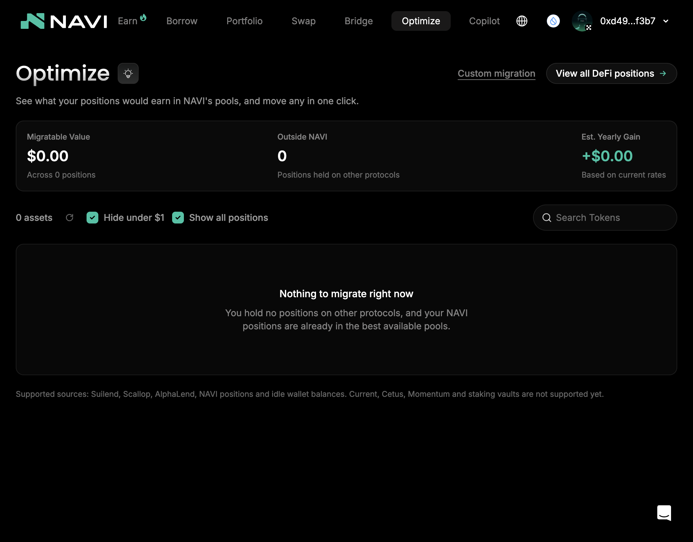
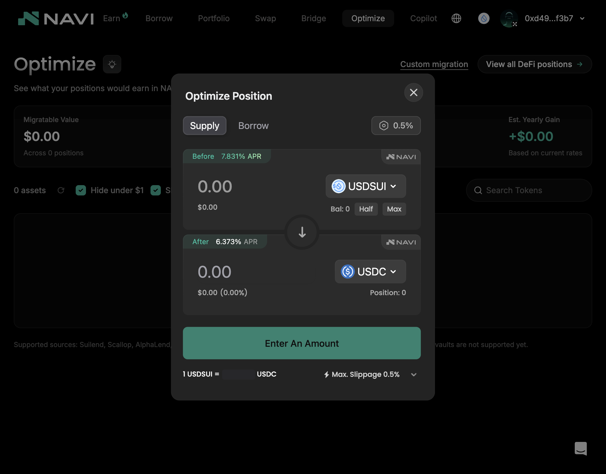

# Navi — SUI

> **链**：SUI（交易标识为 digest，base58） ｜ 浏览器 https://suiscan.xyz/mainnet ｜ 取数 GraphQL `https://graphql.mainnet.sui.io/graphql`
> **调研日期**：2026-08-22，2026-10-13 补全交易类型
> 本协议无本人实测交易，全部为公开样本；公开样本均为链上公开交易，非本人钱包，已逐条确认成功

## 合约

| 项 | 值 |
|---|---|
| 前端 | Earn https://app.naviprotocol.io ｜ Borrow https://app.naviprotocol.io/borrow ｜ Portfolio https://app.naviprotocol.io/portfolio ｜ Optimize https://app.naviprotocol.io/optimize ｜ Copilot https://app.naviprotocol.io/copilot ｜ Reward Hub https://app.naviprotocol.io/leaderboard ｜ Swap / Bridge（顶部按钮，右侧面板） |
| lending 包（`incentive_v3` / `lending`） | 当前 `0x512f28261c1a293f49416d8885b8d5d32bde6dd68a99a0be36fe42b248e6833a`；早期版本 `0xd899cf7d2b5db716bd2cf55599fb0d5ee38a3061e7b6bb6eebf73fa5bc4c81ca`（历史交易） |
| Storage 对象 | `0xbb4e2f4b6205c2e2a2db47aeb4f830796ec7c005f88537ee775986639bc442fe` |
| navi_vault（Lending Vault） | `0x13e1e0ddcf3a76cde006d530e98a0f985c446013cfedeae6dd067a2f1ea88ff5` |
| vault（Multiply / 外部 Volo Vault 共用） | 当前 `0xdb8fca27462e39cb3cdb66c64baa498bfa037b3d8dce4046726eb4573371f02e`；旧版 `0xfba9e78742d8f3edeb405561b954846ce3e60cab64dac00e600d50bb4923be0f` |
| 聚合器（Swap） | 滑点检查 `0xdd21f177ec772046619e401c7a44eb78c233c0d53b4b2213ad83122eef4147db` |

## 交易类型覆盖

18 类：17 类有公开样本，1 类 ⬜。

| # | 交易类型 | 前端入口 | 模块 · 函数 | digest | 来源 |
|---|---|---|---|---|---|
| 1 | Supply 存款（Main Market） | Borrow 页 → Main Market → Supply | lending 包 · `incentive_v3::entry_deposit` | [8pMtBtAq3MbikZumvF8PenuTVRFXkzD2R9o2sBL9faM9](https://suiscan.xyz/mainnet/tx/8pMtBtAq3MbikZumvF8PenuTVRFXkzD2R9o2sBL9faM9) | 公开样本 |
| 2 | Withdraw 取款 | Portfolio → Withdraw | lending 包 · `incentive_v3::withdraw_v2` | [C7Pm64cW1T31Lh9QtoDrEKksrzr1TYpJnTV1pZ4oZt8T](https://suiscan.xyz/mainnet/tx/C7Pm64cW1T31Lh9QtoDrEKksrzr1TYpJnTV1pZ4oZt8T) | 公开样本 |
| 3 | Borrow 借款（费 0.3%） | Borrow 页 → Borrow | lending 包 · `incentive_v3::borrow_v2` | [6R9rW2gVKNckCnH7QcvoeTr7f1EEsJN1zDC1Mz5qSHps](https://suiscan.xyz/mainnet/tx/6R9rW2gVKNckCnH7QcvoeTr7f1EEsJN1zDC1Mz5qSHps) | 公开样本 |
| 4 | Repay 还款 | Borrow 弹窗 → Repay tab / Portfolio → Repay | lending 包 · `incentive_v3::entry_repay` | [2xYhsHwgLfJU1c16Dxo5Fmv4NyGdV6x92zJDYkyZLpjB](https://suiscan.xyz/mainnet/tx/2xYhsHwgLfJU1c16Dxo5Fmv4NyGdV6x92zJDYkyZLpjB) | 公开样本 |
| 5 | 领借贷奖励 | Portfolio → Rewards → Claim | lending 包 · `incentive_v3::claim_reward_entry` | [8ENYNYTBUSn2rrMyrSVTnyCmWGrbGe6eDSqF4RDv2QFA](https://suiscan.xyz/mainnet/tx/8ENYNYTBUSn2rrMyrSVTnyCmWGrbGe6eDSqF4RDv2QFA) | 公开样本 |
| 6 | 进入 E-mode 市场（建子账户） | Borrow 页 → 非 Main Market 的市场，首次操作 | lending 包 · `lending::create_account` + `lending::enter_emode_with_account_cap` | [FHPiCkYwsomj1ed2UmKvGZ4ChqxQATeABSJq886EM82S](https://suiscan.xyz/mainnet/tx/FHPiCkYwsomj1ed2UmKvGZ4ChqxQATeABSJq886EM82S) | 公开样本 |
| 7 | E-mode 市场借款（存 / 取 / 还同理） | Borrow 页 → E-mode 市场 → Borrow | lending 包 · `incentive_v3::borrow_with_account_cap_v2`（存 `deposit_with_account_cap`、取 `withdraw_with_account_cap_v2`、还 `repay_with_account_cap`） | [C6ujXro2ZTQmoEa35YLAFgZD9n5ckY3xPDnbx43oyw4P](https://suiscan.xyz/mainnet/tx/C6ujXro2ZTQmoEa35YLAFgZD9n5ckY3xPDnbx43oyw4P) | 公开样本 |
| 8 | Lending Vault 存入 | Earn → USDC High Yield / Prime 等 → Deposit | navi_vault 包 · `navi_vault::deposit`（前置 `sync_market_balance` ×N + `collect_reward`） | [5BP3MP1371nchxLufVdPiUFugX1ApnqxC4sMB9nmJqgD](https://suiscan.xyz/mainnet/tx/5BP3MP1371nchxLufVdPiUFugX1ApnqxC4sMB9nmJqgD) | 公开样本 |
| 9 | Lending Vault 取出 | Earn → Vault 详情 → Withdraw | navi_vault 包 · `navi_vault::withdraw` | [DdQH29VrfjC1SY4KeRYp2nDZHAxWnGsvfqym3sUb4kAH](https://suiscan.xyz/mainnet/tx/DdQH29VrfjC1SY4KeRYp2nDZHAxWnGsvfqym3sUb4kAH) | 公开样本 |
| 10 | Lending Vault 领奖励 | Earn → Vault 详情（需连钱包） | navi_vault 包 · `navi_vault::collect_reward` + `claim_reward` | [HMrMCjiScircCKgQ9UoncWnXHnJv7T9wo3tUm9PXFzok](https://suiscan.xyz/mainnet/tx/HMrMCjiScircCKgQ9UoncWnXHnJv7T9wo3tUm9PXFzok) | 公开样本 |
| 11 | Multiply 存入申请 | Earn → Sui/vSui Multiply → Multiply | vault 包 · `user_entry::deposit_with_auto_transfer` | [E1abEBwnHcJchyfmQyJysEsUuTDJNqxhiqmyp1QD2Tp6](https://suiscan.xyz/mainnet/tx/E1abEBwnHcJchyfmQyJysEsUuTDJNqxhiqmyp1QD2Tp6) | 公开样本 |
| 12 | Multiply 取出申请 | Multiply 详情 → Withdraw（需连钱包，每日 14:00 UTC 执行） | vault 包 · `user_entry::withdraw_with_auto_transfer` | [F7imhxa2tmHZj1jDKkxLzjDtMyf8bV6cWGwgWDrdGPTg](https://suiscan.xyz/mainnet/tx/F7imhxa2tmHZj1jDKkxLzjDtMyf8bV6cWGwgWDrdGPTg) | 公开样本 |
| 13 | 外部 Vault（Volo）存入申请 | Earn → More Vaults → Volo SUI Prime 等 → Deposit | vault 包 · `user_entry::deposit_with_auto_transfer` | [6EpSTyofxc24RhmjacTc93Vyjy9bKWWrWfk2CMhzctkM](https://suiscan.xyz/mainnet/tx/6EpSTyofxc24RhmjacTc93Vyjy9bKWWrWfk2CMhzctkM) | 公开样本 |
| 14 | 外部 Vault 取出申请 | 外部 Vault 详情 → Withdraw（需连钱包，按周执行） | vault 包 · `user_entry::withdraw_with_auto_transfer` | [5kL5mqNRyWa9mrhjQex4pxgLBFhUovUZB3b9vn48BSyC](https://suiscan.xyz/mainnet/tx/5kL5mqNRyWa9mrhjQex4pxgLBFhUovUZB3b9vn48BSyC) | 公开样本 |
| 15 | Vault 撤销存入申请 | Vault 详情 → 待执行申请（需连钱包） | vault 包 · `user_entry::cancel_deposit_with_auto_transfer` | [BUgLoqPoQsUhkKT7an2qepgFMhPAHqEnAdQCWWyyLzDx](https://suiscan.xyz/mainnet/tx/BUgLoqPoQsUhkKT7an2qepgFMhPAHqEnAdQCWWyyLzDx) | 公开样本 |
| 16 | Vault 撤销取出申请 | Vault 详情 → 待执行申请（需连钱包） | vault 包 · `user_entry::cancel_withdraw` | [7cL3MEtD8zycAtsohZ2sgDqnpHPNkvjYnMWoS9d4A6En](https://suiscan.xyz/mainnet/tx/7cL3MEtD8zycAtsohZ2sgDqnpHPNkvjYnMWoS9d4A6En) | 公开样本 |
| 17 | Swap | 顶部 Swap（右侧面板） | Navi 聚合器 · `<DEX>::swap`（本例为 vSUI `stake_pool::stake`）+ `slippage::check_slippage_v3` | [3FawchG9ReKTidtgjFWUebmfTwYTLvNWpCv1RNRjbFrz](https://suiscan.xyz/mainnet/tx/3FawchG9ReKTidtgjFWUebmfTwYTLvNWpCv1RNRjbFrz) | 公开样本（聚合器通用交易，链上无法区分是否经 Navi 前端发起） |
| 18 | Optimize（跨协议迁仓 / 换仓） | Optimize（一键迁移）；Optimize → Custom migration（Navi 内把 Supply / Borrow 仓位换成另一种资产） | 迁移来源：Suilend / Scallop / AlphaLend / Navi 仓位 / 钱包闲置余额（Current、Cetus、Momentum、质押金库不支持）；链上为外部协议取出 + 兑换 + Navi 存入的组合，无专用函数 | ⬜ 无样本 | 测试账户无可迁移仓位，页面见下方连钱包截图 |

页面有入口但**不产生 Navi 交易**：Reward Hub（积分与兑换，链下）、Bridge 面板（外部跨链）、Copilot（多钱包看板，需登录；其 Claim 按钮未登录时无法确认调用）、Security 页（展示）。Portfolio 上的 Withdraw / Repay / Claim 复用 #2 / #4 / #5 的函数。闪电贷、清算非页面可点击操作，不计入。

## 截图

**前端页面**

| Earn（Vault 列表） | Borrow（Main Market，Supply / Borrow） |
|:-:|:-:|
|  |  |
| **Borrow / Repay 弹窗** | **Lending Vault 详情（USDC High Yield）** |
|  |  |
| **Multiply 详情（Sui/vSui）** | **外部 Vault 详情（Volo SUI Prime）** |
|  |  |
| **Swap 面板** | **Bridge 面板（外部跨链）** |
|  |  |
| **Optimize（未连钱包）** | **Reward Hub（积分，链下）** |
|  |  |
| **Optimize（连钱包，无可迁移仓位）** | **Optimize → Custom migration（连钱包）** |
|  |  |
| **Copilot（多钱包看板）** |  |
|  |  |

**交易详情（每类一张，均为 suiscan）**

| 1 Supply（`8pMtBt…`） | 2 Withdraw（`C7Pm64…`） |
|:-:|:-:|
|  |  |
| **3 Borrow（`6R9rW2…`）** | **4 Repay（`2xYhsH…`）** |
|  |  |
| **5 领借贷奖励（`8ENYNY…`）** | **6 进入 E-mode（`FHPiCk…`）** |
|  |  |
| **7 E-mode 借款（`C6ujXr…`）** | **8 Lending Vault 存入（`5BP3MP…`）** |
|  |  |
| **9 Lending Vault 取出（`DdQH29…`）** | **10 Lending Vault 领奖励（`HMrMCj…`）** |
|  |  |
| **11 Multiply 存入申请（`E1abEB…`）** | **12 Multiply 取出申请（`F7imhx…`）** |
|  |  |
| **13 外部 Vault 存入申请（`6EpSTy…`）** | **14 外部 Vault 取出申请（`5kL5mq…`）** |
|  |  |
| **15 撤销存入申请（`BUgLoq…`）** | **16 撤销取出申请（`7cL3ME…`）** |
|  |  |
| **17 Swap（`3Fawch…`）** | **参考：运营方批量执行存入（`9kdSs9…`，非用户操作）** |
|  |  |

## 开发注意

- **lending 包两个版本都要覆盖**：当前 `0x512f2826…`，早期 `0xd899cf7d…`（历史交易）。**E-mode 市场的操作全部走 `*_with_account_cap` 变体**（#6 / #7），仓位挂在 AccountCap 子账户下，不在用户地址名下。
- **Multiply 与外部 Volo Vault 是「申请 + 批量执行」两笔**：用户只发 `deposit/withdraw_with_auto_transfer` 申请（#11～#14），资金由运营方按日 / 周用 `operation::batch_execute_deposit` / `batch_execute_withdraw` 批量执行（如 [9kdSs9LBmYq6EzAvJScx2Xno12zgqc2QAjk52CRXq5Zt](https://suiscan.xyz/mainnet/tx/9kdSs9LBmYq6EzAvJScx2Xno12zgqc2QAjk52CRXq5Zt)），signer 是运营方，归属需按交易内受益人参数关联申请。
- **按 MoveCall 函数名判类型，不靠事件**：`PoolDeposit` / `PoolWithdraw` 在存、取、还款中都会出现；借款另抛 `BorrowFeeDeposited`（0.3% 借款费，不计入本金）。链上大量 `arb_flash::*` / `lending::flash_loan_with_ctx` 为套利机器人闪电贷，需排除。

## 待确认

- Optimize（#18）链上的组合形态：需持有外部借贷仓位的钱包实测一笔
- Copilot 的 Claim 按钮登录后实际调用哪个合约
- Swap（#17）为聚合器通用交易，是否纳入 Navi 解析范围
