# Sanctum — Solana 协议调研

> **链**：Solana mainnet ｜ 浏览器 https://explorer.solana.com （Solscan 本次无法检索这些交易，截图统一用 Solana Explorer）
> **调研日期**：2026-10-13 ｜ signature 均为链上公开交易（非本人钱包），已逐条确认成功

## 合约（程序）

| 项 | 值 |
|---|---|
| 前端 | Stake https://app.sanctum.so/stake/INF （选其他 LST 为 `/stake/<symbol>`）｜ Swap https://app.sanctum.so/swap ｜ Migrate https://app.sanctum.so/migrate ｜ Unstake https://app.sanctum.so/unstake ｜ Infinity https://app.sanctum.so/infinity ｜ Explore https://app.sanctum.so/explore |
| Infinity（S Controller）程序 | `5ocnV1qiCgaQR8Jb8xWnVbApfaygJ8tNoZfgPwsgx9kx` |
| INF mint | `5oVNBeEEQvYi1cX3ir8Dx5n1P7pdxydbGF2X4TxVusJm` |
| Infinity 池 PDA（各 LST 储备账户的 owner） | `AYhux5gJzCoeoc1PoJ1VxwPDe22RwcvpHviLDD1oCGvW` |
| Infinity 估值子程序（CPI） | wSOL 估值 `wsoGmxQLSvwWpuaidCApxN5kEowLe2HLQLJhCQnj4bE` ｜ 定价 `s1b6NRXj6ygNu1QMKXh2H9LUR2aPApAAm1UQ2DjdhNV` |
| Sanctum Router 程序 | `stkitrT1Uoy18Dk1fTrgPw8W6MVzoCfYoAFT4MLsmhq`（prefunder PDA `ALpzvhALRr35nH8mw9SXk2WvmwEYjfw1dvmpFG9Kosu6`） |
| Sanctum SPL Stake Pool 程序 | 多验证者池 `SP12tWFxD9oJsVWNavTTBZvMbA6gkAmxtVgxdqvyvhY` ｜ 单验证者池 `SPMBzsVUuoHA4Jm6KunbsotaahvVikZs1JyTW6iJvbn`（Router 也会 CPI 官方 SPL 池程序 `SPoo1Ku8WFXoNDMHPsrGSTSG1Y47rzgn41SLUNakuHy` 上的 LST） |
| Reserve（unstake.it）程序 | `unpXTU2Ndrc7WWNyEhQWe4udTzSibLPi25SXv2xbCHQ` |

前端 Explore 页共列 237 个基于 Sanctum 的 LST，每个 LST 是独立 mint + 独立池账户，跑在上面两个 SPL Stake Pool 程序之一。

### 交易类型覆盖

| # | 交易类型 | 前端入口 | 程序 · 指令 | signature |
|---|---|---|---|---|
| 1 | 质押 SOL → INF（直接存入） | Stake → INF → Direct deposit | Infinity · `SwapExactInV2`（输入 wSOL，铸出 INF） | [3riD3hBQk5grfwY9D4MArzNMgxerSjphmEuk7ZKNd3TdjC826kMM53LWNPxmuyG1MZP5fqdpmzF1JR6zihf5ncjK](https://explorer.solana.com/tx/3riD3hBQk5grfwY9D4MArzNMgxerSjphmEuk7ZKNd3TdjC826kMM53LWNPxmuyG1MZP5fqdpmzF1JR6zihf5ncjK) |
| 2 | 质押 SOL → LST（直接存入 Sanctum 池，例 bbSOL） | Stake → 选 LST → Direct deposit | SPL Stake Pool · `DepositSol` | [r9mPKGaun8iTAjRj3G5GrGrhVunLMtaJ2w6hbpMX5T7nrQYiLHy3qt5pZFVMaaZCwEnxMWAxfP7nGvDTS3RGwAN](https://explorer.solana.com/tx/r9mPKGaun8iTAjRj3G5GrGrhVunLMtaJ2w6hbpMX5T7nrQYiLHy3qt5pZFVMaaZCwEnxMWAxfP7nGvDTS3RGwAN) |
| 3 | wSOL → LST（Router 代存） | Stake / Swap 路由命中 Sanctum Router 时 | Router · `StakeWrappedSol`（CPI 目标池 `DepositSol`，本样本为官方 SPL 池程序上的 LST） | [2kCpv2FyjpYttaJwiv4eRn888f3MLFaCYs1JzxTtKgkT6BRaJFZPWC1KTQjYzhij7R6XRA2LfEr5vKbNahWDNERc](https://explorer.solana.com/tx/2kCpv2FyjpYttaJwiv4eRn888f3MLFaCYs1JzxTtKgkT6BRaJFZPWC1KTQjYzhij7R6XRA2LfEr5vKbNahWDNERc) |
| 4 | LST → wSOL（Router 代取） | Unstake → Instant 路由命中 Router 时 | Router · `WithdrawWrappedSol`（CPI 目标池 `WithdrawSol`） | [4Fz4jFv2nmgR1rhkua24hJPRi2LhKmg4NqvmXZc8y9ggFeuwd8tYPzVEw5imVgUToqf3QH3DBwg74v5Djys8c2SL](https://explorer.solana.com/tx/4Fz4jFv2nmgR1rhkua24hJPRi2LhKmg4NqvmXZc8y9ggFeuwd8tYPzVEw5imVgUToqf3QH3DBwg74v5Djys8c2SL) |
| 5 | LST ↔ LST 互换（走 Infinity 池，例 rkSOL→JupSOL） | Swap | Infinity · `SwapExactInV2` | [4HddtxQ2M29HG2SRoaEWEzT48aAcS2zLAvSZsiukoexpCwbzZngUhMM6F87tVZ66fSobCWwfyAFJuHwCBmZ9oswQ](https://explorer.solana.com/tx/4HddtxQ2M29HG2SRoaEWEzT48aAcS2zLAvSZsiukoexpCwbzZngUhMM6F87tVZ66fSobCWwfyAFJuHwCBmZ9oswQ) |
| 6 | 经 stake 账户中转兑换（Router） | Swap / Unstake → Instant 路由命中 Router 时 | Router · `PrefundSwapViaStake`（源池 `WithdrawStake` 取出 stake → 存入目的端；本样本目的端为 Reserve `Unstake`/`UnstakeWsol`，即 LST→wSOL） | [3B5KyC6BX5ddYDHT5mUAvckfz8MkjMWkxJzaJTPjfLR7rmbhLHeGv7G1B7pVHM71QeDnBiLJZLzfX4kHJ7rAwvTC](https://explorer.solana.com/tx/3B5KyC6BX5ddYDHT5mUAvckfz8MkjMWkxJzaJTPjfLR7rmbhLHeGv7G1B7pVHM71QeDnBiLJZLzfX4kHJ7rAwvTC) |
| 7 | 即时解押 INF（INF 换出，销毁 INF） | Unstake → 选 INF → Instant | Infinity · `SwapExactIn`（输入 INF） | [2yYaJdPnDmRzfrwu3dN3gLJciocKbSVMr2hq92qucnGUC1bg5xeE9DtrAAB92HJFC5ywgUmP5VA1ojDVLVySTkkT](https://explorer.solana.com/tx/2yYaJdPnDmRzfrwu3dN3gLJciocKbSVMr2hq92qucnGUC1bg5xeE9DtrAAB92HJFC5ywgUmP5VA1ojDVLVySTkkT) |
| 8 | 延迟解押（LST → 解押中的 stake 账户，例 hubSOL） | Unstake → Delayed | SPL Stake Pool · `WithdrawStake` + Stake 程序 `Deactivate` | [4KveX2FJBXhVNhCVSUzT3TAsTWJKy4czYtBHvoi6PxsGVU8ngibeipAiRqcbptmbGc9qJWEQ5CXrB9Z4xcBqaTSF](https://explorer.solana.com/tx/4KveX2FJBXhVNhCVSUzT3TAsTWJKy4czYtBHvoi6PxsGVU8ngibeipAiRqcbptmbGc9qJWEQ5CXrB9Z4xcBqaTSF) |
| 9 | stake 账户 → LST（Migrate） | Migrate → Migrate to LST（需连钱包） | Router · `DepositStake`（本样本目的端为 Reserve 换 SOL，同笔含 `PrefundWithdrawStake`） | [CZ2PbD9GFQsWrjPTzUmBMTgXEKGTkkDJa6qkZz2giwWtw6oL3t7ySxy5Fb1ZdktE1vytXECXpyeVjMbZFYTAwC8](https://explorer.solana.com/tx/CZ2PbD9GFQsWrjPTzUmBMTgXEKGTkkDJa6qkZz2giwWtw6oL3t7ySxy5Fb1ZdktE1vytXECXpyeVjMbZFYTAwC8) |
| 10 | stake 账户即时换 SOL（Reserve） | Migrate → Unstake Instantly（需连钱包） | Reserve · `Unstake` | [xpXikm2GxNoqCqMW4f4X8RxquRxaF2zpAkT9uQ66RpUrZmyLsLc1nGUX55Z4C1MDuDMQU9pzY5Bxp61ZQCcpGWo](https://explorer.solana.com/tx/xpXikm2GxNoqCqMW4f4X8RxquRxaF2zpAkT9uQ66RpUrZmyLsLc1nGUX55Z4C1MDuDMQU9pzY5Bxp61ZQCcpGWo) |
| 11 | 领取延迟解押后的 SOL | ⬜ 前端暂无入口（FAQ：在钱包里从 stake 账户提取） | Stake 程序 · `Withdraw`（非 Sanctum 程序） | ⬜ |

#1、#2、#6、#8、#10 是 Sanctum 程序作为顶层指令的交易；#3、#4、#5、#7、#9 的样本是聚合器（Jupiter / Titan 等）路由里 CPI 调到的同一指令。前端 Swap / Instant Unstake 按 FAQ 会在 Jupiter、Infinity、Router 三者中选价，所以这几类在链上本来就常以 CPI 形式出现。

页面有入口但**不产生 Sanctum 程序交易**：
- Stake / Unstake 选 “Via Jupiter”：走 Jupiter 程序（`JUP6Lk…`），只有路由刚好经过 Infinity / Router 时才会出现 #3～#7 的指令。
- Explore、Infinity 页的数据展示（Infinity 页的 Stake 按钮与 #1 相同）。
- More 菜单（Wonderland 积分、Vote 治理、Research、Blog、Docs）：跳转外部或链下。

### 截图

**前端页面**

| Stake（INF，Direct deposit / Via Jupiter） | Stake（其他 LST，例 JupSOL） |
|:-:|:-:|
| 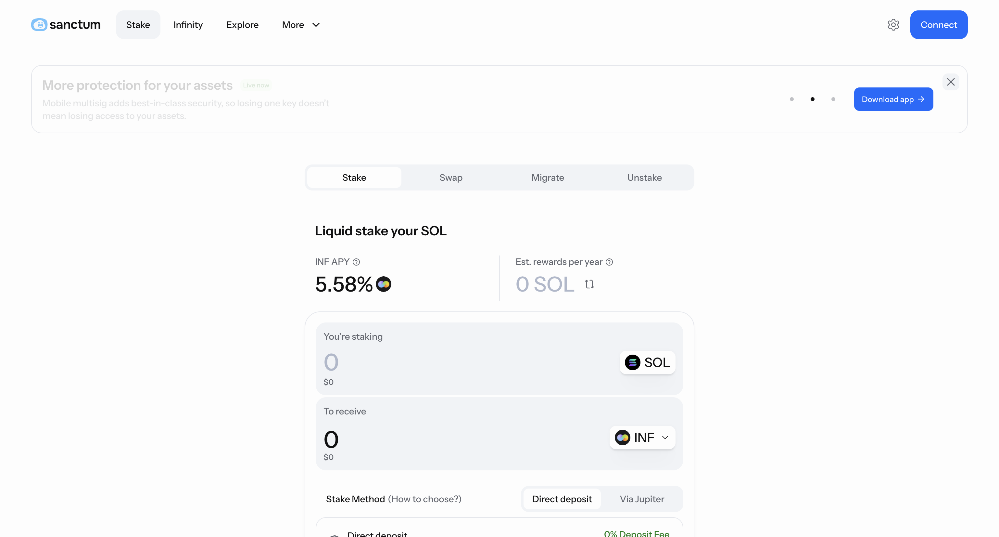 | 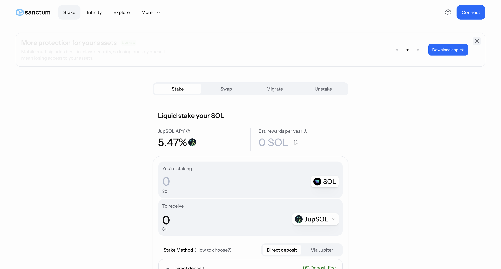 |
| **Swap（LST ↔ LST）** | **Unstake（Instant / Delayed）** |
| 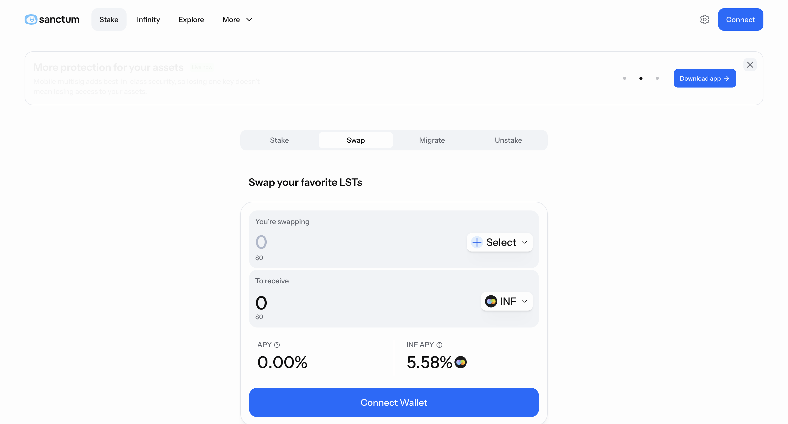 | 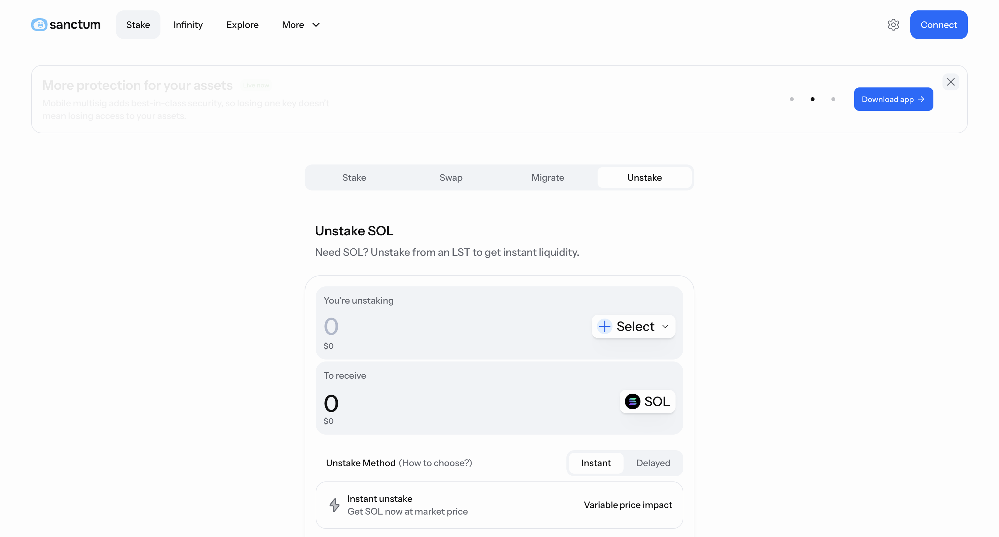 |
| **Migrate（Migrate to LST / Unstake Instantly）** | **Infinity** |
| 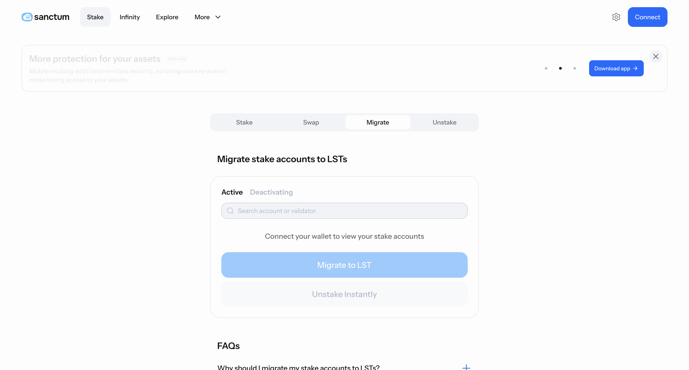 | 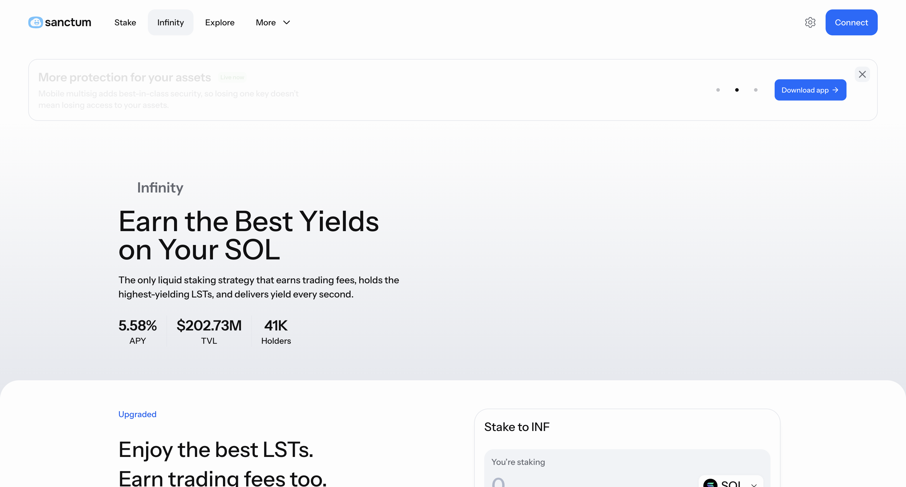 |
| **Explore（237 个 LST）** | |
| 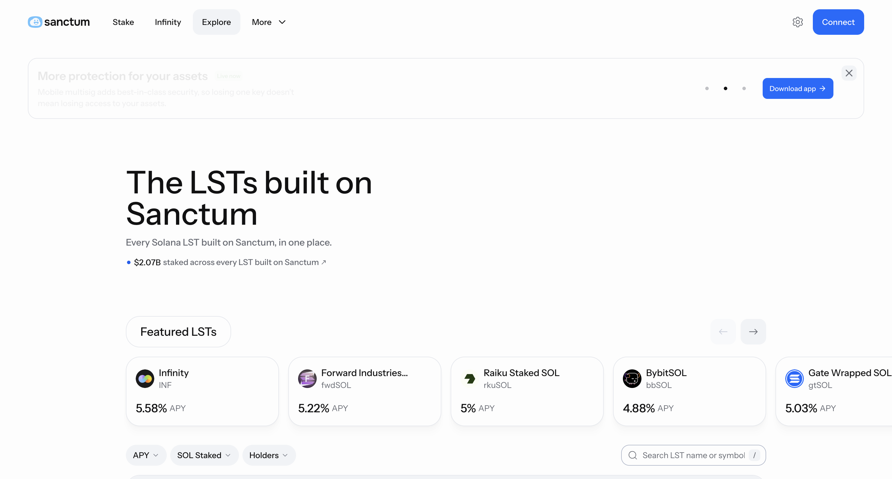 | |

**交易详情（每类一张，均为 Solana Explorer）**

| 1 质押 SOL→INF（`3riD3h…`） | 2 质押 SOL→LST（`r9mPKG…`） |
|:-:|:-:|
| 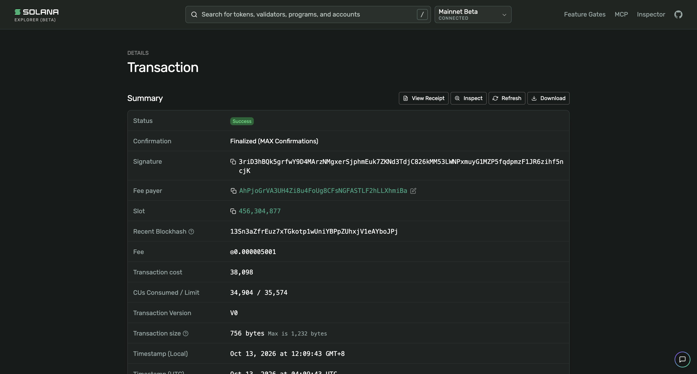 |  |
| **3 Router StakeWrappedSol（`2kCpv2…`）** | **4 Router WithdrawWrappedSol（`4Fz4jF…`）** |
|  | 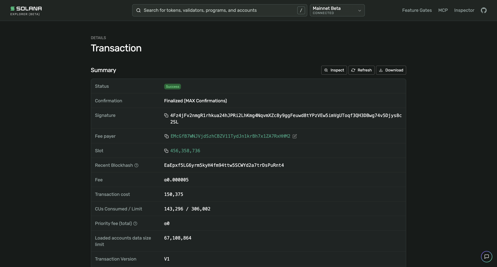 |
| **5 Infinity LST 互换（`4HddtxQ…`）** | **6 Router PrefundSwapViaStake（`3B5KyC…`）** |
| 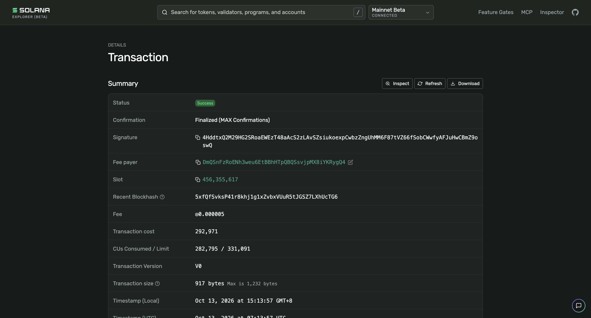 | 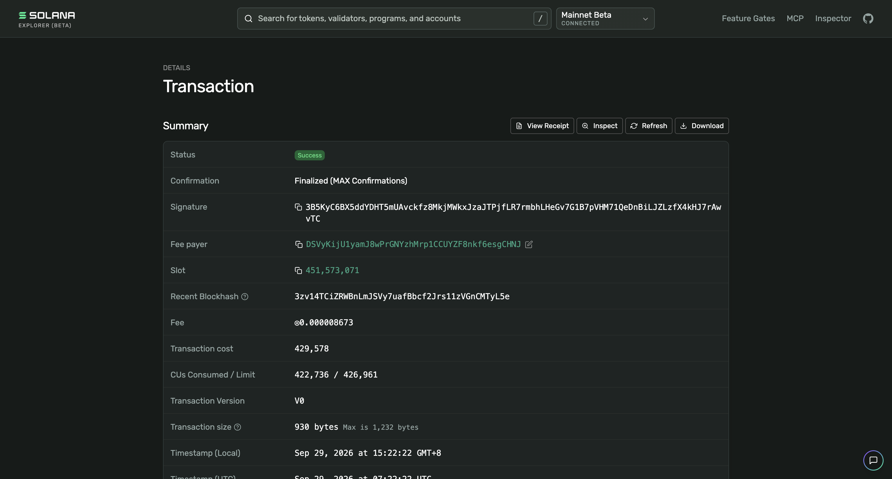 |
| **7 INF 即时解押（`2yYaJd…`）** | **8 延迟解押（`4KveX2…`）** |
| 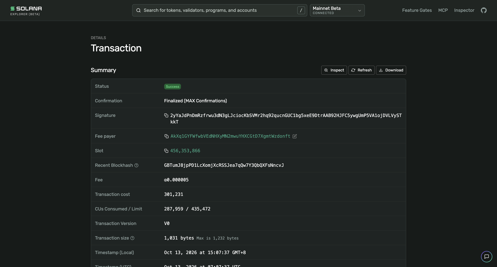 | 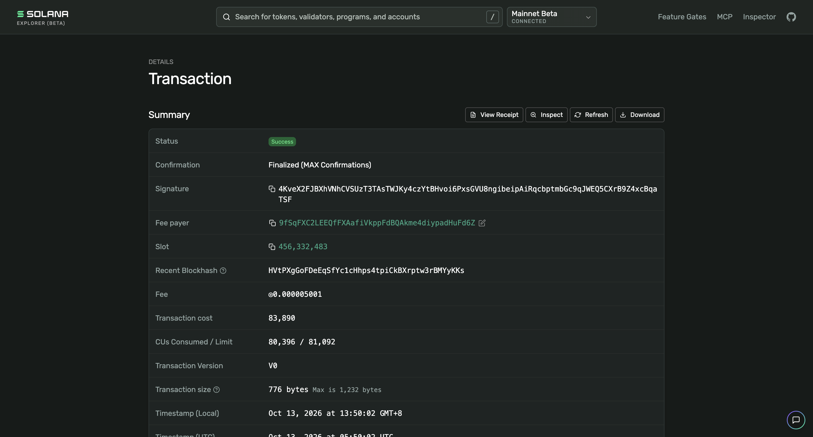 |
| **9 Router DepositStake（`CZ2PbD…`）** | **10 Reserve 即时解押（`xpXikm…`）** |
| 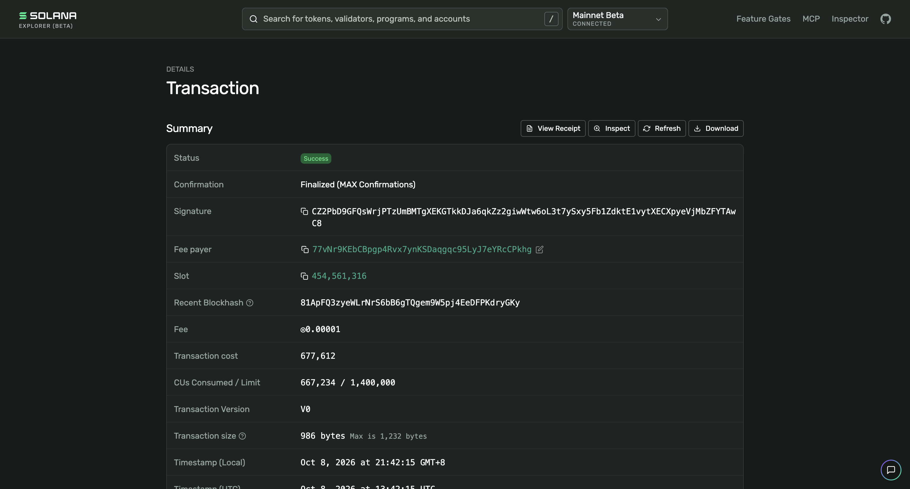 | 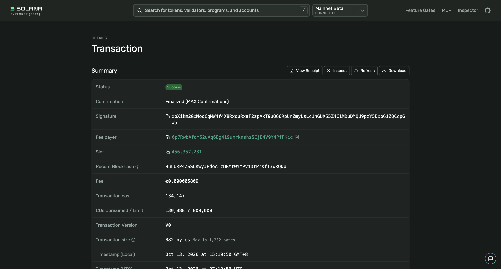 |

⚠️ 开发注意：
- **Infinity / Router / Reserve 都不是 Anchor 程序**：没有 8 字节 discriminator，Infinity 用指令数据首字节区分（`0x17` SwapExactInV2、`0x01` SwapExactIn、`0x00` SyncSolValue 为定时同步，非用户交易），日志直接打印指令名（如 `Program log: SwapExactInV2`）；Router 日志形如 `StakeWrappedSol(...)`。大部分调用是聚合器 CPI，解析必须同时扫顶层和 inner instructions。
- **“质押 / 解押”靠代币铸造销毁判断，不靠指令名**：SOL→INF、INF→其他资产在 Infinity 里都是 Swap 指令，区别只在 INF 是 Mint To 还是 Burn（近期样本里未见 AddLiquidity / RemoveLiquidity 调用）；Router 的 SwapViaStake / DepositStake 会生成临时 bridge stake 账户，不是用户持仓。

## 待确认

- #9 是 Router `DepositStake` 的同指令样本（目的端为 Reserve 换 SOL）。Migrate 需要钱包持有原生 SOL 质押账户（stake account）才有可迁移对象；本次测试钱包质押账户为 0，前端 Migrate to LST 实际调用的程序待用持有质押账户的钱包确认
- “Via Jupiter” 路径（Jupiter 程序发起、Sanctum 程序只在 CPI 里出现）是否纳入解析范围
- 237 个 LST 的 mint / 池地址需从 Sanctum 接口拉全量清单，本文只列了程序级地址
