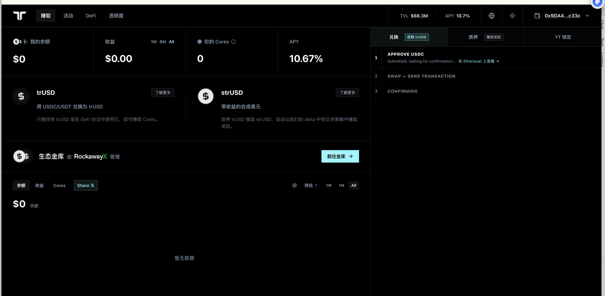
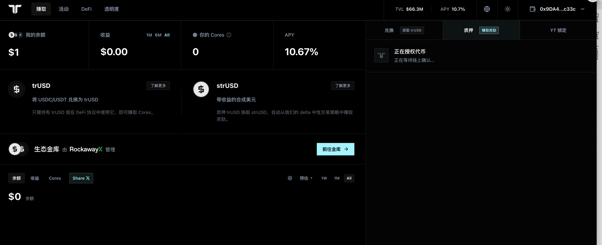
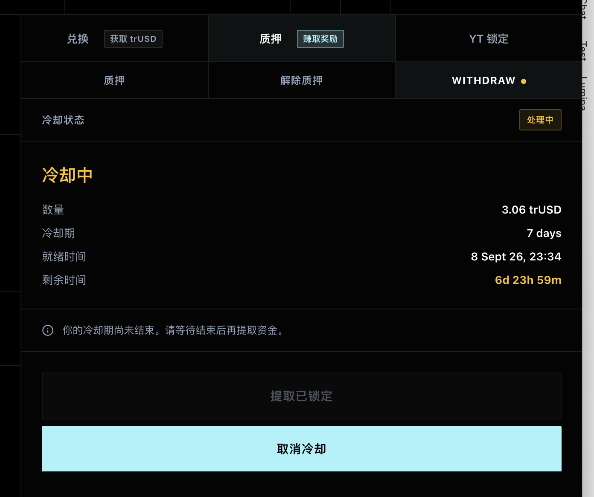
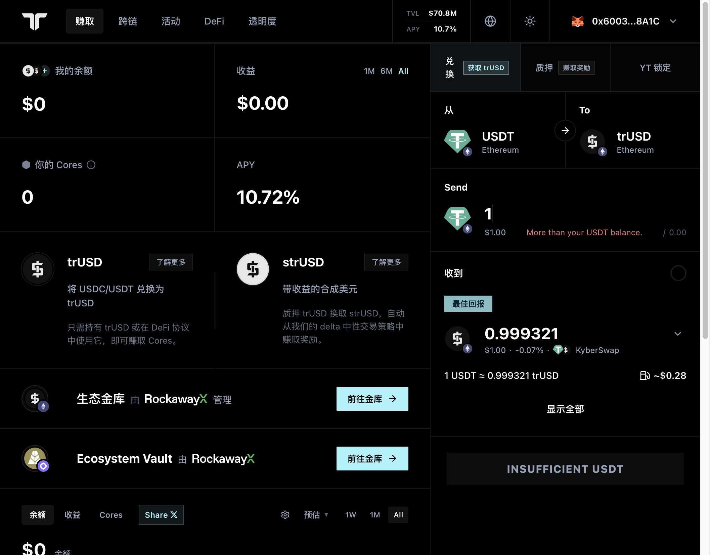
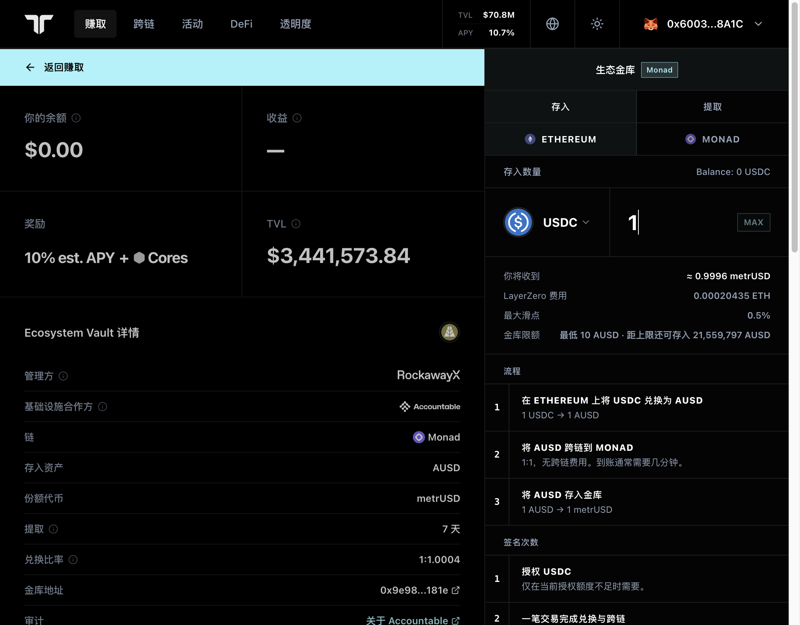

# Tori Finance（trUSD / strUSD）— Ethereum

> **链**：Ethereum（chainId 1） ｜ 浏览器 https://eth.blockscout.com
> **调研日期**：2026-09-01 本人实测，2026-10-13 补全交易类型 ｜ 本人实测与公开样本已在「来源」列标注；公开样本均为链上公开交易（非本人钱包），已逐条确认成功

## 合约

| 项 | 值 |
|---|---|
| 前端 | https://app.tori.finance （赚取 / 跨链 / 活动 / DeFi / 透明度） |
| trUSD | `0xd0580192E98eA6CEB9c7b6191Ed2E27560911697` |
| strUSD（质押 / 解押合约即代币本身） | `0x280839980a7eD0D7717F64125fE241012E5F5815` |
| TrUsdSilo（冷却期 trUSD 托管） | `0xF7c0d8853E69DCD37ee7599c6280d2632F3360B4` |
| Curve trUSD/USDC 池（前端兑换） | `0xb723a224c9ACF3891B20437B4d55dd45600F5FA3` |
| PendleYTLock（YT 锁定） | `0x6569C554cBf71Dfcc32aEc48B0eDd2582f5C4a96` |
| Chainlink CCIP Router（跨链） | `0x80226fc0Ee2b096224EeAc085Bb9a8cba1146f7D`（trUSD 锁入 LockRelease 池 `0x558d77ff4B6C760c1034536E379feB69dB5a96e2`） |
| 生态金库（Upshift TokenizedVault） | `0xcd69123b3FBBfC666E1f6a501da27B564C00De54`（份额 ETRUSD `0x6f20aE2C98c2D34e6A57f3411f2C5Af92E32592d`） |
| Ecosystem Vault（Monad） | Monad 上金库 `0x9e98bDA72ced55E562BEd1dCAf2b123E95eB181e`（份额 metrUSD）；Ethereum 侧经 Enso `0x00000000eFE302BEAA2b3e6e1b18d08D69a9012a` + LayerZero |

## 交易类型覆盖

| # | 交易类型 | 前端入口 | 合约 · 方法 | tx hash | 来源 |
|---|---|---|---|---|---|
| 1 | 兑换获取 trUSD（USDC→trUSD） | 赚取 → 兑换 | Curve trUSD/USDC 池 · `exchange` | [0xece57d0b3b9a430f172e77382e0c1d4df30e2cd84f9fcc497d18d579f8efc7ca](https://eth.blockscout.com/tx/0xece57d0b3b9a430f172e77382e0c1d4df30e2cd84f9fcc497d18d579f8efc7ca) | 本人实测 |
| 2 | 兑换（USDT / AUSD / strUSD → trUSD） | 赚取 → 兑换（下拉选币） | 前端向 LI.FI / Enso / KyberSwap 询价取最优，链上是聚合器路由合约 | ⬜ 无 Tori 专属合约（聚合器交易） | — |
| 3 | 质押（trUSD→strUSD） | 赚取 → 质押 → 质押 | strUSD · `deposit` | [0x58d57d11a4b199bdd5808d5995aa9c935fdbf5837803847001cc50cce79fea0b](https://eth.blockscout.com/tx/0x58d57d11a4b199bdd5808d5995aa9c935fdbf5837803847001cc50cce79fea0b) | 本人实测 |
| 4 | 解除质押（发起 7 天冷却） | 质押 → 解除质押 | strUSD · `cooldownShares`（按数量输入时为 `cooldownAssets`） | [0xbdbf713ed1e9b9264aa2746a813a585e971b02789261b71b1923bd4bda5c9434](https://eth.blockscout.com/tx/0xbdbf713ed1e9b9264aa2746a813a585e971b02789261b71b1923bd4bda5c9434) | 本人实测 |
| 5 | 冷却期满提取 trUSD | 质押 → WITHDRAW（需连钱包） | strUSD · `unstake` | [0x31b5fec2f8f23e398a722e34fed42cc43de9ed74f045eff274d98a52d9dc876e](https://eth.blockscout.com/tx/0x31b5fec2f8f23e398a722e34fed42cc43de9ed74f045eff274d98a52d9dc876e) | 公开样本 |
| 6 | 取消冷却（重新质押） | 质押 → WITHDRAW（需连钱包） | strUSD · `cancelCooldown` | [0x873e23e451263f4d1beff035079d4579c1c1bf2150802459e10483b25908f413](https://eth.blockscout.com/tx/0x873e23e451263f4d1beff035079d4579c1c1bf2150802459e10483b25908f413) | 公开样本 |
| 7 | YT 锁定（YT-strUSD→lYT-strUSD） | 赚取 → YT 锁定 | PendleYTLock · `deposit` | [0xd49d57d103e4c589539fef66e76c2af7d6b2dea9eae4cc64331da0b9b1c994ef](https://eth.blockscout.com/tx/0xd49d57d103e4c589539fef66e76c2af7d6b2dea9eae4cc64331da0b9b1c994ef) | 公开样本 |
| 8 | 领取 lYT 收益（strUSD） | YT 锁定（需连钱包） | PendleYTLock · `claimYield` | [0xb71f8293c6086e595a516dcf882ed4436a402bc5fbecd189bc19e6bfc524c73b](https://eth.blockscout.com/tx/0xb71f8293c6086e595a516dcf882ed4436a402bc5fbecd189bc19e6bfc524c73b) | 公开样本 |
| 9 | Pendle YT 收益归集（SY-strUSD 收进锁仓合约，非领给调用者） | YT 锁定 → 可领取收益旁「Sync now」（任何地址可调用） | PendleYTLock · `claimPendleYield` | [0xa7d4fd088a65c046f19027820e87ff49a15cea814416899fa962056720d04c55](https://eth.blockscout.com/tx/0xa7d4fd088a65c046f19027820e87ff49a15cea814416899fa962056720d04c55) | 公开样本 |
| 10 | 跨链 trUSD / strUSD（Ethereum→Monad） | 跨链 | CCIP Router · `ccipSend` | [0xd94697354f6d7269cf2fdb87da767c54af3303f7fffca932e8cfa68804ba1093](https://eth.blockscout.com/tx/0xd94697354f6d7269cf2fdb87da767c54af3303f7fffca932e8cfa68804ba1093) | 公开样本 |
| 11 | 生态金库存入（trUSD） | 赚取 → 生态金库 → DEPOSIT | Upshift TokenizedVault · `deposit` | [0x744263d59e642a9b47221fa6464b19ee5111a9c249015eed17d7e7620ee4b421](https://eth.blockscout.com/tx/0x744263d59e642a9b47221fa6464b19ee5111a9c249015eed17d7e7620ee4b421) | 公开样本 |
| 12 | 生态金库申请提取（7 天） | 生态金库 → WITHDRAW | Upshift TokenizedVault · `requestRedeem` | [0x3da4af13db5194edbdca5a3bf5e7f10b3bc2ad8219f617648e476575730911cd](https://eth.blockscout.com/tx/0x3da4af13db5194edbdca5a3bf5e7f10b3bc2ad8219f617648e476575730911cd) | 公开样本 |
| 13 | 生态金库到期领取 | 生态金库 → WITHDRAW（需连钱包） | Upshift TokenizedVault · `claim` | [0x103fd6db2170ff1679b71bf043f4505122447bbd82f92ede317679e49ec2397a](https://eth.blockscout.com/tx/0x103fd6db2170ff1679b71bf043f4505122447bbd82f92ede317679e49ec2397a) | 公开样本 |
| 14 | Monad 生态金库从 Ethereum 存入（USDC/USDT→AUSD 并跨链） | 赚取 → Ecosystem Vault（Monad）→ 存入 → ETHEREUM | Ethereum 侧一笔完成：Enso 路由换 AUSD + LayerZero 跨链到 Monad 金库 | ⬜ 无样本（最低存入 10 AUSD，测试账户余额不足） | — |

页面有入口但**不产生 Tori 交易**：活动（Cores 积分、推荐，链下）、DeFi（Morpho / Pendle / Curve / Fluid 等外链）、透明度（数据页）、YT 锁定里的「买入」（跳 Pendle）。

## 截图

**前端页面**

| 兑换（本人） | 质押（本人） |
|:-:|:-:|
|  |  |
| **解除质押后 WITHDRAW · 冷却中 7 天（本人）** | **解除质押 / WITHDRAW（未连钱包）** |
|  |  |
| **YT 锁定** | **跨链** |
|  |  |
| **生态金库（Upshift）** | **Ecosystem Vault（Monad）** |
|  |  |
| **DeFi（外链，无 Tori 交易）** | **活动（Cores 积分，链下）** |
|  |  |

**交易详情（每类一张，均为 Blockscout）**

| 1 兑换 · 本人（`0xece57d…`） | 3 质押 · 本人（`0x58d57d…`） |
|:-:|:-:|
|  |  |
| **4 发起冷却 · 本人（`0xbdbf71…`）** | **5 冷却后提取（`0x31b5fe…`）** |
|  |  |
| **6 取消冷却（`0x873e23…`）** | **7 YT 锁定（`0xd49d57…`）** |
|  |  |
| **8 领取 lYT 收益（`0xb71f82…`）** | **9 Pendle YT 收益归集（`0xa7d4fd…`）** |
|  |  |
| **10 跨链（`0xd94697…`）** | **11 金库存入（`0x744263…`）** |
|  |  |
| **12 金库申请提取（`0x3da4af…`）** | **13 金库到期领取（`0x103fd6…`）** |
|  |  |

**连钱包确认**

| 2 USDT 兑换报价（KyberSwap 路由） | 14 Monad 金库从 Ethereum 存入流程 |
|:-:|:-:|
|  |  |

## 开发注意

- **兑换不是 Tori 自有铸币合约**：USDC→trUSD 走 Curve 池 `0xb723a224…` 的 `exchange`（看 `TokenExchange` 事件 + 池地址）；其他币种走 LI.FI / Enso / KyberSwap 聚合器。trUSD 合约的 `mint`/`redeem` 仅供机构直铸，前端不走。
- **strUSD 解押两段式、7 天冷却**：`cooldownShares`/`cooldownAssets` 时 strUSD 立即销毁、trUSD 转入 TrUsdSilo，7 天后 `unstake` 才从 Silo 付给用户；`cancelCooldown` 把 Silo 里的 trUSD 重新铸回 strUSD。中间需要「冷却中」状态。
- **strUSD 是 NAV 累积型收益代币**（汇率约 1 strUSD ≈ 1.0187 trUSD，收益体现在汇率）；生态金库是独立的 Upshift 金库（份额 ETRUSD），与 strUSD 是两套。

## 待确认

- 兑换其他币种（#2）的聚合器交易是否纳入解析范围
- Monad 生态金库（#14）跨链存入是否纳入解析，以及以 Ethereum 侧还是 Monad 侧为准
- YT 锁定线（#7～9）是否纳入解析范围
