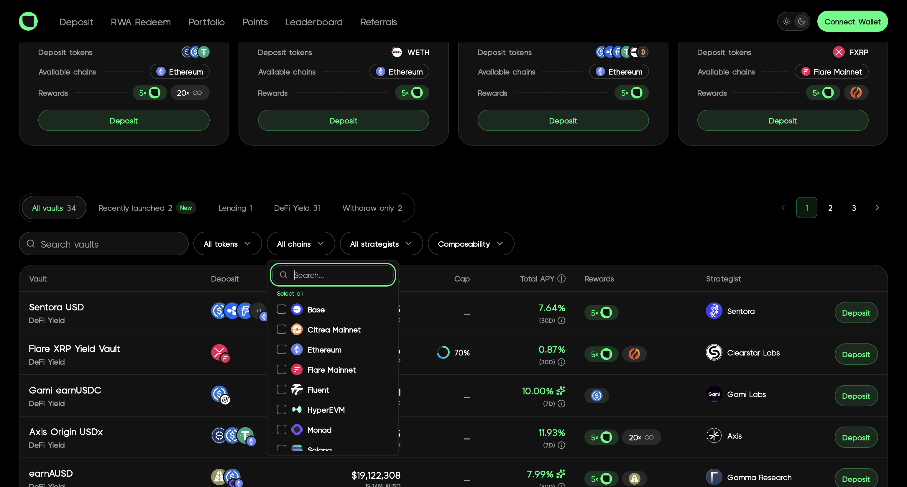
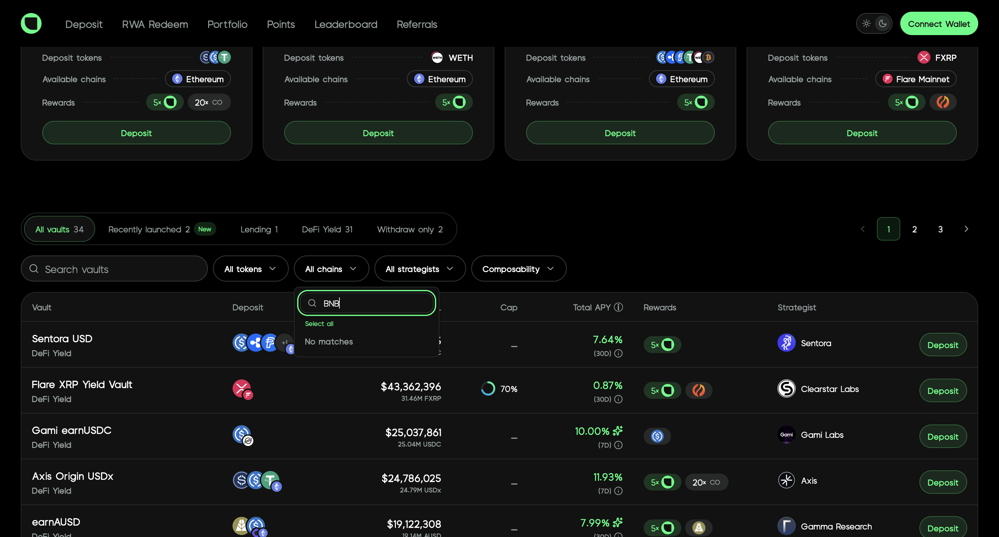
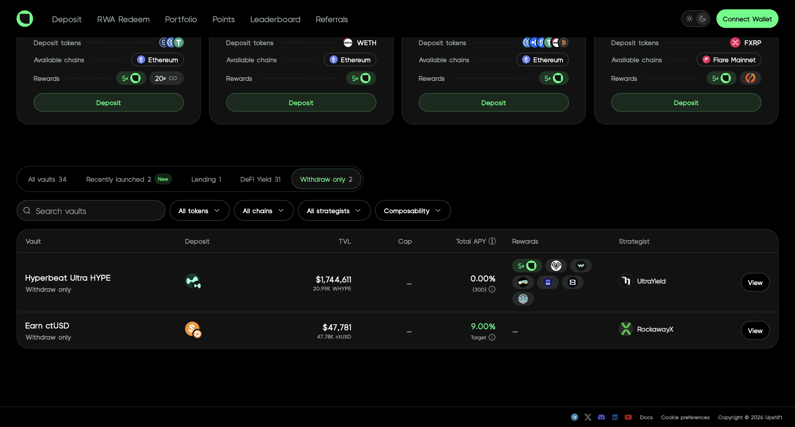
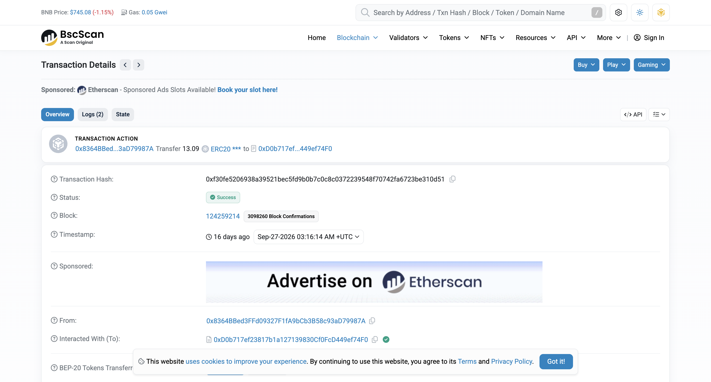
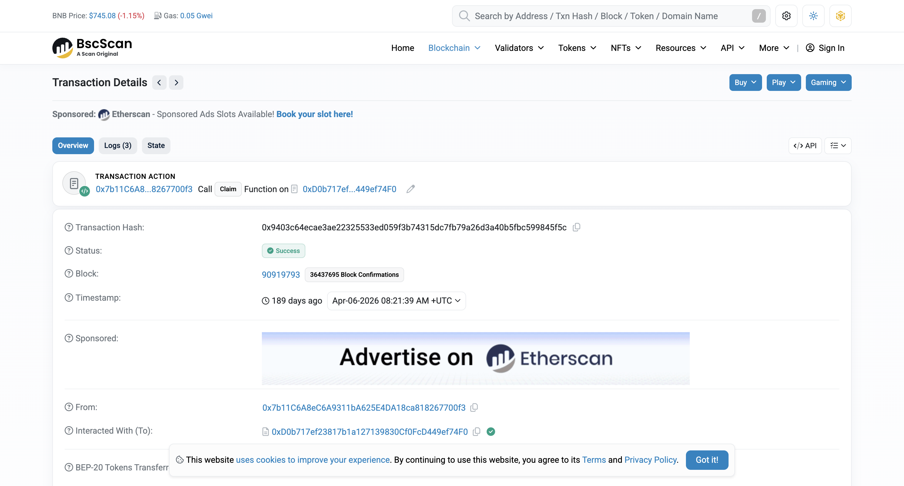
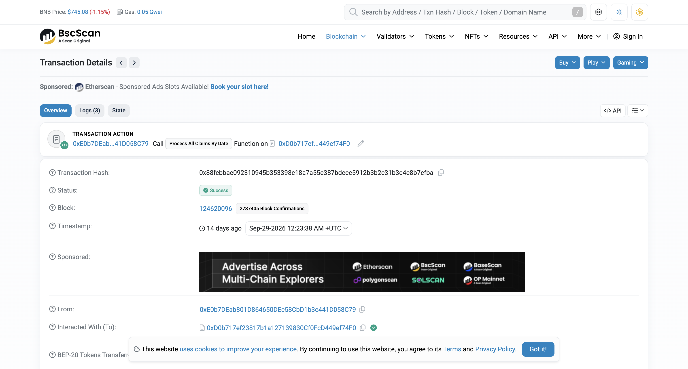

# Upshift — BSC 调研

> **链**：BNB Smart Chain ｜ chainId **56** ｜ 浏览器 https://bscscan.com
> **调研日期**：2026-10-13 ｜ hash 均为链上公开交易（非本人钱包），已逐条确认成功

## 结论：Upshift 前端目前不支持 BSC

| 依据 | 现状（2026-10-13） |
|---|---|
| 前端链筛选 | https://app.upshift.finance 「All chains」只列出 Base / Citrea / Ethereum / Flare / Fluent / HyperEVM / Monad / Solana / Stellar，搜 `BNB` 返回 No matches；「Withdraw only」页的 2 个金库也都不在 BSC |
| 官方金库 API | `api.augustdigital.io/api/v1/tokenized_vault` 中 chain=56 只有 2 个金库，`is_visible` 都是 **false**（前端隐藏）：① Sienna USDT Tulipa，`status=closed`、`withdrawal_only=true`；② HYBOND Earn Vault，`status=active`，TVL 约 $0.5（2026-08-26 上线，像是测试金库） |
| DefiLlama | `chainTvls.Binance` 2025-04-24 起有数据，2025-04～07 约 $1.0M，2025-08 降到约 $1 万，2026-07 起为 **$0** |

**结论**：BSC 上的 Upshift 金库只剩链上合约，前端没有入口。下面的合约和交易仅供参考：Sienna 金库到 2026-09 仍有用户直接调合约申请赎回，这些交易能在链上看到。

## 合约（均为前端隐藏金库）

| 项 | 值 |
|---|---|
| 前端 | 无（链筛选里没有 BSC；`/vaults/bsc/...` 路径均为 404） |
| Sienna USDT Tulipa（v1 tokenizedVault，已关闭） | `0xD0b717ef23817b1a127139830Cf0FcD449ef74F0`（份额代币就是金库本身 `sUSDT`；底层 USDT `0x55d398326f99059fF775485246999027B3197955`） |
| HYBOND Earn Vault（v2 multiAssetVault，隐藏） | `0x6288f4549d4826b76d91Cf6bc3ae2498168406bE`（份额代币 `earnHYBOND` `0x20ec92568a76c9aca65f3bb3d973695a3be6fb7c`，是独立合约；存入资产 USDC `0x8AC76a51cc950d9822D68b83fE1Ad97B32Cd580d`） |

### 交易类型覆盖

Sienna 金库共 1,487 笔交易（BscScan 全量）：Deposit 850 / Request Redeem 348 / Process All Claims By Date 143 / Claim 10，其余是管理操作（Charge Management Fee、Withdraw From Subaccount、Update Total Assets 等）。HYBOND 金库共 50 笔，其中 47 笔是收管理费，用户侧交易只有 1 组存入、赎回、处理。

| # | 交易类型 | 前端入口 | 合约 · 方法 | tx hash | 来源 |
|---|---|---|---|---|---|
| 1 | 存入 | 无（金库已隐藏） | Sienna · `deposit(uint256,address)`（事件 `Deposit`） | [0x974e345cb94658208cebf754ad850e7d3609719b41eb62930f3beed7891b9e44](https://bscscan.com/tx/0x974e345cb94658208cebf754ad850e7d3609719b41eb62930f3beed7891b9e44) | 公开样本 |
| | 存入（v2 金库，多资产版） | 无 | HYBOND · `deposit(address,uint256,address)` | [0xe3fd0696e4f1e9af2e59ff8df2a329c46c68791022e8441c412c7f0c329f93c3](https://bscscan.com/tx/0xe3fd0696e4f1e9af2e59ff8df2a329c46c68791022e8441c412c7f0c329f93c3) | 公开样本 |
| 2 | 申请赎回（进入排队） | 无（金库已隐藏） | Sienna · `requestRedeem(uint256,address,address)`（事件 `WithdrawalRequested`） | [0xf30fe5206938a39521bec5fd9b0b7c0c8c0372239548f70742fa6723be310d51](https://bscscan.com/tx/0xf30fe5206938a39521bec5fd9b0b7c0c8c0372239548f70742fa6723be310d51) | 公开样本 |
| | 申请赎回（v2 金库） | 无 | HYBOND · `requestRedeem(uint256,address)` | [0x58c479b26f711485cfcc751ed4975345c78aa37a0089de156d2434961e5d8c41](https://bscscan.com/tx/0x58c479b26f711485cfcc751ed4975345c78aa37a0089de156d2434961e5d8c41) | 公开样本 |
| 3 | 用户自领赎回款 | 无（金库已隐藏） | Sienna · `claim(uint256,uint256,uint256,address)`（事件 `WithdrawalProcessed`） | [0x9403c64ecae3ae22325533ed059f3b74315dc7fb79a26d3a40b5fbc599845f5c](https://bscscan.com/tx/0x9403c64ecae3ae22325533ed059f3b74315dc7fb79a26d3a40b5fbc599845f5c) | 公开样本 |
| 4 | 运营方按日期批量兑付赎回（不经前端） | — | Sienna · `processAllClaimsByDate(uint256,uint256,uint256,uint256)`（事件 `WithdrawalProcessed`，USDT 直接转给用户） | [0x88fcbbae092310945b353398c18a7a55e387bdccc5912b3b2c31b3c4e8b7cfba](https://bscscan.com/tx/0x88fcbbae092310945b353398c18a7a55e387bdccc5912b3b2c31b3c4e8b7cfba) | 公开样本 |
| | 批量兑付（v2 金库） | — | HYBOND · 同名方法 | [0x93dfdd70d9ed3395ac36909313739c38115f59b1c40f8a900da5568b167ca76c](https://bscscan.com/tx/0x93dfdd70d9ed3395ac36909313739c38115f59b1c40f8a900da5568b167ca76c) | 公开样本 |

前端 Points / Leaderboard / Referrals 是链下积分，不上链；RWA Redeem 页里的金库都不在 BSC。

### 截图

**前端（证明前端没有 BSC）**

| 链筛选（无 BSC） | 搜 BNB → No matches |
|:-:|:-:|
|  |  |
| **Withdraw only（2 个金库，均不在 BSC）** | |
|  | |

**交易详情（BscScan，Sienna 金库）**

| 1 存入（`0x974e34…`） | 2 申请赎回（`0xf30fe5…`） |
|:-:|:-:|
|  |  |
| **3 领取赎回（`0x9403c6…`）** | **4 批量兑付（`0x88fcbb…`）** |
|  |  |

### 开发注意

1. 赎回分两步：`requestRedeem` 只会烧掉份额、发 `WithdrawalRequested`，用户这时还没拿到 USDT；钱到账是在后面的 `claim`（用户自己领）或 `processAllClaimsByDate`（运营方批量发，`from` 不是用户）。赎回金额要按 `WithdrawalProcessed` 事件算。
2. v1 和 v2 金库接口不一样：v1 Sienna 的份额代币就是金库地址，`deposit(uint256,address)`；v2 HYBOND 的份额是独立 ERC20（`0x20ec92…`），`deposit(address asset,uint256,address)` 要多传资产地址。

### 待确认

1. 两个金库都没有上前端，BSC 还要不要接入？建议和需求方确认是否先不做，或者只做历史数据。
2. HYBOND Earn Vault 状态是 `active` 但被隐藏，TVL 只有 $0.5，后面会不会正式上线还不确定。
