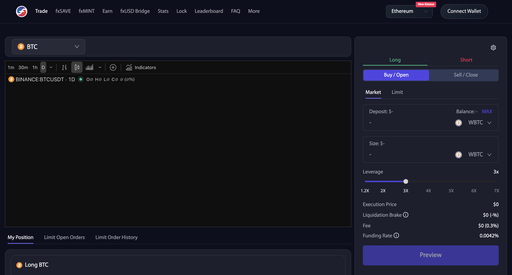
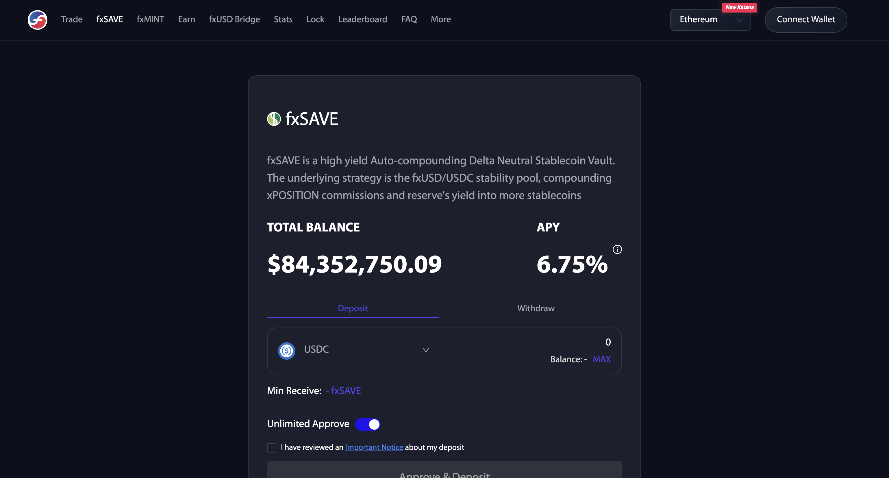
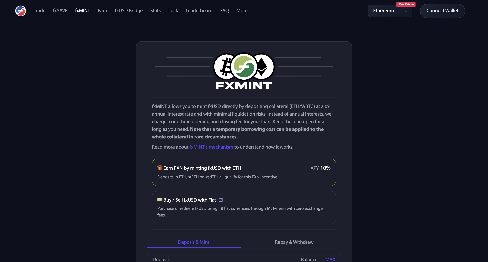
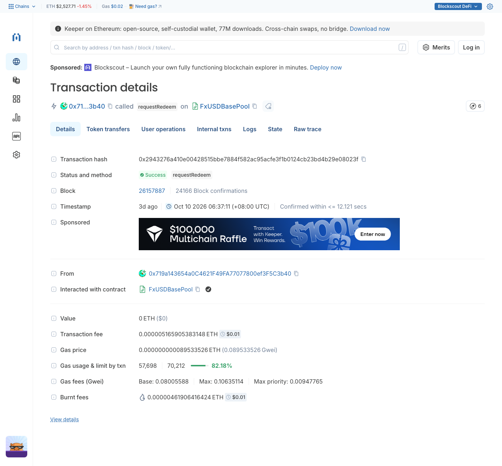

# f(x) Protocol — fxUSD（杠杆 + 稳定币）· Ethereum

> **状态**：✅ 交易类型覆盖已补全（2026-10-13）：30 类上链交易，29 类有 hash + 交易截图（含本人 9/1 实测 5 类），1 类 ⬜（Privacy Pools 隐私存入）；前端 9 张页面截图
> **交付口径**：覆盖页面可点击的全部交易类型 + 给哈希 + 截图 + 背景信息；**链上解析由解析同学做，本页不做深度解析**
> **目标链**：**Ethereum**

## 交易类型覆盖（2026-10-13）

前端导航：Trade（Long / Short × Market / Limit，持仓面板）/ fxSAVE（Deposit / Withdraw）/ fxMINT（Deposit & Mint / Repay & Withdraw）/ Earn（稳定池 Gauge、Curve LP Gauge、FX² 自动复利池）/ fxUSD Bridge / Stats / Lock / Leaderboard / FAQ。共 30 类上链，29 类有 hash（已逐条确认成功且日志里有对应事件），1 类 ⬜。

| # | 交易类型 | 前端入口 | 合约 · 方法 | tx hash |
|---|---|---|---|---|
| 1 | Trade 开多 / 加仓（含加保证金、调杠杆） | Trade → Long → Buy/Open（Market） | Router Diamond `0x33636D49FbefBE798e15e7F356E8DBef543CC708` · `openOrAddPositionFlashLoanV2` | [0x24acba5528caa8d0507bf7a82f132e22c7c3cdd89cc646bd3a5c4724804ad91e](https://etherscan.io/tx/0x24acba5528caa8d0507bf7a82f132e22c7c3cdd89cc646bd3a5c4724804ad91e)（本人实测） |
|  | fxMINT 页用 USDC 铸 fxUSD（链上为 WBTCLongPool 开仓，与 Trade 开多同一方法同一池） | fxMINT → Deposit & Mint（USDC） | 同上 | [0x9a2c7ec339f1a624909f6186b0fa81c4a0513a2dbbc2891900b6fb98daaf7d72](https://etherscan.io/tx/0x9a2c7ec339f1a624909f6186b0fa81c4a0513a2dbbc2891900b6fb98daaf7d72)（本人实测） |
| 2 | Trade 平多 / 减仓 | Trade → Long → Sell/Close；持仓面板（需连钱包） | Router Diamond `0x33636D49FbefBE798e15e7F356E8DBef543CC708` · `closeOrRemovePositionFlashLoanV2` | [0xa5b2a21cffa3df6d2695dce7e7f34366afd74e9edac44ba775ea7bb52e801c77](https://etherscan.io/tx/0xa5b2a21cffa3df6d2695dce7e7f34366afd74e9edac44ba775ea7bb52e801c77)（公开样本） |
| 3 | Trade 开空 / 加仓 | Trade → Short → Buy/Open | Router Diamond `0x33636D49FbefBE798e15e7F356E8DBef543CC708` · `openOrAddShortPositionFlashLoan` | [0x5ffed9f47cdd139b67f3e054c8c05a9f27e94e70df9629396a331bdf3c7aa8e4](https://etherscan.io/tx/0x5ffed9f47cdd139b67f3e054c8c05a9f27e94e70df9629396a331bdf3c7aa8e4)（公开样本） |
| 4 | Trade 平空 / 减仓 | Trade → Short → Sell/Close（需连钱包） | Router Diamond `0x33636D49FbefBE798e15e7F356E8DBef543CC708` · `closeOrRemoveShortPositionFlashLoan` | [0x44497c1fd08d4289369d614f3bac60a9d9f989f571b4b01492799ad88bf476be](https://etherscan.io/tx/0x44497c1fd08d4289369d614f3bac60a9d9f989f571b4b01492799ad88bf476be)（公开样本） |
| 5 | 限价单撤单 | Trade → Limit Open Orders（需连钱包） | LimitOrderManager `0x112873b395B98287F3A4db266a58e2D01779Ad96` · `cancelOrder` | [0x267f06a93b87a37fe1a6a1577bcb0ab3afabff52adb2de44aa50a7f44e0bcd9e](https://etherscan.io/tx/0x267f06a93b87a37fe1a6a1577bcb0ab3afabff52adb2de44aa50a7f44e0bcd9e)（公开样本） |
| 6 | fxSAVE 存入 | fxSAVE → Deposit | Router Diamond `0x33636D49FbefBE798e15e7F356E8DBef543CC708` · `depositToFxSave` | [0x1f3ccd1d471165c2e2de204cab4cb7627a558b57e222a7eb8eddc27f61e4d353](https://etherscan.io/tx/0x1f3ccd1d471165c2e2de204cab4cb7627a558b57e222a7eb8eddc27f61e4d353)（本人实测） |
| 7 | fxSAVE 取出-申请（排队） | fxSAVE → Withdraw（不勾 1% 立即到账） | fxSAVE `0x7743e50F534a7f9F1791DdE7dCD89F7783Eefc39` · `requestRedeem` | [0x4a29e2dedeba98cb12c95b1f4354e5a8b74e02420ca5790f2e2bc9be6b49aa08](https://etherscan.io/tx/0x4a29e2dedeba98cb12c95b1f4354e5a8b74e02420ca5790f2e2bc9be6b49aa08)（公开样本） |
| 8 | fxSAVE 取出-到期领取（fxUSD + USDC） | fxSAVE → Withdraw（需连钱包） | fxSAVE · `claim` | [0x7cbba15d96863112ea6f0a85dec8feb1524ba56b20fb33a55bc882e003a86303](https://etherscan.io/tx/0x7cbba15d96863112ea6f0a85dec8feb1524ba56b20fb33a55bc882e003a86303)（公开样本） |
|  | fxSAVE 取出-到期领取并换成单币 | 同上 | Router Diamond `0x33636D49FbefBE798e15e7F356E8DBef543CC708` · `redeemFromFxSave` | [0xe4ab7bf3914246946eb2d50d9496010a3b59b6b9125a45df9dc69a5e4330a346](https://etherscan.io/tx/0xe4ab7bf3914246946eb2d50d9496010a3b59b6b9125a45df9dc69a5e4330a346)（公开样本） |
| 9 | fxSAVE 立即取出（付 1%） | fxSAVE → Withdraw（勾选 1% 立即到账） | Router Diamond `0x33636D49FbefBE798e15e7F356E8DBef543CC708` · `instantRedeemFromFxSave` | [0xe0be51062ab44dc46ce66e3894fa3bd64945c90bec2dd2e1f8e5ef9f48182a50](https://etherscan.io/tx/0xe0be51062ab44dc46ce66e3894fa3bd64945c90bec2dd2e1f8e5ef9f48182a50)（公开样本） |
| 10 | fxMINT 存抵押铸 fxUSD | fxMINT → Deposit & Mint | FxMintRouter `0xB753366082466c4B5984312f0c4Bb97554be067E` · `borrowFromLong` | [0xc918919b5642b2fda9bb627a918374a67323ceddf771ed97c493d73a1ecfd8b4](https://etherscan.io/tx/0xc918919b5642b2fda9bb627a918374a67323ceddf771ed97c493d73a1ecfd8b4)（本人实测） |
| 11 | fxMINT 还款取回抵押 | fxMINT → Repay & Withdraw | FxMintRouter · `repayToLong` | [0xef57c08cb79dd10ff66b427ecaf11416a919ed794d91db8f503e859ddfe5f2c4](https://etherscan.io/tx/0xef57c08cb79dd10ff66b427ecaf11416a919ed794d91db8f503e859ddfe5f2c4)（公开样本） |
|  | fxMINT 还款并换出其他币 | 同上 | FxMintRouter · `repayToLongAndZapOut` | [0x29a7bd44a210150cb3b4cbd558f23994ac94290ece2e91a0705857ce5ec44000](https://etherscan.io/tx/0x29a7bd44a210150cb3b4cbd558f23994ac94290ece2e91a0705857ce5ec44000)（公开样本） |
| 12 | Earn 稳定池存入（USDC/fxUSD → fxSP → 质押 Gauge） | Earn → fxUSD Stability Pool Gauge → Deposit | Router Diamond `0x33636D49FbefBE798e15e7F356E8DBef543CC708` · `depositToFxBaseGaugeV2` | [0xd0b2db450f4903f06b09a3adbcb4985cbdfe92773443d60f9e437c4c3ba19416](https://etherscan.io/tx/0xd0b2db450f4903f06b09a3adbcb4985cbdfe92773443d60f9e437c4c3ba19416)（本人实测） |
|  | Earn 稳定池存入（已有 fxSP 直接质押） | 同上 | fxSP Gauge `0xEd92dDe3214c24Ae04F5f96927E3bE8f8DbC3289` · `deposit` | [0xc799fc5040781a79ed1fa91a2befddbd3e817202fb9f3501684cea5a92f43283](https://etherscan.io/tx/0xc799fc5040781a79ed1fa91a2befddbd3e817202fb9f3501684cea5a92f43283)（公开样本） |
| 13 | Earn 稳定池解押（Gauge → fxSP） | 同上 → Withdraw | fxSP Gauge · `withdraw` | [0x53f3a8c14871d2b87ec6ba9c80ee9b3237aca8197a836a7f166e4b15223994ee](https://etherscan.io/tx/0x53f3a8c14871d2b87ec6ba9c80ee9b3237aca8197a836a7f166e4b15223994ee)（本人实测） |
| 14 | Earn 稳定池赎回-申请（排队 60 分钟） | 同上 → Withdraw（默认） | fxSP `0x65C9A641afCEB9C0E6034e558A319488FA0FA3be` · `requestRedeem` | [0x2943276a410e00428515bbe7884f582ac95acfe3f1b0124cb23bd4b29e08023f](https://etherscan.io/tx/0x2943276a410e00428515bbe7884f582ac95acfe3f1b0124cb23bd4b29e08023f)（公开样本） |
| 15 | Earn 稳定池赎回-到期领取 | 同上（需连钱包） | fxSP · `redeem` | [0x03598b42155155ca0daf2615a8ec3070541ea9ec19bd69304f346d530f97a43f](https://etherscan.io/tx/0x03598b42155155ca0daf2615a8ec3070541ea9ec19bd69304f346d530f97a43f)（公开样本） |
| 16 | Earn 稳定池立即赎回（付 1%） | 同上 → Withdraw（勾选 1%） | fxSP · `instantRedeem` | [0x26f8b52934449d8b881aa9fade85b3470395fc39955b65b237a8cf7eeafd6df8](https://etherscan.io/tx/0x26f8b52934449d8b881aa9fade85b3470395fc39955b65b237a8cf7eeafd6df8)（公开样本） |
| 17 | Earn 稳定池领奖励（wstETH + FXN） | 同上 → Claim Rewards | fxSP Gauge · `claim` | [0xa6e175833035e6914e073990f2a518b10deb7e99713fc2404731f768e9fb3a3c](https://etherscan.io/tx/0xa6e175833035e6914e073990f2a518b10deb7e99713fc2404731f768e9fb3a3c)（公开样本） |
| 18 | Earn Curve LP 质押（示例 ETH+fxUSD） | Earn → Curve 池行 → Deposit | LP Gauge `0x288810cdbdFEd9EA3Be3cA4E421Ab795FD0669f3` · `deposit`（每个池子各有 Gauge） | [0xc1577311f86b080f930734402ec67c36e1e0b973e0b03860b3b9efb45fba1ac3](https://etherscan.io/tx/0xc1577311f86b080f930734402ec67c36e1e0b973e0b03860b3b9efb45fba1ac3)（公开样本） |
| 19 | Earn Curve LP 解押 | 同上 → Withdraw | LP Gauge · `withdraw` | [0x7393d29b9064fbc775ed0fc2a34c0e14735c8df32337097b82b2c85095f6aba2](https://etherscan.io/tx/0x7393d29b9064fbc775ed0fc2a34c0e14735c8df32337097b82b2c85095f6aba2)（公开样本） |
| 20 | Earn 领 FXN（LP Gauge 排放） | 同上 → Claim FXN | TokenMinter `0xC8b194925D55d5dE9555AD1db74c149329F71DeF` · `mint` | [0x50ad16ea39e59196a2dbe538060c590624e34cb00ce5feb885687c001b75c638](https://etherscan.io/tx/0x50ad16ea39e59196a2dbe538060c590624e34cb00ce5feb885687c001b75c638)（公开样本） |
| 21 | Earn FX² cvxFXN 自动复利池存入 | Earn → FX² Autocompounding Pool | aFXN `0x00Bac667a4cCf9089aB1Db978238C555C4349545` · `deposit`（另有 `depositWithFXN` / `depositWithStkCvxFxn`） | [0xc49f1cd8fc661fc8d6645fa1fa59ac8928bcf37caea941737960f25c807881ae](https://etherscan.io/tx/0xc49f1cd8fc661fc8d6645fa1fa59ac8928bcf37caea941737960f25c807881ae)（公开样本） |
| 22 | Earn FX² 赎回 | 同上 | aFXN · `redeem` | [0x24afa0db445dc882b064340d89bb75b790c6dd034d91319b6d0aa5910b2455f8](https://etherscan.io/tx/0x24afa0db445dc882b064340d89bb75b790c6dd034d91319b6d0aa5910b2455f8)（公开样本） |
| 23 | Lock 创建 veFXN 锁仓 | Lock → Create Lock | veFXN `0xEC6B8A3F3605B083F7044C0F31f2cac0caf1d469` · `create_lock` | [0x7aa70b9f66019b618d2d1bc82d199ea81e8225c88ded0f00c728962fd77cfeb0](https://etherscan.io/tx/0x7aa70b9f66019b618d2d1bc82d199ea81e8225c88ded0f00c728962fd77cfeb0)（公开样本） |
| 24 | Lock 追加锁仓数量 | Lock（需连钱包） | veFXN · `increase_amount` | [0xf61df6b4af2752fe4e24f0e4a5225b5e9fd3ba7bb3e9801f4dded67d72fdc5c5](https://etherscan.io/tx/0xf61df6b4af2752fe4e24f0e4a5225b5e9fd3ba7bb3e9801f4dded67d72fdc5c5)（公开样本） |
| 25 | Lock 延长锁仓时间 | Lock（需连钱包） | veFXN · `increase_unlock_time` | [0xfc44bcc4bb30a79346003260c572d720892719ff91be49ca9aa2f84839658987](https://etherscan.io/tx/0xfc44bcc4bb30a79346003260c572d720892719ff91be49ca9aa2f84839658987)（公开样本） |
| 26 | Lock 到期提取 FXN | Lock（需连钱包） | veFXN · `withdraw` | [0x9e53d359a57ac61c2735839590c4341d661fb3e1d2696e3dd606f77027909ae8](https://etherscan.io/tx/0x9e53d359a57ac61c2735839590c4341d661fb3e1d2696e3dd606f77027909ae8)（公开样本） |
| 27 | Lock 领 wstETH 收益 | Lock → wstETH Rewards（需连钱包） | FeeDistributor `0xd116513EEa4Efe3908212AfBAeFC76cb29245681` · `claim` | [0x57e67a96fcdadb76bae879ac07a83606bc6af4b6c95965f64dfd1728ce6c9ff8](https://etherscan.io/tx/0x57e67a96fcdadb76bae879ac07a83606bc6af4b6c95965f64dfd1728ce6c9ff8)（公开样本） |
| 28 | Lock veFXN 委托（Delegation） | Lock → + New Delegation | VotingEscrowBoost `0x8Cc02c0D9592976635E98e6446ef4976567E7A81` · `boost` | [0x9cf022be81fe751a140d26c569848732b595b8ade00509b8d5932e30566e2c5a](https://etherscan.io/tx/0x9cf022be81fe751a140d26c569848732b595b8ade00509b8d5932e30566e2c5a)（公开样本，2024 年，极少用） |
| 29 | fxUSD 跨链（LayerZero OFT） | fxUSD Bridge（bridge.aladdin.club） | fxUSD OFT Adapter `0xA07d8cc424421cC2bce0544a65481376f010A438` · `send` | [0x94d11a244b7034c80861b3a77c0f651bfc9272ea3863b36e923400334200213e](https://etherscan.io/tx/0x94d11a244b7034c80861b3a77c0f651bfc9272ea3863b36e923400334200213e)（公开样本） |
| 30 | fxMINT → Privacy Pools 隐私存入 | fxMINT → Advanced | ⬜ 第三方 Privacy Pools 合约，前端需连钱包才显示目标合约，未取样 | ⬜ |

页面有入口但**不产生链上交易**：限价单挂单 / TP·SL（链下签名，由 keeper 成交；LimitOrderManager 上用户只会调 `cancelOrder` / `increaseNonce`）、Stats / Leaderboard / FAQ、fxMINT 的 Mt Pelerin 法币买卖（第三方站外）、Earn 底部 “f(x) Earn” 列表（Euler / Morpho / Fluid / Spectra 等外链）。

### 截图

**前端页面**

| Trade · Market | Trade · Limit |
|:-:|:-:|
|  |  |
| **fxSAVE · Deposit** | **fxSAVE · Withdraw（1% 立即到账开关）** |
|  |  |
| **fxMINT · Deposit & Mint** | **fxMINT · Repay & Withdraw** |
|  |  |
| **Earn** | **Lock** |
|  |  |
| **fxUSD Bridge** | **** |
|  |  |

**交易详情（每类一张，均为 Blockscout）**

| 1 开多（`0x24acba…`） | 2 平多（`0xa5b2a2…`） |
|:-:|:-:|
|  |  |
| **3 开空（`0x5ffed9…`）** | **4 平空（`0x44497c…`）** |
|  |  |
| **5 限价撤单（`0x267f06…`）** | **6 fxSAVE 存入（`0x1f3ccd…`）** |
|  |  |
| **7 fxSAVE 申请取出（`0x4a29e2…`）** | **8 fxSAVE 到期领取（`0x7cbba1…`）** |
|  |  |
| **8 fxSAVE 领取换单币（`0xe4ab7b…`）** | **9 fxSAVE 立即取出（`0xe0be51…`）** |
|  |  |
| **10 fxMINT 铸造（`0xc91891…`）** | **11 fxMINT 还款提取（`0xef57c0…`）** |
|  |  |
| **12 稳定池存入（`0xd0b2db…`）** | **13 稳定池解押（`0x53f3a8…`）** |
|  |  |
| **14 稳定池申请赎回（`0x294327…`）** | **15 稳定池到期赎回（`0x03598b…`）** |
|  |  |
| **16 稳定池立即赎回（`0x26f8b5…`）** | **17 稳定池领奖励（`0xa6e175…`）** |
|  |  |
| **18 LP 质押（`0xc15773…`）** | **19 LP 解押（`0x7393d2…`）** |
|  |  |
| **20 领 FXN（`0x50ad16…`）** | **21 aFXN 存入（`0xc49f1c…`）** |
|  |  |
| **22 aFXN 赎回（`0x24afa0…`）** | **23 创建锁仓（`0x7aa70b…`）** |
|  |  |
| **24 追加锁仓（`0xf61df6…`）** | **25 延长锁仓（`0xfc44bc…`）** |
|  |  |
| **26 锁仓到期提取（`0x9e53d3…`）** | **27 领 veFXN 收益（`0x57e67a…`）** |
|  |  |
| **28 veFXN 委托（`0x9cf022…`）** | **29 fxUSD 跨链（`0x94d11a…`）** |
|  |  |

⚠️ 开发注意：
- **Trade / fxSAVE / 稳定池存入大多走同一个 Router Diamond `0x33636D49…`，只能按方法名区分**；Trade 开多与 fxMINT 页 USDC 铸 fxUSD（`0x9a2c7e…`）链上同为 `openOrAddPositionFlashLoanV2`，多空与标的看目标池（WBTCLongPool `0xAB709e26Fa6B0A30c119D8c55B887DeD24952473` / WstETHLongPool `0x6Ecfa38FeE8a5277B91eFdA204c235814F0122E8` / 两个 ShortPool），加仓、加保证金、调杠杆复用 open/close 两个方法；fxMINT 页自己的铸造 / 还款走 FxMintRouter `0xB7533660…`。
- **取出都有“排队 / 付 1% 立即到账”两条路**：稳定池 fxSP 是 `requestRedeem`（60 分钟）→ `redeem`，或 `instantRedeem`；fxSAVE 是 `requestRedeem` → `claim`（或 Router `redeemFromFxSave` 领取后换单币），或 Router `instantRedeemFromFxSave`。

## 0. 一句话说明

f(x) Protocol（Aladdin DAO 旗下）是链上交易平台：一边给 ETH/WBTC 提供**无爆仓压力的杠杆**，一边给稳定币持有人**可持续收益**。核心稳定币是 **fxUSD**，另有稳定池 fxSP。

## 1. 基础信息

| 字段 | 值 |
|------|-----|
| 协议 | f(x) Protocol（Aladdin DAO / aladdin.club） |
| 链 | **Ethereum** |
| **操作入口** | https://fx.aladdin.club |
| **fxUSD** | `0x085780639CC2cACd35E474e71f4d000e2405d8f6`（symbol fxUSD / name f(x) USD） |
| fxSP（稳定池） | `0x65C9A641afCEB9C0E6034e558A319488FA0FA3be`（symbol fxSP / f(x) Stability Pool） |
| 底层敞口 | ETH / WBTC |
| 接入情况 | 待定 |

## 2. 操作清单（页面可点击）

| # | 操作 | 说明 |
|---|------|------|
| 1 | **Mint fxUSD** | 存抵押铸稳定币 |
| 2 | **Redeem fxUSD** | 赎回 |
| 3 | **开杠杆头寸** | ETH/WBTC 杠杆（无爆仓压力） |
| 4 | **稳定池 fxSP 存/取** | 稳定币赚收益 |

## 2.1 ✅ 本人实测（2026-09-01）—— 四条产品线全覆盖

f(x) 页面导航：**Trade（杠杆）/ fxSAVE / fxMINT / Earn / fxUSD Bridge / Lock / …**。本次实测覆盖 Earn、fxSAVE、Trade 杠杆、fxMINT 四条。

| # | 时间(UTC) | 产品线 | 操作 | tx hash | 结果 |
|:---:|------|------|------|---------|------|
| 1 | 15:37:47 | Earn | **approve USDC** | `0x0849c865d7dd554ed287f3f182ea528e6b1688481c9a4c523a4f0acfeb9a7bb6` | 前置 |
| 2 | 15:38:11 | Earn | **质押到 fxUSD Stability Pool Gauge**（Approve&Deposit&Stake，sel `0xcd20b95e`） | `0xd0b2db450f4903f06b09a3adbcb4985cbdfe92773443d60f9e437c4c3ba19416` | 10 USDC → 9.8982 fxSP + 铸 Gauge 份额，选 wstETH 收益 |
| 3 | 15:38:47 | Earn | **解押+提取**（Unstake&Withdraw，sel `0x00f714ce`） | `0x53f3a8c14871d2b87ec6ba9c80ee9b3237aca8197a836a7f166e4b15223994ee` | 烧 5 fxSP-Gauge → 退 5 fxSP |
| 4 | 15:39:11 | Earn | **稳定池申请赎回**（Stability Pool `0x65C9A641…` · `requestRedeem`，排队 60 分钟） | `0xd00239241edd6bf0fd8de7e9e0ddd089fa5d8c84930c79dbea3c56d1455819ca` | 进入赎回队列 |
| 5 | 15:41:59 | fxSAVE | **存入 fxSAVE**（sel `0x3ea34dc0`，`depositToFxSave`） | `0x1f3ccd1d471165c2e2de204cab4cb7627a558b57e222a7eb8eddc27f61e4d353` | 5 USDC → 4.4825 fxSAVE（APY 7.49%，自动复投的 delta 中性稳定币金库） |
| 6 | 15:42:59 | fxMINT | **用 USDC 铸 fxUSD**（链上：Router Diamond `0x33636D49…` · `openOrAddPositionFlashLoanV2`，WBTCLongPool 开仓） | `0x9a2c7ec339f1a624909f6186b0fa81c4a0513a2dbbc2891900b6fb98daaf7d72` | 铸 9.9985 fxUSD |
| 7 | 15:43:59 | Trade | **approve xWBTC** | `0xce0438d6d3d1b1fbd595ef3ae3a91e740b61fb774421ff05d46fd0a0dcc62f30` | 前置 |
| 8 | 15:44:11 | fxMINT | **存 WBTC 铸 fxUSD**（sel `0x216d5108`，Deposit&Mint） | `0xc918919b5642b2fda9bb627a918374a67323ceddf771ed97c493d73a1ecfd8b4` | WBTC 抵押 → 铸 1.99 fxUSD，LTV 67%→80% |

🔴 **几个链上看不出的机制**：
1. **Earn 质押是"三合一"**：approve + deposit + stake to gauge 一笔完成（sel `0xcd20b95e`），且存款时**要选收益币种**（wstETH / FXN / USD 三选一，APR 各不同）。
2. **Earn 解押/提取有 60 分钟延迟**（截图 `fx-Earn解押提取-20260901.png`）：默认排队 60 分钟，或勾选 **"付 1% 费用立即到账"**。解析要区分这两种。
3. **杠杆开仓**（Trade 页，截图 `fx-杠杆开多BTC-20260901.png`）：Long/Short BTC，杠杆 1.2x~7x，有 Liquidation Brake、Funding Rate —— 实测见追加第 10 笔 `0x24acba…`。
4. **fxMINT 有两种铸法，链上走不同合约**：用 USDC 铸（第 6 笔）= Router Diamond `openOrAddPositionFlashLoanV2`，在 WBTCLongPool 开仓（与 Trade 开多同一方法）；存 WBTC 抵押铸（第 8 笔）= FxMintRouter `0xB7533660…` · `borrowFromLong`，会显示 LTV 和 Liquidation Brake。

## 2.2 操作覆盖

| 交易类型 | 本人实测 | 公开样本 |
|---------|:---:|:---:|
| **fxMINT 用 USDC 铸 fxUSD（WBTCLongPool 开仓）** | ✅ `0x9a2c7e…` | ✅ `0x49e16d…` |
| **fxMINT 存 WBTC 铸 fxUSD** | ✅ `0xc91891…` | — |
| Redeem fxUSD | ⬜ | ✅ `0x9fb6f4…` |
| **Earn 质押（Stability Pool Gauge）** | ✅ `0xd0b2db…` | — |
| **Earn 解押+提取** | ✅ `0x53f3a8…` | — |
| **fxSAVE 存入** | ✅ `0x1f3ccd…` | — |
| fxSAVE 取出 | ⬜ | ⬜ 待补 |
| **杠杆开多（Trade，xPOSITION）** | ✅ `0x24acba…` | — |
| approve ×4 | ✅ | — |

### 追加实测（2026-09-01 16:03）
| # | 操作 | tx hash | 结果 |
|:---:|------|---------|------|
| 9 | **approve USDC**（给杠杆合约 `0x33636d49…`） | `0x400031419b0be5c6dda93c9077026eab9f6755b996ec30aad580f5bac4086314` | 前置 |
| 10 | **杠杆开多 BTC**（Trade 页 Long，5 USDC 保证金 @ 5.12x，sel `0xef9e1aa7`） | `0x24acba5528caa8d0507bf7a82f132e22c7c3cdd89cc646bd3a5c4724804ad91e` | 铸 20.619 fxUSD 建 xPOSITION 多头 |

🔴 **杠杆开多（第 10 笔）与 fxMINT 用 USDC 铸（第 6 笔）链上完全相同**：同为 Router Diamond `0x33636D49…` 的 `openOrAddPositionFlashLoanV2`（sel `0xef9e1aa7`）、同在 WBTCLongPool `0xAB709e26…` 开仓，区别只在杠杆倍数参数；fxMINT 存 WBTC 抵押铸（第 8 笔）才走 FxMintRouter `borrowFromLong`。截图 `fx-杠杆开多BTC-5x-20260901.png` 显示持仓面板有 **Repay / Add Collateral / TP/SL / Adjust Leverage** 四个管理按钮，说明杠杆头寸是可管理的独立仓位。

**页面实际导航**：Trade / fxSAVE / fxMINT / Earn / fxUSD Bridge / Lock / Stats / Leaderboard。

⚠️ 还差：**杠杆平仓 / Repay / Add Collateral**、fxSAVE 取出、fxUSD 赎回。

## 3. 待确认清单

| # | 问题 | 怎么查 |
|---|------|--------|
| 1 | 杠杆头寸是 NFT 还是账户记录 | 实测 |
| 2 | fxUSD 铸造接受哪些抵押（ETH/WBTC/稳定币） | 页面 |
| 3 | fxSP 稳定池凭证机制 | 实测 |
