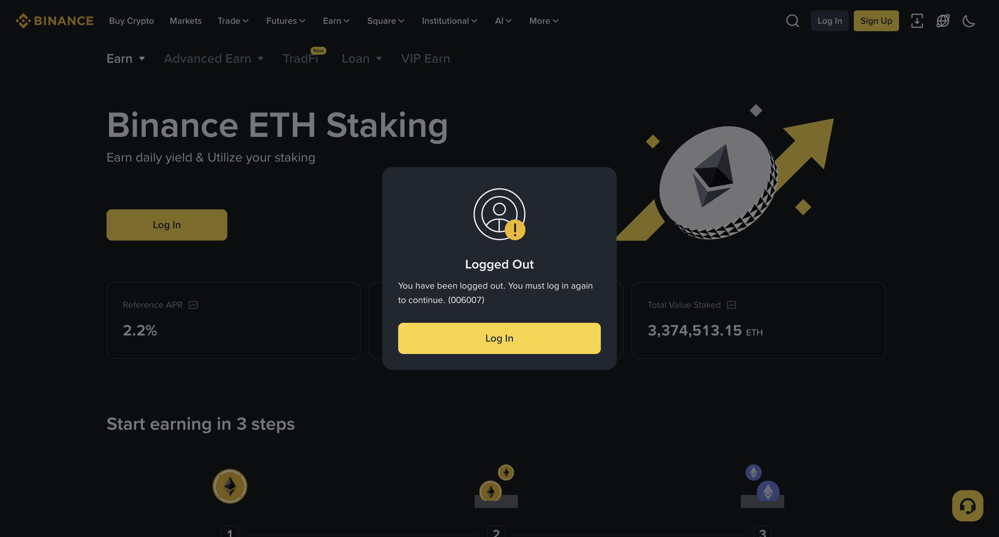
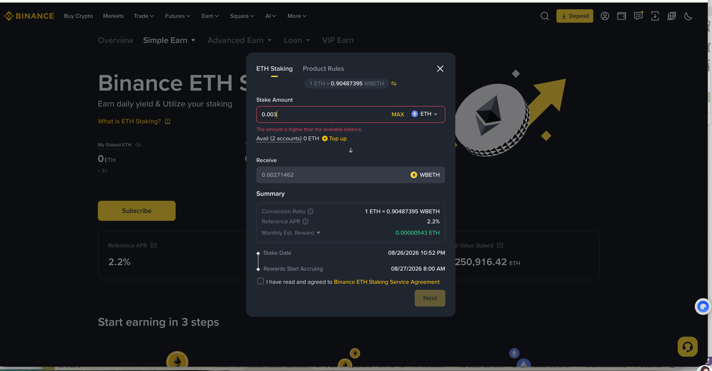
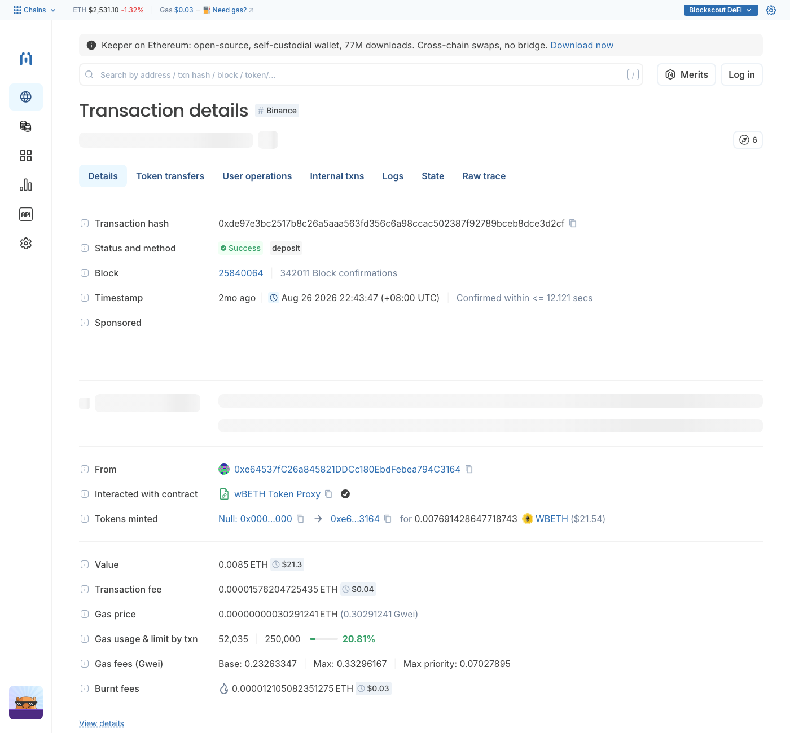
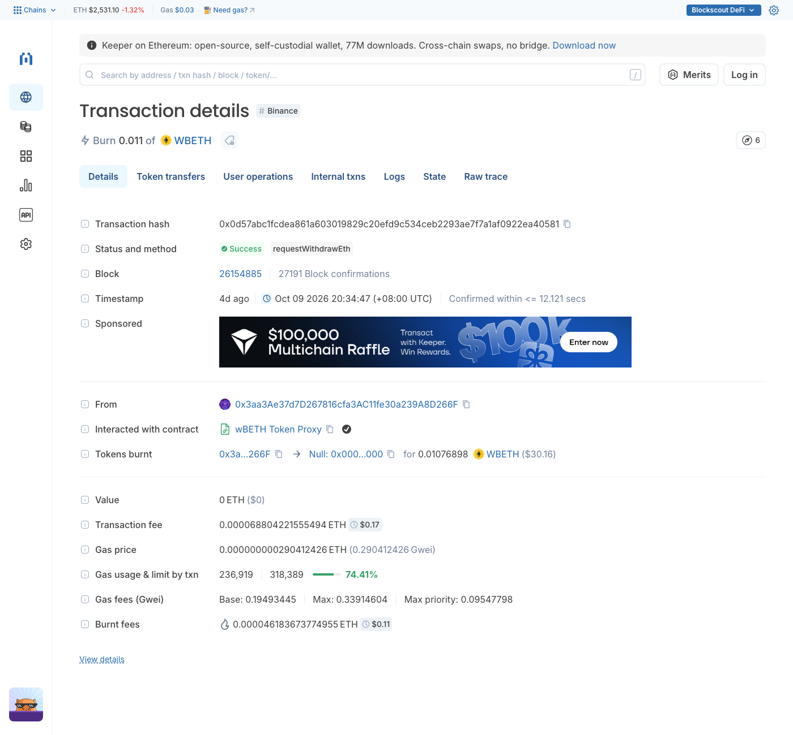
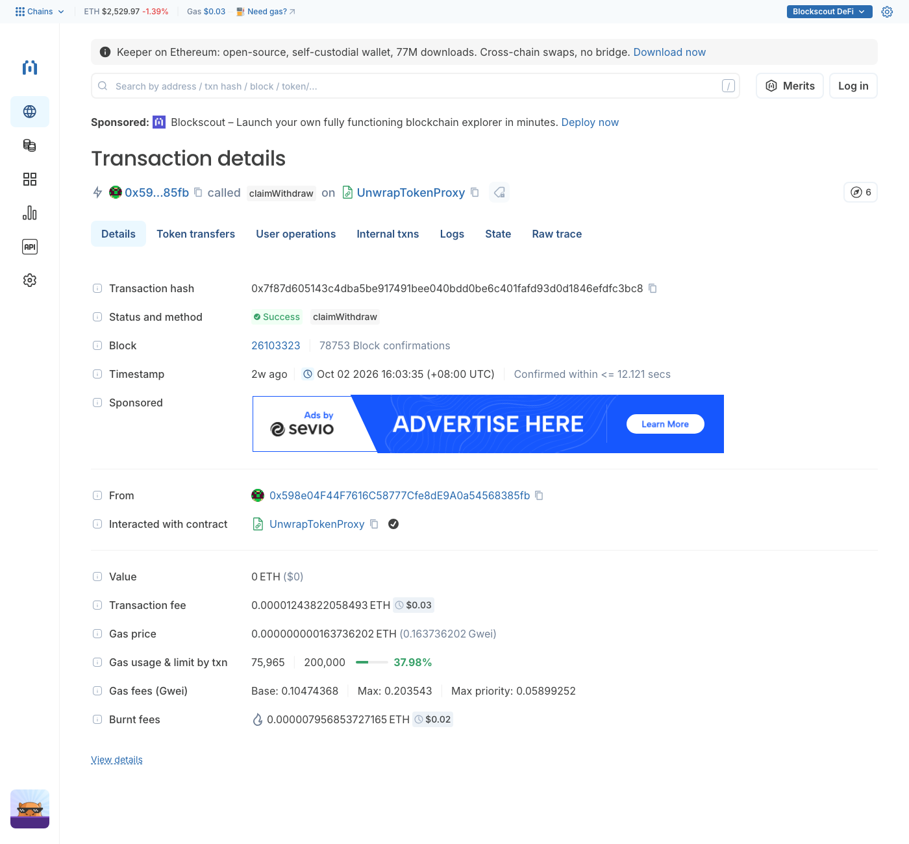
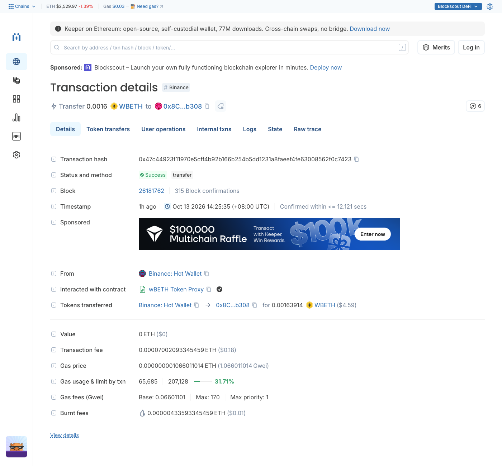

# wBETH — Ethereum

> **链**：Ethereum ｜ 浏览器 https://etherscan.io （交易截图为 https://eth.blockscout.com ）
> **调研日期**：2026-08-26，2026-10-13 补全交易类型 ｜ 本人实测与公开样本已标注；公开样本均为链上公开交易，非本人钱包，已逐条确认成功

## 合约

| 项 | 值 |
|---|---|
| 前端 | https://www.binance.com/en/wbeth （跳转币安 Simple Earn → ETH Staking，站内 CEX 页面） |
| wBETH | `0xa2E3356610840701BDf5611a53974510Ae27E2e1`（Wrapped Beacon ETH ｜ WBETH ｜ decimals 18） |
| UnwrapTokenProxy | `0x79973d557CD9dd87eb61E250cc2572c990e20196`（链上赎回领取 ETH） |

## 交易类型覆盖

币安站内的 Subscribe（申购）/ Redeem（赎回）是 CEX 账户操作，不产生用户钱包的链上交易。链上交易类型共 4 类，均无前端按钮（合约直调或第三方集成）。

| # | 交易类型 | 前端入口 | 合约 · 方法 | tx hash | 来源 |
|---|---|---|---|---|---|
| 1 | 存入 ETH 铸 wBETH | 无（合约直调 / 第三方集成） | wBETH · `deposit(address referral)` | [0xde97e3bc2517b8c26a5aaa563fd356c6a98ccac502387f92789bceb8dce3d2cf](https://etherscan.io/tx/0xde97e3bc2517b8c26a5aaa563fd356c6a98ccac502387f92789bceb8dce3d2cf) | 公开样本 |
| 2 | 申请赎回（销毁 wBETH，进解包队列） | 无（合约直调） | wBETH · `requestWithdrawEth` | [0x0d57abc1fcdea861a603019829c20efd9c534ceb2293ae7f7a1af0922ea40581](https://etherscan.io/tx/0x0d57abc1fcdea861a603019829c20efd9c534ceb2293ae7f7a1af0922ea40581) | 公开样本 |
| 3 | 领取赎回的 ETH | 无（合约直调） | UnwrapTokenProxy · `claimWithdraw` | [0x7f87d605143c4dba5be917491bee040bdd0be6c401fafd93d0d1846efdfc3bc8](https://etherscan.io/tx/0x7f87d605143c4dba5be917491bee040bdd0be6c401fafd93d0d1846efdfc3bc8) | 公开样本 |
| 4 | wBETH 转账 | 无（标准 ERC-20） | wBETH · `transfer` | [0x47c44923f11970e5cff4b92b166b254b5dd1231a8faeef4fe63008562f0c7423](https://etherscan.io/tx/0x47c44923f11970e5cff4b92b166b254b5dd1231a8faeef4fe63008562f0c7423) | 公开样本 |

## 截图

**前端页面**

| 币安 ETH Staking 页 | Subscribe 弹窗（2026-08-26，用户截图） |
|:-:|:-:|
|  |  |

**交易详情（每类一张，均为 Blockscout）**

| 1 存入铸造（`0xde97e3…`） | 2 申请赎回（`0x0d57ab…`） |
|:-:|:-:|
|  |  |
| **3 领取赎回 ETH（`0x7f87d6…`）** | **4 转账（`0x47c449…`）** |
|  |  |

## 开发注意

- **NAV 累积型，不能按 1:1**：汇率随质押收益单向上涨、余额不 rebase；样本 0.0085 ETH → 0.007691428647718743 wBETH，即 1 wBETH ≈ 1.105126 ETH，与币安页面 Conversion Ratio（1 ETH ≈ 0.90487395 WBETH）一致。
- **链上赎回两步且极少**：`requestWithdrawEth` 直接烧 wBETH（`Transfer` 到 0x0 + Unwrap 合约 `RequestWithdraw`），锁定期后 `claimWithdraw` 以内部转账付 ETH，无 token transfer；绝大多数用户在币安站内赎回。
- **链上大量 `transfer` 来自币安热钱包（站内充提）**，不是协议操作；用户站内申购 / 赎回不会出现在其地址上。

## 待确认

- 汇率的链上读取函数（`exchangeRate()` 未命中标准签名），目前用「存入量 ÷ 得到量」反推
- `deposit` 的 referral 参数用途
