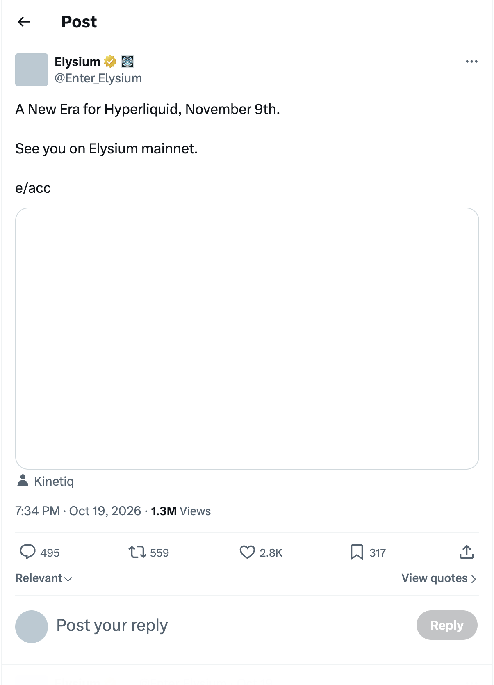
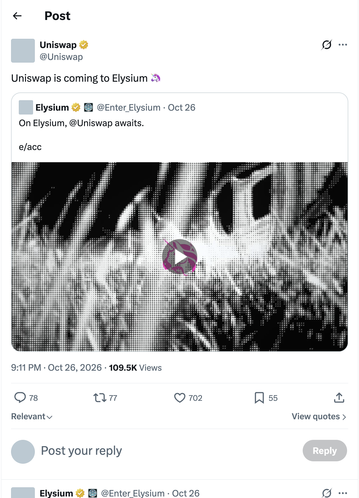
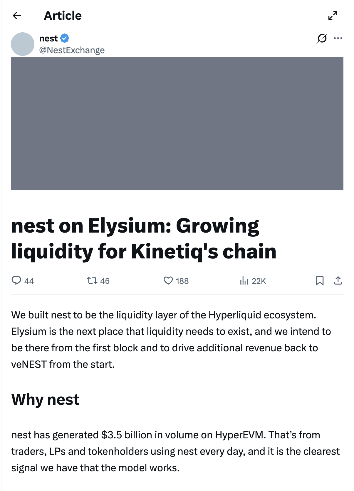
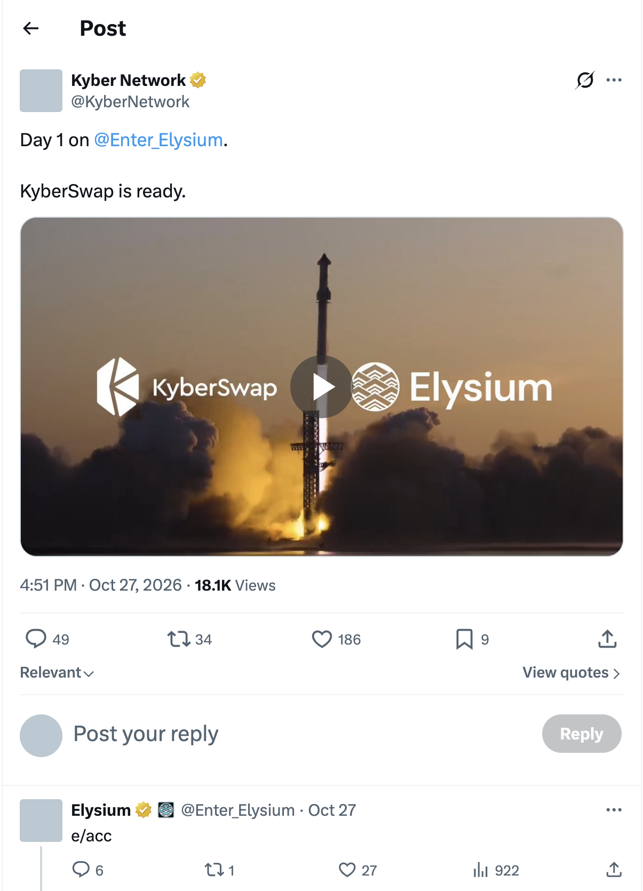
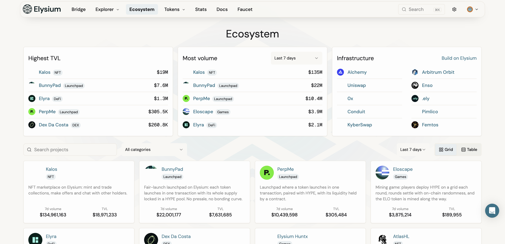

# Elysium — 主网时间 & DEX 协议调研

> **链**：Elysium（Kinetiq 出品）｜ Arbitrum Orbit L2，结算到 HyperEVM（chainId 999），gas = HYPE ｜ 测试网 chainId **99801**，主网 chainId 上线时公布 ｜ 官网 https://elysium.kinetiq.xyz
> **调研日期**：2026-10-29 ｜ 主网未上线，暂无主网合约地址和 hash，上线后补
> ⚠️ 同名链区分：Vulcan Forged 的 Elysium（chainId 1339，LAVA）不是这条链

## 一、官方预期主网时间：2026-11-09

| 来源 | 原文 | 截图 |
|---|---|---|
| 官方 X @Enter_Elysium，2026-10-19（Kinetiq 转发） | "A New Era for Hyperliquid, November 9th. See you on Elysium mainnet." [原帖](https://x.com/Enter_Elysium/status/2112145430339588407) |  |
| 官方 X @Enter_Elysium，2026-10-23 | "mainnet has not officially launched yet … November 9th, see you on Elysium." [原帖](https://x.com/Enter_Elysium/status/2113643907527680467) | |
| 官方文档 Connecting to Elysium（2026-10-21 更新） | 主网 chainId、浏览器"Coming soon"，上线时公布 | |

- **分阶段上线**：主网首日是标准 ArbOS + HYPE gas + 跨链桥；约 4 周后通过 ArbOS 升级加入 HyperCore 行情预编译和快速下单通道（官方文档）
- 官方文档注明仍处 pre-launch，"timelines may be refined"，日期存在调整可能

## 二、DEX 协议

### 主流（主网首日官方确认）

| # | 协议 | 类型 | 官方状态 | 依据 | 截图 |
|---|---|---|---|---|---|
| 1 | **Uniswap** | AMM | 官方生态页 Announced："Coming to Elysium" | Uniswap 官方 X 2026-10-26 "Uniswap is coming to Elysium" [原帖](https://x.com/Uniswap/status/2114706477562912836) |  |
| 2 | **Nest** | ve(3,3) AMM（HyperEVM 原生 DEX） | 官方生态页 Announced："from the first mainnet block" | Nest 官方 X 2026-10-14 文章《nest on Elysium》[原帖](https://x.com/NestExchange/status/2110071913955623254) |  |
| 3 | **KyberSwap** | DEX 聚合器 | 官方生态页 Announced："supporting every Elysium DEX & Launchpad" | Kyber 官方 X 2026-10-27 "Day 1 on Elysium. KyberSwap is ready."（Elysium 转发）[原帖](https://x.com/KyberNetwork/status/2115003360437051800) |  |

### 其他（官方生态页收录）

| 类别 | 协议 | 状态 |
|---|---|---|
| 聚合器 / 路由 | 0x（Swap API）、HyperFlow、Enso | 0x、HyperFlow 已官宣；Enso 路由合约已部署在测试网 |
| 交易入口 | fomo（官方"独家交易合作方"）、Dawn（Telegram 交易）、Pump.fun | fomo、Dawn 已官宣支持主网；Pump.fun 11-09 开放 Elysium 交易仅见媒体报道，未找到官方原帖 |
| 测试网独立 DEX | Dex Da Costa、HexSwap、MarketLab、Mosaic（链上订单簿）、True Markets | 仅测试网，未官宣主网 |
| 自带池子的 Launchpad | BunnyPad、Kiln、PerpMe、Citadel、CorePad、Ascend、Neuriio | Citadel 写明"每个代币在 Uniswap V3 池起步、以 HYPE 计价" |

官方生态页全貌：（https://testnet.elysium.kinetiq.xyz/ecosystem）

⚠️ 开发注意：主网 chainId、WHYPE / USDC 及各 DEX 合约地址都要等 11-09 上线后才公布，届时补 Factory / Router / 示例池 / hash。官方文档提醒链上有仿冒 WHYPE、USDC，接入前按官方 Contract addresses 页核对地址。

## 待确认

1. Uniswap 部署哪个版本：官方只说"coming"；有单一媒体称 V2 + V4 router，Citadel 的描述又说明会有 V3 池子
2. 主网 chainId 和 Nest 主网合约：11-09 上线后核对
